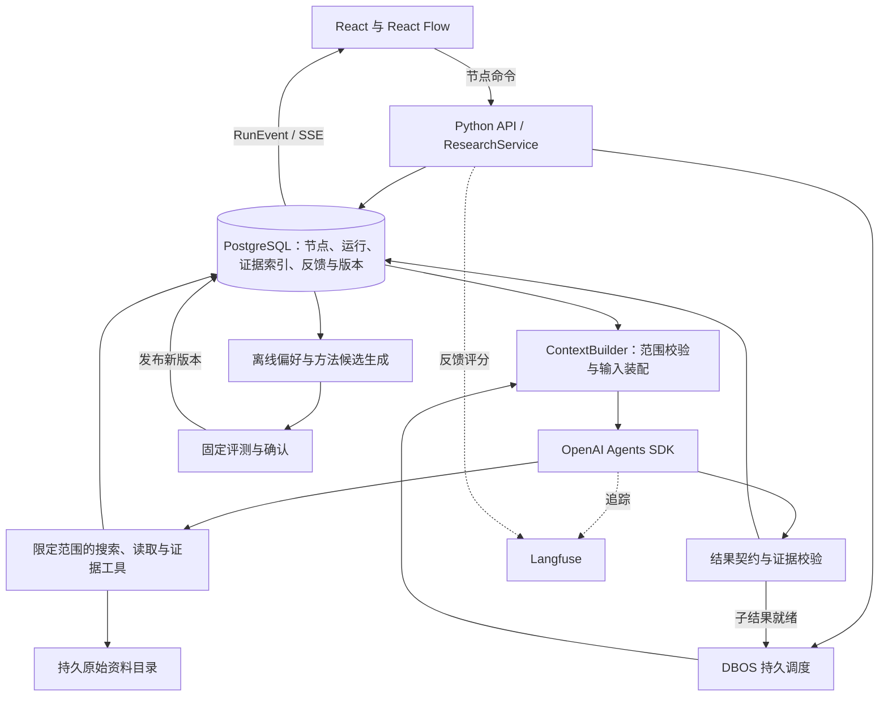

# 可进化深度研究 Agent：需求—功能—参考实现

核对日期：2026-09-15。范围：用户指定的 12 个项目；其中 Letta 依官方说明追踪到当前 `letta-ai/letta-code`。本次读取固定提交的仓库目录、选定源码和官方文档，未部署这些服务或进行性能、质量基准测试。具体版本和阅读入口见[源码阅读索引](</Users/chenyouran/Documents/ChatGPT/New project 2/architecture-analysis/源码阅读索引.md>)。

## 结论

产品应当是一个**用户能选择研究方向、逐层深入、回查证据、从历史决策中积累方法的研究工作台**。

核心产品资产有四项：研究节点及其版本、上下文边界、证据关系、用户决策记录。它们由自己的业务模型掌握。Agent SDK 提供执行循环，DBOS 提供持久执行，React Flow 提供界面，Langfuse 提供追踪和评测。无需把 12 个项目全部拼进运行环境。

推荐 MVP：React + React Flow；Python API 与后台 worker；OpenAI Agents SDK；DBOS；PostgreSQL；持久文件目录；Langfuse SDK 接现成实例。首先实现结构化偏好和人工确认的 Skill/workflow 复用，暂不引入自动长期记忆服务与图数据库。

这里的“自研”指研究业务规则和数据模型，不是重新实现模型客户端、队列、向量数据库或图形画布。

## 一、重新定义需求与边界

### 1. 一个完整的产品闭环

1. 用户提出研究目标、时点、范围和选择标准，形成 ResearchBrief。把“高潜力”展开为可配置的研究标准，例如增长空间、竞争优势、现金流与估值，而不是让模型自行决定偏好。
2. Agent 提出可解释的候选行业，附理由和证据。
3. 用户选定方向，排除其他方向；必要时允许系统在既定规则下继续。
4. 选定行业内寻找公司，以一致的指标体系研究、比较。
5. 每家公司按不同维度拆分任务，允许并行。
6. 子节点回传结构化结论、证据和不确定性，父节点基于这些结果汇总。
7. 用户可以回到任何节点续研、改假设、开分支；旧结论仍可查看。
8. 记录选择、纠正和实际采用的结果，逐步形成偏好和研究方法。

### 2. 必须区分的三个结构

- **研究树**：用户如何组织问题，例如行业 → 公司 → 财务。它是业务结构。
- **执行记录**：一个节点可运行多次；每次输入、状态、成本、版本和结果独立。
- **证据关系**：同一份年报可能支撑多个节点，结论又可能引用其他结论。这是多对多关系，不应通过复制整段聊天解决。

MVP 用关系表和明确引用就够了，不需要通用图执行引擎或知识图谱数据库。前端先展示树；跨节点证据引用用来源面板展示。

### 3. “可进化”的三个层次

1. **偏好适配**：记住用户明确的研究习惯，并按场景应用。
2. **方法复用**：把已验证的研究步骤保存为版本化 Skill/workflow。
3. **自动改进**：从多次使用中提出候选改动，经固定评测后发布。

MVP 必须做前两项的最小闭环；第三项放在有历史任务和有效评价标准之后。一次点击只能表达兴趣，不能直接证明答案正确，也不能直接推断永久偏好。

## 二、逐模块需求与实现

### A. Agent 运行与调度

**用户需要**：不同研究方向能独立执行，必要时并行，输出逐层汇总，有明确的时间和成本边界。

**MVP 必须做**：

- 三类可复用角色：规划、研究、汇总/验证。公司数量增加时创建运行实例，不复制角色代码。
- 规划 Agent 输出 `NodeSpec[]`，由服务端检查允许的节点类型、范围、深度和预算，再保存为节点。
- 每次节点运行通过 `Runner.run()` 或 `Runner.run_streamed()` 执行，`output_type` 使用 Pydantic 模型约束输出。
- 所有子任务先在业务数据库登记，再交给执行层；公司研究由 DBOS 队列控制并发。
- 每次运行创建独立的应用上下文和模型输入。全任务预算由调度服务统一管理，不能只设每个 Agent 的 `max_turns`。
- 搜索和抓取通过受限工具调用，返回可保存的来源记录。模型只提出检索意图；实际读写范围由后端校验。

**具体参考**：

- OpenAI SDK `src/agents/agent.py`：`Agent`、`output_type`、`as_tool()`。
- `src/agents/run.py`：`Runner.run()` / `run_streamed()`。
- `examples/financial_research_agent/manager.py`：`FinancialResearchManager`、`_perform_searches()`、`_produce_verified_report()`。
- 同一示例中的 `FinancialSearchEvidence` / `FinancialSource` 已包含查询、理由、摘要、来源和时间，适合扩展成第一版证据输出。
- `agents/planner_agent.py`：`FinancialSearchPlan` / `FinancialSearchItem`；`agents/verifier_agent.py`：`VerificationResult`。

**使用方式**：SDK 直接依赖；financial research 示例作为服务骨架借鉴。示例中的终端输出、宽泛异常吞掉和内存式任务集合需要改造成节点事件和显式失败记录。

`as_tool()` 适合一次短小的专家调用，但不会自动生成产品节点或实现分支隔离。源码中嵌套运行默认共享底层应用上下文。需要独立范围的持久子节点，推荐分别调用 Runner，由外层调度控制；不要直接共享可变的 `scope` 对象。`handoff` 适合转移会话主导权，不是默认的父子结果回传方案。

**后续扩展**：动态深度、不同节点使用不同模型、基于质量与预算自动决定继续检索或停止。

### B. 树状研究任务与节点状态

**用户需要**：理解已经研究到哪里、为什么有这个节点、下一步有哪些选择。

**MVP 必须做**：

- `ResearchNode` 存父节点、问题、类型、选择状态、当前结果指针和版本。
- `NodeRun` 存一次运行的输入快照、状态、结果、成本、配置版本、执行 ID。
- **选择状态与执行状态分开**：一个节点可以已经成功执行，却被用户排除。
- 父汇总记录实际引用的子结果 ID。子结果更新后，父结果标记为过期，保留旧结果，不悄悄覆盖。
- 公司比较使用同一份字段契约：指标名称、时间、单位、证据、缺失值。缺失不得被模型自行补齐。
- 候选范围以服务端保存的选定节点集合为准。

**具体参考**：Co-STORM `knowledge_storm/dataclass.py` 的 `KnowledgeNode`、`KnowledgeBase`；前者保存父子关系、信息 ID 集合、`synthesize_output` 和 `need_regenerate_synthesize_output`。后者维护信息映射和组织操作。`modules/information_insertion_module.py` 的 `InsertInformationModule` / `ExpandNodeModule` 可参考信息归位与节点展开流程。

**使用方式**：借鉴结构和摘要失效机制，自研业务节点。Co-STORM 的知识树没有你需要的完整任务状态、用户选择语义和独立运行记录，不直接用其对象作为数据库模型。

**后续扩展**：跨研究复用节点、比较多个假设、自动建议合并节点。保持节点身份稳定，避免自动改名或重组破坏引用。

### C. 用户介入、续研与分支

**用户需要**：点击节点决定下一步，并且后续输入作用在正确分支上。

**MVP 必须做**：

| 动作 | 业务含义 | 保存方式 |
|---|---|---|
| 选定/排除 | 决定当前研究范围 | 保存用户决策及范围版本 |
| 重试 | 同一问题和同一输入重新执行 | 同节点新建运行，关联失败运行 |
| 续研 | 同一对象提出新问题 | 同节点新运行或新子问题节点，关联基础结果 |
| 开分支 | 修改假设、范围或方法进行比较 | 新节点，保存 `derived_from_run_id` |
| 暂停/取消 | 停止继续调度 | 保存命令，执行层取消或在边界停止 |
| 接受/纠正 | 评价某个具体结果 | 关联结果版本和具体反馈 |

React Flow 的 `Node.data` 放视图数据，业务状态由 API 返回。拖动卡片只改变布局，不自动改变研究依赖。使用 `Node`、`Edge`、`useNodesState()`、`useEdgesState()` 和自定义节点组件，不自行实现画布。

用户命令携带 `node_id`、基础版本和幂等键；同一命令重复提交不得创建重复任务。范围变化后，旧运行迟到的结果可以归档，但不能覆盖新范围的当前结果。

**具体参考**：

- React Flow `packages/react/src/types/nodes.ts` / `edges.ts`、`hooks/useNodesEdgesState.ts`。
- Co-STORM `CoStormRunner.step(user_utterance=...)`、`DiscourseManager.get_next_turn_policy()`：用户输入改变后续研究方向。
- OpenAI SDK `RunResult.to_state()`、`RunState.to_json()` / `from_json()`、`approve()` / `reject()`：适合工具审批造成的暂停。它不是所有用户介入动作的通用业务模型。

**使用方式**：React Flow 直接依赖；节点命令自研；SDK 审批功能按需依赖。MVP 在节点/步骤边界应用新指令，不承诺任意 token 时刻改写正在执行的模型思路。

**后续扩展**：运行中更细粒度的引导、多人协作、并列展示分支差异。

### D. 上下文作用域与信息隔离

**用户需要**：公司 A 的 Agent 获得必要上游信息，同时不混入已排除行业或公司 B 的内部研究过程。

**MVP 必须做**：建立服务端 `ContextBuilder` 和不可变 `RunScope`，每次运行保存装配清单。

建议模型可见输入由以下部分组成：

1. 本次研究目标、时点和明确约束。
2. 父节点明确发布且允许继承的摘要与证据引用。
3. 当前节点已接受的历史结果。
4. 在当前允许范围内检索到的资料。
5. 当前场景的用户偏好和所用 Skill 版本。

`RunScope` 至少包含用户/研究/节点 ID、允许的结果与资料集合、排除对象、可用工具和 token 预算。它通过 `RunContextWrapper.context` 供工具代码读取；该对象不会自动进入模型提示词。

隔离在三个地方同时落实：**检索之前限制候选集合、读取工具校验目标、写入工具固定归属**。模型不能自行传入别人的 scope_id 来扩大权限。空范围应返回空结果或错误，不能降级成全库搜索。

祖先历史也不能整段默认继承：主节点之前可能分析过被排除行业。需要专门发布对当前分支适用的摘要。比较节点则获得选定公司的结构化结果，兄弟节点不会因此自动互相开放。

“排除行业”也要区分候选范围与相关证据：某公司客户来自另一行业，仍可能是必要证据。跨范围资料应有明确的关联理由与授权规则。技术上能限制系统检索和注入的信息，不能清除模型预训练知识；网页混合主题也不能仅靠关键词保证完全隔离。

**具体参考**：

- OpenViking `core/retrieval_targets.py`：`ResolvedRetrievalTargets` / `resolve_retrieval_targets()`，把检索目标显式化。
- `retrieve/hierarchical_retriever.py`：层级检索。
- `retrieve/context_assembler/pipeline.py`：`assemble_context()`；`budget.py`：`plan_entries()`；`models.py`：`AssembledEntry` / `AssembleResult`。参考先检索、再预算分配、按层级退化、最后渲染的流程。
- OpenAI SDK `docs/context.md` / `src/agents/run_context.py`：区分本地执行上下文与模型可见上下文。
- Letta 当前 `src/agent/memory-filesystem.ts`：`getScopedMemoryFilesystemRoot()` / `resolveScopedMemoryDir()`；参考显式 Agent 范围优先。

**使用方式**：自研薄的业务上下文装配层；借鉴上述设计，不整体引入 OpenViking 或 Letta。目录检索默认值不是你产品的授权规则，需单独实现。

**后续扩展**：大量资料下的分层语义检索、动态上下文预算、跨任务共享资源授权。OpenViking 当前相关源码使用 AGPL-3.0；借鉴设计与复制代码须区分。

### E. 证据、来源与引用链

**用户需要**：看到“为什么判断行业有增量”“为什么公司有潜力”，并能回查原始材料。

**MVP 必须做**：

- `SourceSnapshot`：URL/文档 ID、发布/报告时间、抓取时间、内容哈希、解析器版本、原始文件或抓取内容位置。
- `Evidence`：关联来源、页码/段落定位、原文片段、相关实体、作用域。自动摘要另存，不能冒充原文。
- `Finding`：结论、支持/反驳证据 ID、适用时点、不确定性和待验证问题。可先保存在节点结果 JSON 中。
- 上下游传递 Finding 与证据 ID，不只传一段摘要；最终引用编号由程序从稳定 ID 生成。
- 保留反证和不同口径；对量化比较保存单位、币种、期间、口径。
- 两道验证：程序检查引用存在、权限和时间字段；模型检查证据是否真的支持结论。相关性分数不是真实性概率。
- 页面拿不到原文时，明确记录只有搜索摘要，不把它标记为原文验证通过。

**具体参考**：

- PaperQA `src/paperqa/types.py`：`Doc`（含 `content_hash`）、`Text`（关联文档的片段）、`Context`（问题相关摘要、原片段、相关性分数）、`PQASession`（contexts、原始/格式化答案、引用）。
- `src/paperqa/agents/tools.py`：`GatherEvidence.gather_evidence()` → `GenerateAnswer.gen_answer()`。
- `src/paperqa/docs.py`：`Docs.aget_evidence()` 等文档与证据操作，可作为未来 PDF 研究工具的封装入口。
- OpenAI financial research 示例：`FinancialSearchEvidence`、`_extract_financial_sources()`、`_produce_verified_report()`，可作为更轻的 MVP 起点。

**使用方式**：借鉴 PaperQA 的对象关系，自研与研究作用域绑定的证据存储；第一版不整体引入 PaperQA 的另一个 Agent runtime。其学术元数据、搜索策略和框架依赖不必搬入。

**后续扩展**：PDF 表格/图像定位、证据冲突检测、跨任务证据复用。Graphiti 的 `EntityEdge.episodes` 与时间字段可用于长期事实演化，但不能替代原始材料存储。

### F. 中断恢复与任务重试

**用户需要**：关闭页面不丢任务、服务重启能继续、局部失败不导致全树重跑。

**MVP 必须做**：直接使用 DBOS 处理持久执行；自己只定义业务状态和恢复策略。

- 一个节点运行按有意义的阶段拆成 workflow/step，例如计划、检索批次、分析、校验、提交结果。
- 模型调用和外部 API 调用放在 step 边界内；完成的步骤结果可以复用。
- 父节点等待子节点时释放工作槽，不让占满并发槽的父任务阻塞自己的子任务。分解阶段结束后保存等待状态，子结果到齐再调度聚合阶段。
- 只重试超时、限流等可恢复故障；证据不足进入“需补充/部分完成”，不机械重试同一问题。
- 保存 `run_id ↔ workflow_id`；业务写入使用唯一键/幂等提交。请求先保存为 queued，再以稳定 ID 入队；启动时补发未入队记录，避免 API 提交和调度之间丢任务。
- DBOS 系统状态和业务表分开管理，可共用一个 PostgreSQL 实例。
- 前端状态通过持久事件表加 SSE 获取；断线后按事件序号补取。

**具体参考**：DBOS `dbos/_dbos.py` 的 `DBOS.workflow()`、`step()`、`enqueue_workflow_async()`、`register_queue()`、`cancel_workflow_async()`、`send_async()` / `recv_async()`；`_queue.py` 的 `Queue`；`_recovery.py` 的恢复实现。

**边界**：DBOS 保存的是执行步骤结果，不保证外部 API 副作用或计费恰好一次。外部调用完成但检查点未落盘时，当前 step 仍可能重做。MVP 承诺步骤级恢复，不承诺恢复未保存的每个模型 token。`RunState` 主要用于 SDK 可序列化的暂停点，不能自动解决崩溃前没有保存的状态。

SDK `Session` / `SQLAlchemySession` 解决会话历史，不作为任务状态数据库。MVP 优先显式装配节点输入并保存输出；后续需要完整会话重放时再接 Session，避免两套历史同时追加导致重复上下文。

**后续扩展**：工具级更细检查点、跨 worker 恢复、任务优先级、批量取消。DBOS `fork_workflow()` 可以重放执行历史，但产品的假设分支应通过新节点和新输入表达。

### G. 用户反馈与评测

**用户需要**：系统记住自己采用了什么，并且改进后确实更有用。

**MVP 必须做**：

- 自己保存不可丢失的用户动作和反馈，绑定 `node_id + run_id + result_version`。
- 区分兴趣、范围决定、结论认可、来源纠正和方法修改。
- Langfuse SDK 发送运行 trace、阶段 observation 和反馈 score，元数据带研究与运行 ID；不把 Langfuse 当产品数据库。
- 准备小型固定评测集：分支越界、引用失效、错误父节点汇总、期间口径不一致、失败恢复、用户偏好冲突。
- 用户纠正进入新的评测样本；只有错误答案而没有正确参照时，可以使用无参考验证规则，不能把原错误答案当 expected output。

**具体参考**：Langfuse `packages/shared/prisma/schema.prisma` 的 `ScoreConfig`、`AnnotationQueue`、`AnnotationQueueItem`、`DatasetItem`；后者有 `sourceTraceId`、`sourceObservationId`、`expectedOutput`、`validFrom` / `validTo`。`web/src/features/annotation-queues/server/annotationQueueItemsRouter.ts` 可参考标注任务管理；`features/datasets/server/service.ts` 可参考数据集服务流程。

**使用方式**：直接依赖 Langfuse SDK/服务；参考其关联模型，不复制整套管理后台。部署轻量化要求下，使用已有实例或托管服务；若另行自托管完整平台，需单独计入运维负担。

**后续扩展**：专家标注队列、候选工作流 A/B、评分器与用户反馈一致性分析。用户偏好分数与事实质量分数始终分开。

### H. 长期记忆与用户偏好

**用户需要**：跨任务沿用自己的研究方法，同时能够查看、修改和删除记住的内容。

**MVP 必须做**：在 PostgreSQL 保存结构化 `Preference`：用户、场景、偏好键值、来源反馈、确认状态、有效期、版本。用户可以显式“保存为偏好”。每次运行装配少量适用偏好，保存所用版本。

优先级：本次明确要求 > 当前场景已确认偏好 > 用户通用已确认偏好 > 未确认推断。偏好只影响排序、展示和工作步骤，不改变事实或忽略反证。

无需为了十几条明确偏好先引入向量检索。研究原始资料和事实不混入偏好表；SDK session 也不充当长期偏好系统。被模型反复引用不等于事实已经核实，重复使用不能自动提升其可信度。

**具体参考与适用边界**：

- Mem0 `mem0/memory/main.py`：`Memory.add()` / `search()`、`AsyncMemory`、`_add_to_vector_store()`；参考在写入时获取旧记忆、提取新信息、再保存的流程。当前写入检索主要按 user/agent/run ID 定界，不能假设任意自定义 metadata 都构成写入去重隔离。未来适合通用用户记忆 API；MVP 不依赖。
- Hindsight `hindsight-api-slim/hindsight_api/engine/memory_engine.py`：`MemoryEngine.retain_async()` / `recall_async()` / `reflect_async()`；`retain/orchestrator.py`：`retain_batch()`；`consolidation/consolidator.py`：`run_consolidation_job()`；`reflect/agent.py`：`run_reflect_agent()`。参考“经历 → 归纳观察 → 有依据的反思”，以及 bank / observation_scopes 隔离。未来更适合从多次研究归纳习惯；MVP 不依赖。
- Letta 当前 `memory-filesystem.ts` / `memory-runtime.ts`：按 agent 管理记忆目录；`reflection-memory-v2.ts`：`buildMemfsV2ParentMemorySnapshot()`，只给反思任务受限的父记忆快照。
- Graphiti `nodes.py` 的 `EpisodicNode` / `EntityNode`，`edges.py` 的 `EntityEdge`，`graphiti.py` 的 `Graphiti.add_episode()`。用于长期企业事实、关系与有效时间，适合后期事实知识层，不是第一版用户偏好的必要依赖。

**使用方式**：MVP 自研小型显式偏好表；以上服务是后续候选，Mem0 和 Hindsight 按真实样本二选一，不同时接入。已有服务加入后，产品仍掌握偏好确认和有效版本。

**后续扩展**：从多次使用中生成偏好候选、处理相互矛盾和过期的习惯、按场景自动排序研究维度。

### I. Skill / workflow 的积累与进化

**用户需要**：成功的研究方法可以再用，反复使用后更贴合个人习惯。

**MVP 必须做**：

- `SkillVersion` 表示单项能力：输入/输出契约、说明、允许工具、适用条件、评测版本。
- `WorkflowVersion` 表示多个节点模板的组合：步骤、依赖、用户选择关口、停止规则、预算。
- 使用同一套节点执行服务实例化 workflow，不再引入第二套通用工作流引擎。
- 用户可把已完成的研究路径保存为模板。将公司名、时间、行业等变成参数；去掉临时重试、个人数据和本次事实，保留方法与判断关口。
- 维护 draft / active / retired 版本和 active 指针；一次运行固定所用版本。复制模板产生新任务，不复用上次运行状态。
- 候选生成、评测、正式启用分开；MVP 由用户确认启用，已经在运行的任务不自动切换版本。

**具体参考**：

- BearCode `agents/online_skill_evolution.py`：`OnlineSkillCandidate`、`online_ingest()`、`maintain_online_skill_candidate()`。
- `agents/skill_evolution.py`：`create_skill_file()` / `evolve_skill_file()` 的内容版本、历史和来源记录。
- `agents/online_skill_eval.py`：`_build_replay_pool()`、`_freeze_replay_pool()`、`_promotion_decision()`、`evaluate_online_skill_evolution_async()`。
- Letta 当前 `src/agent/memory-worktree.ts`：`createReflectionMemoryWorktree()`、`ReflectionMemoryScope`、`finalizeReflectionMemoryWorktree()`。参考后台修改隔离、再整合的生命周期；第一版用候选记录即可，不必为每次反思创建 Git worktree。

**不能照搬**：BearCode 更新会直接写入当前 `SKILL.md`，评测 champion 尚未成为运行时加载门禁。需要改为候选版本先独立保存，评测通过、确认后再原子切换 active 指针。

**后续扩展**：自动生成候选，固定测试集 + 留出任务评测，质量不退步且预算达标才晋级；必要时回退。不能用同一批任务同时修改候选并证明其泛化效果。

## 三、推荐数据模型

以下名称是本产品建议，不是上述仓库自带的类。

| 对象 | 最小字段/作用 |
|---|---|
| Research | 目标、研究时点、用户、总预算、状态 |
| ResearchNode | research_id、parent_id、问题、节点类型、选择状态、版本、active_run_id、是否过期 |
| NodeRun | node_id、基础运行、输入/范围/配置快照、状态、workflow_id、成本、结果 JSON、错误 |
| ResultDependency | 当前运行引用了哪些上游/子节点结果；用于复现与过期判断 |
| SourceSnapshot | 原始内容位置、URL/文件 ID、内容哈希、时间、解析版本 |
| Evidence | source_id、原文片段与定位、作用域、实体和期间 |
| UserEvent | 命令/反馈、用户、节点与运行、幂等键、时间、理由 |
| Preference | 场景、键值、来源、确认状态、有效时间、版本 |
| SkillVersion / WorkflowVersion | 方法内容、契约、适用条件、状态、来源、评测信息 |
| RunEvent | 顺序号、research_id、run_id、阶段、状态或输出引用；供 SSE 重放 |

Finding、比较字段、允许范围清单在 MVP 可以作为校验过的 JSONB 保存，没必要为每个分析维度建立一张表。原文使用持久目录，数据库只保存引用和索引。内容去重不能绕过访问范围，缓存键也必须包含范围与输入版本。

## 四、MVP 架构与数据流

### 一次“行业 → 公司 → 维度”的运行

1. API 保存 Research、根节点和本次约束。
2. DBOS 执行规划阶段，SDK 输出候选节点；程序检查后写库。
3. 用户选择行业，UserEvent 和范围版本在同一业务事务内保存。
4. ContextBuilder 根据选定范围装配公司发现节点的输入。
5. 公司节点产生维度任务；叶子研究通过受控队列并行执行。
6. 工具保存来源快照和 Evidence；Agent 输出引用这些 ID 的 Finding。
7. 校验后提交不可变节点结果，发布事件。父节点按既定完成条件收集结果，失败或缺失明确标记。
8. 汇总节点以固定字段比较公司，保留其引用的子结果版本。
9. 用户继续某节点时创建新运行；原结论继续可读，依赖旧版本的汇总显示过期。
10. 用户反馈写入产品库并发送 Langfuse；候选偏好/模板独立生成，确认和评测后供未来任务使用。

### 依赖边界

**直接依赖**：

- OpenAI Agents SDK：模型/工具循环、输出契约、流式事件。
- React Flow：画布和节点交互。
- DBOS：持久步骤、队列、恢复和执行控制。
- PostgreSQL、Python API 框架/Pydantic/数据库访问库：常规业务基础设施。
- Langfuse SDK 接已有或托管实例：追踪、评分与评测。评测不可用不应阻断正常研究结果保存。

**仅借鉴**：Co-STORM 的 KnowledgeNode 与信息归位；OpenViking 的范围与预算装配；PaperQA 的证据对象；Letta 的记忆作用域和候选整合；BearCode 的 Skill 版本与候选评测。

**暂不引入**：Letta 整体 runtime、Co-STORM 整体 DSPy 流程、OpenViking 服务、PaperQA 整体 Agent runtime、Mem0、Hindsight、Graphiti。没有否定它们的价值；这些组件解决的更大问题尚不是 MVP 的必要依赖。

## 五、MVP 验收与扩展顺序

### P0：一个完整研究闭环

- 能完成一个行业、三家公司、每家公司两个维度的研究，并回传到正确父节点。
- 排除一个候选后，其分支材料不会通过历史摘要、搜索结果、缓存或工具读取混入后代。
- 公司比较字段和时点一致；没有证据的指标显示缺失。
- 所有主要结论可回查证据；引用不能由模型凭空生成。
- 关闭页面不会取消后台任务；重启 worker 后保留已完成步骤。
- 用户重试、续研、分支行为有区别；旧结果不会被覆盖。
- 新结果令依赖旧结果的汇总显示过期。
- 用户可以明确保存偏好、保存模板，再创建新研究验证复用效果。

### P1：有数据后才做自动归纳

- 从多次反馈形成可编辑的偏好候选。
- Mem0 与 Hindsight 用实际样本比较隔离、归纳质量、延迟和成本，至多接入一个。
- 自动提出 Skill/workflow 候选，固定评测和留出任务验证后启用。
- 按真实 PDF/网页资料增加解析和检索组件。

### P2：跨任务知识与更强自治

- 需要公司/供应链关系与时间推理时评估 Graphiti。
- 资料量和上下文装配复杂度足够高时评估 OpenViking 服务。
- 更复杂的任务分支、协作、自动重新规划和长期监测。

## 六、最终功能映射表

P0 = 首版闭环必需；P1 = 首版稳定后；P2 = 规模与场景驱动。表中的自研对象名称均为本产品建议。

| 产品需求 | 功能模块 | 推荐实现 | 参考项目 | 具体参考模块 | 使用方式（依赖/借鉴/自研） | MVP 优先级 |
|---|---|---|---|---|---|---|
| 规划、执行和汇总研究 | Agent runtime | 独立运行上下文、结构化输入输出、规划结果先落库 | OpenAI Agents SDK | Agent、Runner、output_type；FinancialResearchManager | 依赖 SDK；借鉴示例；自研调度规则 | P0 |
| 多家公司并行且限制成本 | 任务调度 | 持久入队、限制并发、统一任务预算 | DBOS、OpenAI SDK | DBOS.register_queue / enqueue_workflow_async；_perform_searches | 依赖 DBOS；自研预算与父子收集 | P0 |
| 看懂研究树和当前进度 | 节点模型与画布 | ResearchNode + NodeRun；布局与业务状态分离 | Co-STORM、React Flow | KnowledgeNode / KnowledgeBase；Node / Edge / useNodesState | 借鉴树；依赖画布；自研持久模型 | P0 |
| 选定、排除、续研与分支 | 用户命令 | 版本化命令、新运行/新分支、幂等提交 | Co-STORM、OpenAI SDK | CoStormRunner.step；RunResult.to_state / RunState | 自研业务动作；按需依赖 SDK 暂停能力 | P0 |
| 子节点不混入其他分支 | 上下文治理 | 服务端 RunScope + ContextBuilder，读写检索均校验 | OpenViking、OpenAI SDK、Letta | resolve_retrieval_targets / assemble_context / plan_entries；RunContextWrapper；resolveScopedMemoryDir | 自研范围规则；借鉴装配 | P0 |
| 研究结论可追溯 | 来源与证据 | SourceSnapshot → Evidence → Finding | PaperQA、OpenAI 示例 | Doc / Text / Context / PQASession；FinancialSearchEvidence | 借鉴数据关系；自研证据存储 | P0 |
| 多公司结果能一致比较 | 汇总与验证 | 统一指标契约、时期单位校验、保留缺失与反证 | PaperQA、OpenAI 示例、Co-STORM | GatherEvidence / GenerateAnswer；VerificationResult；摘要失效标记 | 借鉴流程；自研比较契约与结果依赖 | P0 |
| 中断和失败后继续 | 持久执行 | 步骤检查点、选择性重试、幂等结果提交 | DBOS | workflow / step / _recovery.py / cancel_workflow_async | 直接依赖；自研业务状态 | P0 |
| 页面重连不丢状态 | 事件与呈现 | RunEvent 持久序号 + SSE + React Flow 更新 | OpenAI SDK、React Flow | Runner.run_streamed；受控 nodes/edges | 依赖 SDK/画布；自研事件映射 | P0 |
| 用户评价能改进系统 | 反馈与评测 | UserEvent + trace/score + 固定评测集 | Langfuse | ScoreConfig / AnnotationQueueItem / DatasetItem | 依赖 SDK/服务；自研反馈语义 | P0 |
| 跨任务沿用明确习惯 | 偏好记忆 | 可编辑、有场景和来源的 Preference | Letta、Mem0 | 作用域记忆目录；Memory.add / search | MVP 自研小表；借鉴设计 | P0 |
| 从多次经历推断偏好 | 自动记忆归纳 | 候选观察、范围隔离、明确确认 | Hindsight、Mem0 | retain_batch / run_consolidation_job / run_reflect_agent；AsyncMemory | P1 评估后至多依赖一个 | P1 |
| 复用成功研究方法 | Skill/workflow 版本 | 参数化模板、固定版本、人工启用 | BearCode、Letta | OnlineSkillCandidate / create_skill_file / evolve_skill_file；ReflectionMemoryWorktree | 借鉴；自研模板与版本注册 | P0 |
| 方法可自动进化 | 候选评测与发布 | 候选隔离、留出评测、晋级和回退 | BearCode、Langfuse | _promotion_decision / _freeze_replay_pool；DatasetItem | 借鉴；自研发布门禁 | P1 |
| 公司事实随时间积累 | 长期事实知识 | 时间有效性与来源 episode 关联 | Graphiti | EpisodicNode / EntityNode / EntityEdge / add_episode | 暂不引入；有需求后依赖 | P2 |

