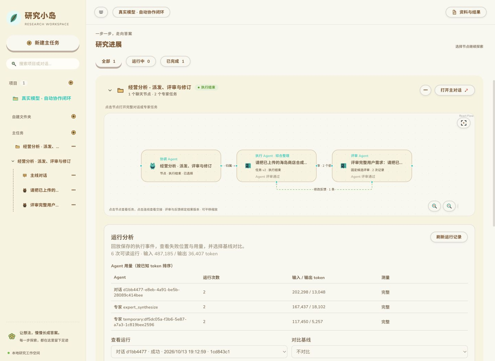
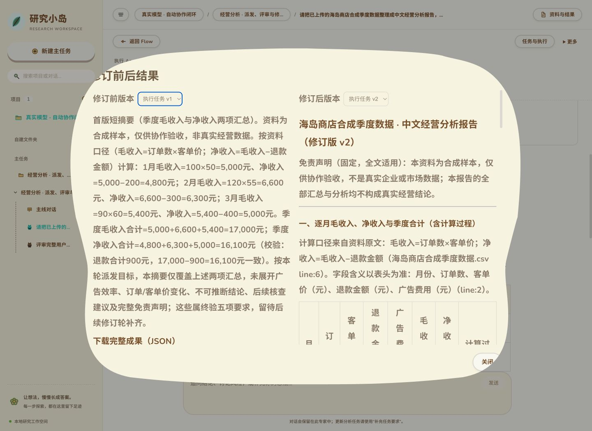

# 真实模型自动协作验收 · 2026-10-13

最终真实闭环通过：主助手派发 → v1 保存 → 独立评审 needs_revision → 自动修订 v2 → 独立复评 passed → 主助手自动汇报。修订次数为 1，没有人工填写评审建议、修改模型输出或手动生成报告。

主助手、执行 Agent 和评审 Agent 均通过已配置端点使用 `deepseek-flash`，沿用真实 SDK、受控账本与 PostgreSQL。仅输入资料是合成商店季度数据，不含真实企业信息。为了观察交接与修订，派发者明确要求首版先交收入摘要，原始用户最终要求仍包含五项完整交付；评审和复评的实际结论均由真实模型给出，没有固定 verdict 的夹具。

页面：[真实协作演示](http://127.0.0.1:18750/)。服务当前保留运行，选择“真实模型 · 自动协作闭环”，打开执行任务即可查看每轮评审并比较修订版本；“返回 Flow”可查看交接与反馈边。窄侧栏使用上下排列，桌面宽度使用双列排列。

## 实际结果

| 阶段 | 实际记录 |
| --- | --- |
| 派发 | 主助手真实调用 `find_experts`、`read_context`、`delegate_task`，后台启动执行任务 |
| v1 | 保存收入摘要，季度毛收入 17,000 元、净收入 16,100 元；其余终验项未展开 |
| 第一次评审 | 读取固定候选及源资料，给出 5 项问题：广告效率、走势与不可推断项、核查建议、免责声明及范围自缩 |
| 自动修订 | 通过 `read_context` 读取 v1 全文，保存 v2；原始要求、候选 ID、SHA256 和评审建议可追溯 |
| v2 | 补齐月度表与计算过程、广告效率 16,100÷2,400≈6.71、非利润/非因果解释、4 项不可推断结论、2 条核查建议及合成数据声明 |
| 第二次评审 | 读取 v2 全文并核对源资料，判定 passed；指出一处字段数表述不精确，但认为不影响结论 |
| 主助手收尾 | 自动读取结果和任务状态，并完成汇报；没有新增派发、人工采用或发布 |

最终研究的 6 次账本运行均 succeeded，未确认操作为 0，共 40 次模型请求。累计输入 487,185 token、输出 36,407 token；这是多轮请求的累计供应商用量，不能当成单次上下文长度。运行分析没有已记录的计费单价，因此费用保持未知，不估造金额。上述统计仅指最终通过的研究，不包含此前排障尝试。

最终证据：[evidence.json](evidence.json)，包含固定身份、完整原始请求、派发指令、两次评审、两份工件、用量、时间线与主助手消息。数据是实际保存的 API 结果，截图是实际页面。

## 本轮真实运行暴露并修复的问题

1. `read_context` 的讨论目录遗漏当前交接消息。模型请求读取当前消息与候选时触发拒绝；现已纳入同一冻结讨论，仍禁止跨会话读取。
2. 评审曾接受派发者的“仅首版”范围并返回 passed。现以原始用户的完整最终需求为通过标准，派发者与候选不能缩减终验要求。
3. 修订把完整工件及交接指令反复展开，触发输入预算限制。现传递固定候选引用并读取全文，用户原始要求与评审建议分别保存；去掉目标文本对完整交接包的重复展开，没有提高预算或删掉用户约束。

此前失败和范围误判没有覆盖成成功。初次记录保留在 `auto_review_live_20261013`、`auto_review_live_verified_20261013`、`auto_review_live_final_20261013`、`auto_review_live_complete_20261013`，私有工件在 `.agent-evals/automatic-collaboration-live-20261013/` 对应目录。两次预算阻塞的 API 快照分别保存在 [failed-budget-evidence.json](failed-budget-evidence.json) 和 [failed-duplicate-input-evidence.json](failed-duplicate-input-evidence.json)。其中主助手还出现过供应商输出协议/工具失败，均保留原运行状态；最终通过研究的主助手派发及自动收尾均成功。

修复后完整回归 **578 通过，295 跳过**；独立自动评审专项 **13 通过**，真实 SDK/DBOS/PostgreSQL 专项 **4 通过**。缺少外部环境的跳过项不计作验证通过。实际模型验收只证明这个合成任务的闭环，没有建立通用评审准确率。

## 再次查看

同一数据库及目录下启动 `OPENAI_MANAGER_MODEL=deepseek-flash .venv/bin/python scripts/verify_automatic_collaboration_live.py` 会复用保存的项目，启动页面不会重新发起已完成的模型任务。`.env` 只在进程中读取，不写入证据。数据库使用本轮隔离 PostgreSQL（127.0.0.1:18749），最终数据库名为 `auto_review_live_acceptance_20261013`。

`.venv/bin/python scripts/collect_automatic_collaboration_live.py` 只读取状态并验证派发、候选读取、自动修订、复评与最终状态，不发起模型请求。
