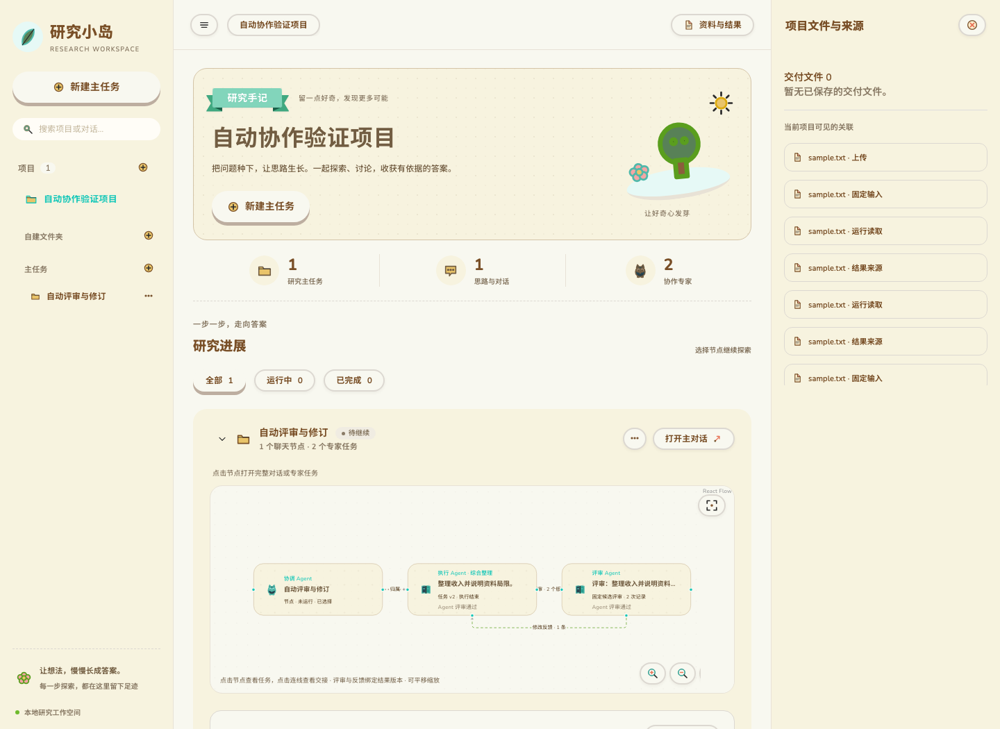

# 自动评审与协作 Flow

本轮在现有项目任务上增加一个完整的自动协作闭环：主助手派发任务，执行 Agent 保存产物，独立评审 Agent 给出结构化建议，执行 Agent 按建议修订后重新评审。用户无需填写评审意见。

## 使用方式

主助手委派专家任务，或运行已经归属研究项目的执行任务，就会启动自动协作。普通聊天和独立任务仍沿用各自的执行入口。

Flow 显示主助手、执行 Agent、评审 Agent，以及现有消息和依赖。点击交接边查看对应版本、评审建议和修订要求；点击执行节点查看自动协作进展、每轮产物，并通过“比较修订版本”并排阅读两个版本。用户仍可通过已有讨论入口补充要求，或停止任务。

评审通过直接结束协作。需要修订时自动推进，最多修订两次，因此最多生成三个执行版本和三次评审。两轮后仍不通过，会结束循环并展示最后产物及剩余问题，不会宣称任务通过。

## 实现与边界

- 沿用现有任务、专家会话、讨论、TaskRevision、受控执行账本、权限和 DBOS 队列，没有增加另一套调度系统。
- 每个执行任务对应一个独立评审身份。评审通过现有讨论执行机制读取固定候选，保存类型化结论：通过，或附有问题、依据和可执行修改建议的待修订结论。
- 评审记录绑定任务版本、结果 ID 和工件 SHA256。修订保留原始需求，加入上一版产物与建议；每轮记录能追溯实际交接对象。
- 新增 `collaboration_review_loops` 保存自动协作状态、评审记录及修订计数。稳定执行 ID 和修订 ID 复用既有结果；重启后从保存状态继续。收费步骤结果未知时停止并展示失败或暂停，不盲目重跑。
- 评审运行遵守原有授权，并使用独立受控账本；每次最多 8 个模型轮次、8 次工具调用、180 秒。执行修订沿用任务原预算。评审身份计入现有任务数量限制，评审用量计入项目预算及运行分析。
- 取消、权限撤销和任务版本变化会阻止继续自动交接。页面读取再次检查授权，不能仅凭旧评审记录显示已撤销内容。
- 一个任务只启动一次有两轮额度的自动循环。显式修改任务要求会使旧评审成为历史记录；新版本可沿用现有执行入口运行，但不会继承旧结论或重置自动修订额度。新需求需要新的自动循环时，创建新任务。
- Agent 评审和正式人工审核、采用、发布分别记录。现有要求人工审核的下游依赖规则保持原语义，自动评审不替代这些正式状态。

这是多个 Agent 模拟共同项目协作的轻量适配，未实现多人账号、成员邀请或实时编辑。

## 验证

本轮验证使用确定性模型响应检查产品机制，不代表真实模型的评审质量测评，也没有调用付费模型。

后续已完成真实模型的一轮自动修订与复评，并修复真实运行暴露的读取和输入预算问题；实际页面、原始记录与最终回归见 [真实模型验收](automatic-collaboration-live-20261013/README.md)。

| 验证 | 结果与范围 |
| --- | --- |
| 完整 Python 回归 | 575 通过，293 跳过；缺少外部环境的项目未计为通过 |
| 最终协作、运行分析专项 | 44 通过，6 跳过；覆盖直接通过、一/两轮修订、达到上限、无重复执行、取消、撤权、非法结论、保存后恢复、手动版本及工具结果序列化 |
| 隔离 PostgreSQL + SDK + DBOS | 4 通过；实际受控执行、数据库重开恢复、既有队列交接、未知评审结果不重复、失败运行用量统计 |
| Chromium 与真实 API | 1 通过；Flow 角色、点击边查看指定版本、修订前后报告、刷新保留记录，无浏览器运行错误 |
| 前端生产构建 | 通过；保留现有大包体积提示 |

完整回归之后还修正了手动版本的历史结论展示和工具状态的 JSON 序列化，随后重新运行上述专项、SDK/数据库测试和浏览器验收。

最后补充了手动修改版本在队列失败时不会篡改历史评审结论的检查，自动评审专项再次运行，11 项全部通过。

相关入口：`src/agent_core/collaboration/review.py`、`tests/test_automatic_review.py`、`tests/test_automatic_review_controlled.py`、`frontend/tests/automatic-collaboration.spec.js`。浏览器夹具为 `scripts/verify_automatic_collaboration_server.py`，使用临时内存数据库与合成资料，在本地 18746 端口提供生产构建页面。

