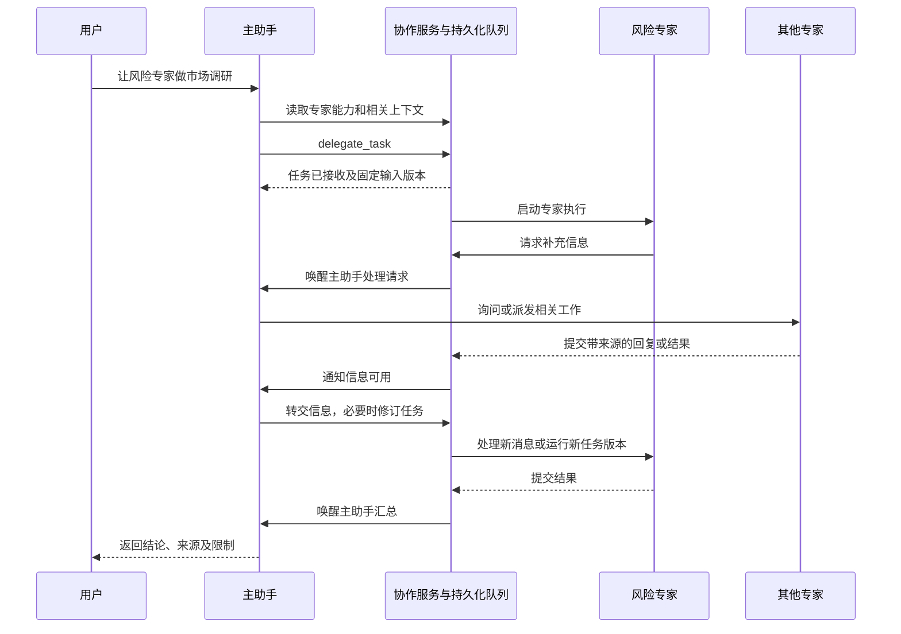

# 增量开发计划：主助手调度、专家协作与信息转交

- 编写日期：2026-10-03
- 状态：C1、C3 已实现并验证；C2 功能已实现（综合浏览器验收见 C5）；C4、C5 进行中
- 适用范围：现有研究工作台的后续增量开发
- 编号：C1–C5，仅用于本计划，不覆盖既有 Stage / R 系列编号
- 本文是开发与验收计划；已完成项目以复选框和阶段记录为准。

## 1. 目标与用户场景

用户在主对话中说：

> 告诉风险专家进行项目市场调研，并把你认为必要的信息交给它，包括其他子 agent 的相关成果。

系统应完成以下闭环：

1. 主助手识别目标专家，确认其能力是否覆盖任务。
2. 主助手读取有权限访问的背景、资料与其他专家成果，选择必要内容。
3. 系统保留用户原始指令，将任务说明、约束、资料和结果引用形成固定交接记录。
4. 任务实际送达专家并进入执行，主对话显示真实的接收和运行状态。
5. 专家可以请求补充信息；主助手或获准协作的专家可以回答。
6. 专家产生可追溯的结果，系统持久化并唤醒主助手继续处理。
7. 主助手区分初步结果、复核状态和正式采用，向用户汇总。
8. 用户可随时进入该专家会话讨论，记录在刷新和进程重启后仍可读取。

最终操作应由自然语言发起，无需用户手动复制上下文、逐个填写派发窗口或不断点击刷新。

## 2. 当前基线与待补缺口

| 模块 | 当前已有基础 | 本轮需要补上 |
| --- | --- | --- |
| 主助手 | 主线和分支聊天、资料读取、联网搜索与抓取 | 注册专家发现、上下文读取、派发、通信和任务管理工具 |
| 专家身份 | 方法角色、任务 ID、挂在任务上的独立讨论记录 | 持续的专家会话身份；一个专家会话可承担多项任务 |
| 任务执行 | `TaskSpec`、`TaskRun`、`TaskReceipt`、版本与固定输入 | 从主助手工具调用贯通创建、接收、执行、结果回传 |
| 输入组织 | 当前节点聊天快照、资料引用、显式结果输入 | 主助手按相关性选择上下文，保留原始指令及摘要来源 |
| 信息转交 | 显式结论回传和部分结果关联 | 专家消息队列、送达记录、问题与回复关联、补充上下文 |
| 后台运行 | DBOS 固定专家序列及恢复机制 | 持久化派发意图、消息处理、完成通知和主助手续接 |
| 专家能力 | 当前任务执行主要读取已挂载材料 | 为调研角色接通联网能力，并进行派发前能力检查 |
| 工作台 | 项目内多个 Flow、专家聊天页、右侧资料和结果 | 从同一后端事件展示派发、等待信息、回传和采用状态 |

已有专家聊天验证仅证明直接续聊和记录持久化，不能作为主助手自主派发或多专家协作的验收依据。

### 2.1 可复用的代码入口

- 主助手工具装配：`src/agent_core/app/research_execution.py`。
- 工具调用及有界委派基础：`src/agent_core/core.py`、`src/agent_core/contracts.py`。已有 Core 委派机制未接入工作台的专家任务闭环；直接启用它也不会自动获得任务、消息和结果持久化。
- 任务定义、执行、复核与采用：`src/agent_core/tasks/models.py`、`src/agent_core/tasks/service.py`。
- 主线消息和结论回传：`src/agent_core/research/chat.py`。
- 当前专家讨论：`src/agent_core/projects/service.py`、`src/agent_core/projects/models.py`。
- 后台调度：`src/agent_core/durable.py`、`src/agent_core/orchestration/dispatcher.py`。
- 来源与权限：`src/agent_core/context/`、`src/agent_core/resources/`、`src/agent_core/app/research_web.py`。
- 界面：`frontend/src/workspace/ExpertView.jsx`、`ProjectOverview.jsx`、`FlowCanvas.jsx`、`RightPanel.jsx`。

## 3. 架构决策

### 3.1 主助手持续负责主对话

采用主助手统筹、专家完成具体工作的 Manager 模式。主助手选择专家、分配输入、处理分歧和汇总结果。专家可在明确授予的范围内提问、协作或派发子任务。

主对话控制权保持在主助手；用户打开专家会话时，可以直接与该专家讨论。两种入口共同使用持久化的会话、任务和消息记录。

### 3.2 分离专家会话、任务和执行

| 对象 | 核心职责 | 身份和版本规则 |
| --- | --- | --- |
| `ExpertSession`（新增） | 专家的持续会话、角色配置和所属主任务 | 独立会话 ID；角色配置有版本；不以任务 ID 代替 |
| `TaskSpec`（扩展） | 某项工作的目标、交付要求和固定输入 | 同一任务可有多个不可变版本；绑定接收专家会话 |
| `TaskRun`（复用） | 一次实际执行及其输入、模型、方法 | 绑定确定的任务版本；执行期间输入不变 |
| `TaskReceipt`（复用） | 结果、检查、交付和采用状态 | 结果关联运行；保留假设、缺失、限制和来源 |
| `AgentMessage`（新增） | 用户、主助手和专家间的信息往来 | 消息 ID、发送者、接收者、关联任务、回复关系和引用 |
| `ContextPacket`（新增） | 某次派发或补充消息所传递的上下文 | 不可变记录；保存原始指令、选定片段及固定引用 |
| 待投递事件记录（新增） | 将业务提交可靠地交给后台执行和通知流程 | 与业务数据在同一事务保存；投递可重试且去重 |

专家所属关系、任务依赖、消息往来和手动文件夹分别建模。移动文件夹不改变权限、执行依赖或上下文。

### 3.3 复用既有依赖和业务层

- 继续使用现有 Agents SDK 适配器、Core 工具接口、SQLAlchemy、PostgreSQL 和 DBOS。
- 新增独立的 `collaboration` 模块承载工具、交接与消息服务；项目模块继续负责导航和项目归属。
- 工具调用复用任务、资料、聊天和权限服务，避免在工具 handler 中复制业务实现。
- Memory 与 PostgreSQL 适配器遵守同一业务契约；生产持久化验收使用 PostgreSQL。
- 新语义使用新专用数据库验收。切换正式实现时移除被替代的任务绑定聊天路径，不添加兼容层、自动数据迁移或静默降级。
- 历史数据库、blob 和原预览实例保留，不作为重建测试库或清理对象。

## 4. 协作工具契约

共设计 8 个协作工具。工具参数由 schema 约束；调用者身份、所属主任务、权限和预算由运行环境注入，模型不能自行声明或扩大。

| Tool | 目标 | 主要参数 | 成功返回与边界 |
| --- | --- | --- | --- |
| `find_experts` | 找到已有专家或可创建的专家角色 | 名称/能力查询、当前任务所需能力 | 返回稳定会话 ID、角色及版本、能力、可见任务状态；不泄露无权访问的会话 |
| `read_context` | 读取准备分析或转交的信息 | 对话片段、资料或结果引用；分页与内容预算 | 返回内容、作者、版本、来源和状态；可定位到原文；读取前检查权限 |
| `delegate_task` | 正式派发工作 | 已有专家会话 ID 或角色 ID（二选一）、任务说明、上下文选择、交付要求 | 创建或复用目标会话，保存任务与交接记录并进入后台队列；返回任务版本、接收状态和交接记录 ID |
| `send_agent_message` | 提问、答复或补充信息 | 接收会话、关联任务、消息类型、正文、引用、`reply_to`、是否需要回复 | 保存消息和投递状态；需要回复时安排专家对话；普通消息不启动正式分析 |
| `get_task_status` | 查看进展、阻塞和结果 | 任务 ID、可选事件游标 | 返回业务状态、确定版本、结果引用和错误/缺失信息；不得为查询再次执行任务 |
| `revise_task` | 改变正式目标或输入 | 任务 ID、预期版本、新要求、输入变更、执行安排 | 创建新版本；明确仅保存、在当前运行结束后执行，或请求停止后替换；不修改正在执行的快照 |
| `cancel_task` | 停止工作 | 任务 ID、是否包含其未完成子任务、原因 | 返回停止请求和后续实际状态；取消过程保留历史和已提交结果 |
| `adopt_result` | 将选定结论正式用于主任务 | 结果引用及版本、目标主任务、采用说明 | 检查交付条件和权限后记录采用；不代替独立复核，不改写原结果 |

### 4.1 接口共通规则

1. 每个写命令携带运行环境生成的稳定命令 ID。同 ID、同参数重试返回已有结果；同 ID、不同参数报冲突。
2. 修改操作携带预期版本。冲突返回可操作的当前状态，由主助手重新读取后判断，不能自动覆盖。
3. `delegate_task` 在任务、输入快照、投递意图全部持久化后才返回“已接收”。开始执行、完成和交付通过另有状态。
4. 引用以完整身份传递：文件使用完整 `ResourceRef`，对话使用会话版本和消息 ID，结果使用固定结果/运行版本。
5. 没有目标专家所需能力时返回明确限制和可选安排；不静默换专家、模型或方法。
6. 后端自动保存专家结构化输出并产生完成事件。模型不需要额外调用“宣布成功”工具。
7. 模型间传递其他专家结果时保留其复核状态。待核实内容可作为标明状态的讨论材料，不能伪装成已通过检查的事实依据。

### 4.2 工具授予

| 调用方 | 默认可用范围 |
| --- | --- |
| 主助手 | 当前主任务内的专家发现、上下文选择、派发、通信、查询与有权限的任务管理 |
| 专家 | 自己的任务与获准输入；向派发者提问或答复；获准协作者之间的通信 |
| 获准承担子任务管理的专家 | 在继承的预算、深度和权限范围内增加派发、查询、修订及取消子任务能力 |
| 前端用户操作 | 调用相同业务服务；发送者记为真实用户；明确的执行命令按用户权限处理 |

同一项目的不同主任务仍保持上下文隔离。跨主任务共享必须有明确授权记录；专家不能自行扩大共享范围。

## 5. 上下文和消息传递

### 5.1 固定交接记录的内容

`ContextPacket` 至少包含：

- 用户原始消息引用及内容；适用的已明确用户约束。
- 主助手整理的任务说明，标明其来源是主助手。
- 经选择的历史消息片段及版本。
- 固定资料引用，以及保留的请求 URL、实际 URL、抓取时间等来源信息。
- 其他专家结果的作者、会话、任务、运行、结果版本、状态和引用。
- 摘要与其支持引用；假设、争议、缺失和限制。
- 交付要求及后端批准的执行限制。

原始用户要求与助手补充判断分别保存。其他 agent 或网页中的文字作为资料处理，不能借转交获得更高的指令优先级。

### 5.2 组装流程

1. 主助手调用 `read_context` 获取获准的信息目录、片段或结果。
2. 主助手选择与本次工作相关的内容，并给出简短的任务说明。
3. 后端验证引用和版本，将本次用户请求与不可省略的用户约束加入交接记录。
4. 检查输入预算；超限时返回具体缺口，要求缩小选择或明确摘要，不静默截掉关键约束。
5. 保存不可变交接记录，再安排执行。

摘要帮助模型理解任务；原文和结果引用支持核对。整段项目历史不自动注入所有专家。对于“哪些信息相关”的模型选择质量，使用标注必要证据的验收案例评价，不能只靠 schema 校验宣称完整。

### 5.3 普通消息与正式任务变更

- 普通提问触发专家对话回复，可讨论资料、依据、假设和局限。
- 补充消息进入接收队列，在下一次会话处理时可见；记录被哪个会话回合实际消费。
- 运行中的正式分析保留原任务和输入快照。需要改变交付时使用 `revise_task`。
- 用户说“按这个要求重做”已表达执行意图，可在权限和预算内直接调用正式修订工具，不必再要求用户重复点击按钮。
- 意图不清且会明显改变工作范围时，主助手询问具体目标；不把普通讨论自动变成付费重跑。
- 专家聊天回合也固定所使用的任务版本、消息截止点、资料和结果引用，并在生成后重新检查访问权限。

### 5.4 消息与任务状态

- 消息：已保存 → 已投递 → 已被某个会话回合消费；有回复时关联回复 ID。投递失败保留错误和重试信息。
- 任务：已接收、排队、运行、等待信息、完成、失败、取消中、已取消。
- 执行完成、交付复核和采用继续是三个独立维度；有输出不等于可正式采用。
- “等待信息”必须说明问题、接收者和恢复条件，不允许无期限等待循环。

## 6. 后台调度与结果回传

### 6.1 提交与恢复

- 任务、交接记录和待投递事件在同一数据库事务中提交。
- 后台投递使用稳定业务命令 ID 对接 DBOS；数据库提交后进程退出，恢复后仍可继续投递。
- 专家结果和待通知事件一起保存；主助手续接按事件 ID 去重。
- 主助手存在新用户回合时，完成事件进入其待处理队列，不能用旧事件覆盖新请求或启动并发写入同一会话的回合。
- 关闭页面不影响后台工作；重新打开从数据库恢复状态。
- 外部模型请求结果不明时保留尝试记录和费用不确定性。逻辑提交去重不等于外部模型调用绝不重复，不能把重试描述为免费或零成本。

### 6.2 并行与依赖

- 独立任务可并行；依赖任务只在指定结果版本满足条件后执行。
- 依赖边单独保存并检查循环，不从 Flow 布局或手动文件夹推导。
- 任务启动后，上游新版本不会替换已经固定的输入；后续使用新版本需要显式修订。
- 并发、模型调用、执行额度和委派深度按主任务累计，子任务不能重置上限。按用户确认，C4 当前不设金额上限，完整 USD 费用预算不属于本次范围。
- 当前 DBOS 队列并发为 1；并行阶段需扩展现有适配器，并先验证数据库事务、作用域和取消隔离，再调整并发。

### 6.3 复核和采用

复用既有回执与复核规则。专家不能自行把自己的产出标为已通过独立复核；需要独立校验者或真人的场景保留明确状态。主助手可以解释初步结果，但只有满足既有交付条件的结果才能正式采用。需要等待真人时，流程显示具体待办而非宣称闭环完成。

## 7. 调研角色的业务能力

协作工具用于组织工作，调研角色还需要实际业务工具：

| 工具 | 目标 | 实现要求 |
| --- | --- | --- |
| `search_web` | 发现市场、行业、竞品等线索 | 复用现有提供方；搜索摘要不能作为正文证据 |
| `fetch_web` | 获取并保存正文 | 按任务作用域保存完整资料版本、URL 和抓取时间 |
| `search_source` | 在固定材料中检索片段 | 返回完整引用和定位信息，应用输入/工具预算 |
| `read_source` | 阅读获准资料 | 每次检查当前权限；禁止猜测或跨范围访问引用 |

现有 `research_web` 与研究节点运行绑定；为专家接入时应提取共用的来源获取与权限能力，并提供任务运行绑定，不能直接复制造成两套来源逻辑。

市场调研、一般风险分析和财务数值分析应使用各自明确的方法与输入要求。保留现有财务分析对完整提取结果和口径核对的约束，不为了让市场样例运行而放松它。

风险专家可以在已配置调研能力时独立完成调研，也可以通过获准研究专家取得材料。派发者必须根据实际能力选择安排。

## 8. 增量实施顺序

### C1：主助手派发单个专家并收到结果

**用户可见交付：** 在主对话提出一项基于现有资料的工作，专家接收并执行，主助手自动收到结果继续回答。

- [x] 新增专家会话身份，绑定主任务、角色版本和独立消息记录；任务增加接收专家会话关联。
- [x] 实现协作服务、Memory / PostgreSQL 仓储和持久化交接记录。
- [x] 接通 `find_experts`、`read_context`、`delegate_task`、`get_task_status`。
- [x] 注册到主助手实际运行的工具目录，并按任务能力约束派发。
- [x] 接通事务内待投递事件、DBOS 接收、结果提交和主助手自动续接。
- [x] 工作台显示真实的任务接收、执行与结果状态，专家节点仍直接打开聊天页。
- [x] 新专家会话使用正式的新持久化路径；移除被替代的任务绑定讨论入口。

**通过条件：** 一条用户请求完成上述闭环；无需手动派发和复制材料；相同命令重试不增加逻辑任务；进程重启可恢复；两种存储的业务测试及 PostgreSQL 实际恢复测试通过。只能得到待复核结果的案例必须明确标注状态。

### C2：多轮通信、上下文转交与任务修订

**用户可见交付：** 主助手可以把其他专家的相关信息交给风险专家，处理它的提问；用户也能直接进入专家会话讨论或改变任务。

- [x] 接通 `send_agent_message`、`revise_task`、`cancel_task`、`adopt_result`。
- [x] 消息持久化、送达/消费记录、`reply_to` 关联和失败重试。
- [x] 上下文选择支持其他专家的结果和获准会话片段，保留作者、版本、假设与限制。
- [x] 专家讨论回合保存输入绑定；待核实讨论材料与正式结果依赖分别处理。
- [x] 明确用户直接聊天、主助手转交和专家回复的发送者身份。
- [x] 实现运行中补充信息、仅保存修订、排队新版本及取消后替换语义。
- [x] 用户讨论、任务修订/取消及结果/失败以持久通知续接主助手，重复通知不重复执行。
- [x] 专家主动请求信息时暂停当前对话；主助手有信息则显式授权，没有则让专家按已有信息完成并说明缺口。问题/答复持久化，恢复沿原任务和运行继续；真实模型两分支及 PostgreSQL 重开测试通过。
- [x] 专家页以对话为主体，交接记录和任务操作从辅助入口查看；8783 浏览器已核对。

**通过条件：** 风险专家的实际输入同时含用户指令、主助手选择的背景和指定上游结果；没有混入未获准内容；追问不会启动分析；明确重做产生新版本；旧执行与结果可追溯；经过有效复核的结果可正式采用。

### C3：真实市场调研能力

**用户可见交付：** 用户说“做市场调研”后，系统按能力安排专家实际搜集新资料并分析。

- [x] 为调研角色接通联网搜索、抓取和资料读取，复用既有来源服务。
- [x] 建立市场调研与风险分析方法配置，保持既有财务方法约束。
- [x] 对缺少联网能力、来源不足、抓取失败和预算不足返回明确状态。
- [x] 网页资料按本次任务归档，来源 URL、版本和时间可在专家与主对话中核对。
- [x] 执行小规模真实模型和公开网页验证，保留调用、结果、证据及费用/用量记录。

**通过条件：** 在用户消息未提供来源正文时，能够实际获取公开资料并引用；搜索线索不会冒充正文；获取失败时不生成伪造来源；撤权后后续读取、交接和结果披露均受约束。

### C4：并行专家、依赖任务与获准协作

**用户可见交付：** 主助手根据需要安排多个专家，组合其成果；专家可在授权范围内请求其他专家协助。

- [x] 扩展现有调度适配器，支持独立任务并发和固定结果版本依赖。
- [ ] 主助手根据工作需要选择直接执行、并行任务或前后依赖，不强制拆分每个问题。
- [x] 实现获准专家间提问及子任务派发；按主任务记录用量、限制深度和并发。当前不设金额上限。
- [x] 检查依赖循环、互相等待、重复消息和取消传播；未来依赖在指定上游版本复核后固定输入，失败或取消时明确结束。
- [ ] 主助手能处理结果分歧、部分失败及所需补充调查。现有 A/B 案例已完成两侧追问与答复回传；最新真实补查双方成功交付，A 最终 JSON 经原对话纠正；修复长资料读取并重试后汇总成功，仍有语义表述问题，且包含操作员重试；完整验收未通过，见 `collaboration-c4-autonomous-research-review.md`。
- [x] Flow 显示任务归属、依赖和消息关联，图例明确区分；连线来自后端记录。

**通过条件：** 市场与竞品搜集可并行，风险分析等待指定输入；一项失败不会无声消失；局部重试不重跑成功任务；主任务取消能处理其子任务；专家间消息不会形成自动回复循环。

### C5：完整验收与交付

**用户可见交付：** 新功能在已确认的三栏工作台中稳定使用，提供准确的运行入口和操作说明。

- [ ] 执行第 9 节的全流程验收，逐项记录通过、失败、跳过与原因。
- [x] 在新专用 PostgreSQL 数据库及配套 blob 目录验证重启恢复；不使用历史验收库做破坏性测试。
- [ ] 验证前端切换、刷新、延迟响应和运行时输入状态；完成真实浏览器检查及回归测试。
- [ ] 更新接口契约、运行命令、数据库/构建路径、模型配置要求和已知限制。
- [ ] 提供成功与失败的运行证据、关键截图及可复现脚本。
- [ ] 保留每个阶段可运行的完整产品；检查默认入口和现有功能没有回退。

**通过条件：** 本计划目标中的自然语言工作流可复现；所有必须项通过或明确记录真实阻塞；不能以有工具 schema、模拟成功、后台任务已入队或单独聊天可用代替端到端验收。

## 9. 验收矩阵

| 编号 | 场景 | 必须观察到的证据 |
| --- | --- | --- |
| A01 | 主助手自然语言派发 | 真实工具调用、固定交接记录、任务接收、执行结果和主助手续接 |
| A02 | 复用现有风险专家 | 同一专家会话承接新任务，既有消息保留，未生成同名重复会话 |
| A03 | 携带用户指令和必要背景 | 输入快照包含原始用户要求、关键约束和主助手选择内容；来源能核对 |
| A04 | 引用其他专家成果 | 接收方读取指定结果版本，作者、状态、假设和限制完整保留 |
| A05 | 普通讨论与重做 | 普通提问只增加消息；明确重做产生新任务版本和对应运行 |
| A06 | 运行中变更 | 旧运行输入不变，新输入仅用于新的回合/任务版本，安排可见 |
| A07 | 重复提交与并发修订 | 相同命令不重复创建或发布；不同参数复用 ID 和过期版本均被拒绝 |
| A08 | 权限和隔离 | 同项目不同主任务、未授权专家及撤权后的读取/转交被正确限制 |
| A09 | 模型调用期间撤权 | 已在途请求不能撤回已发送数据，但完成后不得继续保存或披露被撤权内容；记录拒绝原因 |
| A10 | 进程重启 | 覆盖业务提交后未投递、执行中、结果已保存未通知三个故障点；无丢失、重复发布 |
| A11 | 主助手已有新消息 | 完成事件与新用户回合有序处理，不覆盖新意图，不并发写坏会话 |
| A12 | 真实联网调研 | 搜索/抓取记录、正文版本、最终来源链接和证据关联均存在 |
| A13 | 信息或能力不足 | 明确报缺口或请求协助，不伪造已委派、已联网或已完成 |
| A14 | 并发和依赖 | 独立任务并行；依赖任务使用指定输入；无环且可取消 |
| A15 | 结果分歧及复核 | 保留冲突和待核实状态；专家不能自行签收；正式采用满足既有条件 |
| A16 | 用量和重复模型调用 | 真实用量与不确定调用均记录；执行额度按主任务汇总，重试不隐藏用量；当前不设金额上限 |
| A17 | 前端状态 | 多 Flow、完整专家对话、右侧预览保留；旧请求不会覆盖新选择，轮询不清空草稿 |
| A18 | 构建和历史记录保护 | 新预览使用独立构建产物；历史内存实例、数据库和 blob 未被覆盖或清空 |

测试按业务契约、API、持久化/恢复、浏览器和小规模真实模型分层。模拟模型用于确定性验证，真实模型用于确认工具选择、信息选择和自然语言续接；两类证据分别记录。

## 10. 工作台与预览约束

- 保持已确认的三栏布局：左侧项目与会话，中间多个主任务 Flow / 完整聊天，右侧资料与结果。
- 专家节点默认进入对话。任务单、执行记录、交接详情从按钮、菜单或弹窗打开。
- 技术 ID、内部字段及状态码放在详情中；普通界面使用任务和消息含义明确的名称。
- 已有前端源码保持一套。不同运行实例使用各自明确的构建产物路径。
- 按当前验收记录，8771 保留原内存会话，8782 为项目持久化预览。实施前重新核对实际进程、端口及存储；不能仅凭旧文档假定实例状态。
- 8771 仍使用 `frontend/dist` 时，不以普通构建覆盖该目录。现有项目预览命令为 `npm run build:project-preview --prefix frontend`；其产物路径记录在预览脚本中。
- 本计划不包含删除历史数据、生产部署、提交或推送代码、建立定时自动化。

## 11. 交付材料与完成判定

每个阶段提交以下可审阅内容：

1. 实际完成项与对应代码/接口说明。
2. 可运行入口、数据库与构建产物位置。
3. 测试命令、结果、跳过项和失败记录。
4. 一条成功链路和相关失败/恢复链路的证据。
5. 本阶段仍未覆盖的能力及下一阶段依赖。

全部完成时，用户应能从主对话发起工作、观察真实派发、进入专家续聊、转交其他专家的信息，并收到有来源、状态明确的汇总结果。

## 12. 参考与基线记录

- [OpenAI Agents SDK：Agent orchestration](https://openai.github.io/openai-agents-python/multi_agent/)：主助手保留主对话控制、通过工具调用专家的组织模式。
- [LangChain：Subagents](https://docs.langchain.com/oss/python/langchain/multi-agent/subagents)：主助手选择专家输入并组合输出、控制上下文范围的模式；本项目额外要求持久化专家会话和用户直接续聊。
- [项目页与 8771 基准对齐](project-stage3-preview-correction.md)。
- [风险专家聊天入口修正](expert-conversation-fix.md)。
- [真实专家对话验证记录](expert-chat-verification.json)。
- [协作验收矩阵当前状态](collaboration-acceptance-status.md)。
- [C2–C5 接口与运行说明](collaboration-c2-c5-interface.md)。

外部资料用于参考组织模式；上述工具接口、消息语义和实施顺序属于本项目的设计决定。
