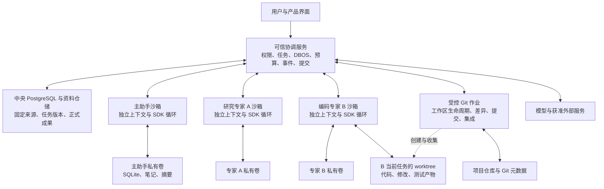

> **历史方案，已被替代（2026-10-07）：** 用户取消 Docker 和强隔离要求。当前执行与验收以[受控工具决策](ce1-controlled-execution-decision-2026-10-07.md)及更新后的增量计划为准。下文保留原调研依据，不再是当前统一决策或容器验收要求。

# 多 Agent 与上下文工程：完整技术选型

日期：2026-10-05。状态：**拟定架构与实施契约，尚未完成新架构实现和验收。**

本文是当前统一决策入口，合并此前上下文选型、独立沙箱决策和 ShareAI 调研，并纳入用户新增的编码专家 worktree 需求。发生部署顺序或 worktree 表述冲突时，以本文为准；原文保留代码取证和候选方案分析。

**Raven 调研更新：** 已补入每请求上下文清单、明确的任务能力与完成契约、交付完整性、无进展检测及压缩诊断；BoxLite 列为实施前的运行时比较候选。现有 SDK、DBOS、私有存储和编码 worktree 的决定不变。详细事实、源码与不采用部分见 [Raven 调研](raven-architecture-review-2026-10-05.md)。

## 1. 总体决定

采用 **现有 OpenAI Agents SDK + DBOS + PostgreSQL/SQLAlchemy + 每 Agent 独立 Docker 沙箱与 SQLite 私有工作库 + 编码任务专属 Git worktree**。

主助手负责理解目标、分工和综合结论；可信协调服务负责权限、调度、预算、恢复和正式提交。每位专家只在自己的执行环境中工作，通过授权接口交换任务与成果。上下文按需组装，原文保存在窗口之外；压缩只是改变本轮模型看到的内容，不覆盖原始记录。

### 技术选型总表

| 层次 | 拟定选择 | 选择理由 |
| --- | --- | --- |
| 模型循环 | 保留 OpenAI Agents SDK，本地已核查版本 0.22.2 | 复用工具调用、结构化结果、输入过滤和模型接口；不重新写 Agent 循环 |
| 模型服务 | 沿用现有提供方与任务固定配置 | 本轮架构调整不引入模型切换；运行与恢复保持模型/方法身份 |
| 持久编排 | 保留 DBOS，本地已核查版本 3.0.0 | 已有队列、恢复和取消接入；逐步细化持久步骤 |
| 中央业务存储 | 保留 PostgreSQL + SQLAlchemy 及现有资料/blob 仓储 | 任务、权限、原始资料、正式结果和预算只有一份权威状态 |
| 本地执行隔离 | Docker 容器，按运行启动，按会话绑定存储 | 限制进程、文件系统和网络访问，容器退出不丢工作资料 |
| 私有工作存储 | 每会话独占卷，SQLite + 文件 | 保存草稿、摘要、阅读进度与完整工具结果；单写者无需独立数据库服务 |
| 编码工作区 | 按代码任务分配专属 worktree 和分支 | 独立修改与测试、固定基线、审查差异及集成；与沙箱同时使用 |
| 通信 | 受控标准输入/输出协议 + 中央持久事件 | 身份由协调器绑定，消息可确认、可重放；不共享专家消息数组或邮箱目录 |
| 上下文工程 | 业务层上下文投影、阅读账本、分页和分层压缩 | 保留研究产品的来源、版本、纠错与授权语义 |
| 检索 | 先用授权目录、固定版本片段读取和现有词法检索 | 先补分页、定位、去重和评测；暂不引入向量库 |
| 正式交付 | 现有结构化结果与证据校验，补充无工具收尾阶段 | 避免调查消耗全部额度；不将草稿、摘要或失败通知当成合格报告 |

上述 SDK/DBOS 版本是已核查的本地版本，不是推荐立即升级到某个最新版。

Docker 仍是拟定实施基线。Raven 使用的 BoxLite 提供微虚拟机路线，值得在阶段 1 前用同一个单专家闭环比较整体执行覆盖、私有存储、网络、取消、worktree/Git 与恢复后选定运行时；当前不安装、不切换，也不预建双后端。两种路线均须隔离整个专家本地执行，不能只隔离 shell。

## 2. 新的多 Agent 架构

### 角色与权力

| 角色 | 负责什么 | 权限边界 |
| --- | --- | --- |
| 主助手模型 | 澄清目标、提出任务、组织专家、读取获准成果、汇总 | 同样位于沙箱；不能直接访问专家私有卷、中央数据库或密钥 |
| 专家模型 | 完成固定任务、使用获准工具、整理私有笔记、申请资料、提交成果 | 独立消息、独立工作存储；角色名称本身不授予权限 |
| 可信协调服务 | 固定任务与授权、启动和停止运行、投递事件、持久计费量与预算、检查发布条件 | 这是确定性应用代码；模型不能修改其规则或自报“已授权” |
| Git 作业 | 管理任务工作区、生成差异与提交、准备集成 | 由协调器授权，限定项目仓库和任务身份，不执行模型提供的任意宿主命令 |

多 Agent 的默认协作仍是主助手组织专家，专家向主助手请求跨专家信息。已有交接中的“主助手实际读过后再授权固定报告”继续保留。不默认建立任意点对点广播、递归生育专家或共享全部历史的团队。

借鉴 Raven 的 Charter，在现有 task/spec 中固定职责、完成条件、允许资源/工具、写入范围、代码基线、成果 schema 和预算。当前任务能力只能与专家已有授权取交集，不能扩大权限；续聊不暗中修改任务契约。有真实前置关系时才表达依赖图，先检查循环、未知依赖和产物版本；独立分支可并行，前置失败不影响无关分支。仍由 DBOS 调度，不新增 DAG 运行时。

### 身份与生命周期

- **会话身份**：使用研究 ID 与主助手/专家会话 ID 隔离私有工作区。同一种专家参加不同研究时不能共用记忆库。
- **执行身份**：每次操作绑定 task/spec/run/attempt 和授权世代；协调器从已绑定通道识别身份，不信任请求正文中的自报 ID。
- **存储生命周期**：私有卷随会话持续存在，容器随运行创建、停止；同一工作区同时只有一个合法写者。
- **代码工作区身份**：绑定项目仓库、代码任务、基线提交和专属分支。正常重试复用该任务工作区；新任务独立分配。容器停止不等于删除代码改动。
- **协作状态**：成果提交、等待资料、失败、空闲分别表达；事件持久化后触发下一轮，不让模型轮询消耗上下文与额度。

### 沙箱与通信的具体决定

运行容器使用非 root、只读根文件系统、独占工作卷和有限临时目录，限制 CPU、内存与进程数，移除不必要 capabilities，启用 no-new-privileges 和 seccomp。初版网络为 `none`；模型调用、检索和业务操作通过有大小/序号/操作 ID 限制的绑定通道转发。容器没有服务商密钥、中央数据库凭据或 Docker socket。

SDK 的模型接口仍在沙箱内，由窄的 `Model` 适配将请求转给协调器使用已有提供方适配。协议流和工具子进程日志分开。协调器每次检查权限、取消、任务版本和剩余额度；未知操作拒绝，不提供任意宿主路径或任意 HTTP 代理。

Docker 容器共享底层内核，本方案不声称每专家独占虚拟机或物理机。当前选型针对本地 Agent 执行隔离，不改变远端模型提供方的推理环境。磁盘硬限额必须用所选部署运行时实际验证，不能仅用应用层计数宣称完成。

## 3. 编码专家：沙箱、私有存储与 worktree 同时使用

三者分别承担：沙箱管访问边界，私有卷管工作记忆，worktree 管代码工作副本。研究专家无需分配代码仓库；编码专家按任务获得已授权的工作副本。

### 挂载与 Git 操作

编码沙箱只挂载自己的 `/workspace` 代码目录和 `/state` 私有工作卷，不挂载宿主开发目录、其他专家目录、整个 `.git` 管理目录或凭据。worktree 是协调器管理的专用工作区，专家对它的写入确实修改这个工作区，所以不能指向用户正在使用的主 checkout。Docker bind mount 的写权限会作用于被挂载的宿主目录。[Docker 挂载文档](https://docs.docker.com/engine/storage/bind-mounts/)。

Git linked worktree 与其他 worktree 共享仓库对象和部分引用，拥有各自的 HEAD/index 等状态；工作目录中的 `.git` 指向管理数据。因此仅挂载代码目录后，不能假定沙箱里的普通 Git CLI 可以完整工作，也不能为解决这一点开放共享 `.git`。这是 worktree 的机制约束。[Git worktree 官方说明](https://git-scm.com/docs/git-worktree#_details)。

**拟定接入：专家在沙箱内读写代码、运行构建和测试；status、diff、查看获准版本、checkpoint commit 等 Git 能力由受控工具提供。** 协调器根据绑定身份选择项目、工作区和分支，忽略模型自行提交的宿主路径；共享引用更新由协调器串行提交。Git 作业使用限定权限的隔离环境、受控配置与环境变量，禁用不受信任的 hooks、外部 diff、textconv/filter 等可执行扩展，不把仓库提供的脚本放到可信宿主运行。

不以伪装 Git CLI 或开放全仓库权限解决工具不兼容。依赖本地 Git 元数据的构建先核查，可由任务固定的版本信息满足时显式传入；必须任意执行原生 Git 的任务需要单独评估执行契约，本方案不宣称已支持。Git worktree 也不提供文件级保密：授权完整 checkout 就意味着专家能读该 checkout 的所有文件；含不应共享内容的仓库不能直接整体授权。

### 编码任务闭环

1. 协调器固定仓库、基线提交、任务范围、可用工具与验收要求，为任务创建专属分支/worktree。
2. 专家在自己的沙箱修改代码，将笔记、日志索引和进度保存到私有卷；所需依赖由固定镜像或受控准备步骤提供，不默认开放网络安装。
3. 交付前停止工作区并发写入，冻结变更。协调器收集 tracked/untracked 文件清单和可回查产物，拒绝越界路径、危险链接、无关凭据与构建垃圾。
4. Git 作业基于冻结内容生成候选提交；记录基线、提交/内容哈希、测试命令、环境和结果。测试日志只有对应同一份代码快照才有效。
5. 在单独的集成工作区汇集候选改动，并在验证沙箱中运行测试。冲突作为明确任务交回处理；不能只因每个分支单独通过就宣布组合结果通过。
6. 合并、推送或部署遵循用户已经授予的范围；不由专家自行扩大权限。归档与清理在成果和未提交文件可靠保存、无活动执行者后进行。

其他专家只能收到获准的代码产物或评审材料，不直接访问编码专家的 worktree。撤权时同样处理 worktree、测试日志和构建产物中的派生内容；不能只清空 SQLite，却留下可读代码缓存。

## 4. 上下文工程：每位 Agent 使用同一套契约

覆盖主助手正常对话、主助手续接、专家正式执行和专家普通讨论。不同角色拥有不同内容与工具权限，但不保留缺少上下文治理的旁路。

### 4.1 窗口外保存哪些内容

| 数据 | 保存位置与所有权 | 用途 |
| --- | --- | --- |
| 原始聊天、固定资料、任务版本、正式报告、授权、中央预算、交接事件 | 中央 PostgreSQL 与现有受控资料仓储 | 权威业务记录；不由专家摘要覆盖 |
| 有出处的工作笔记、局部计划、待核验判断、摘要、检索索引 | 每 Agent 私有 SQLite | 窗口外草稿纸；不自动成为共享知识或正式事实 |
| 完整工具输出、获准资料缓存、执行 transcript、运行快照文件 | 每 Agent 私有卷，以数据库记录索引 | 可回查、可恢复；大正文不全部塞入数据库或活跃窗口 |
| 代码修改和测试产物 | 任务专属 worktree，正式代码交付另存固定引用 | 独立开发与可验证交付 |

本地阅读索引用于整理工作；中央工具服务保存其实际返回的来源/版本/范围和正式引用记录。两者各有职责：专家可写“我认为已验证”的笔记，不能据此修改中央核验状态。中央调度检查点引用私有运行快照，不依靠模型编辑的 SQLite 表授权恢复。

### 4.2 怎样选取活跃上下文

按任务构建：**当前指令与有效约束 → 固定任务及进度 → 有出处的历史摘要 → 最近完整回合 → 授权目录及必要证据片段。** 对专家只传必要任务背景，不默认复制全部主对话。

检索先过滤研究、会话、任务和授权，再根据当前问题选择目录项，分页读取固定版本片段，返回范围、是否截断及续页游标。目录和单份大报告都能继续读取，不以“只给前 50 项”作为完整检索。最后组装输入前再次验权，防止检索期间发生撤权。

阅读账本记录：问题、资料/报告固定版本、查询与位置、实际返回范围、正文哈希、完整/摘录/无匹配状态、响应引用。区别“工具已返回”“模型请求已包含”“结论已引用”“独立复核通过”。去重依据版本与片段，不能只看工具名，也不能禁止必要的重新阅读。

**每请求上下文清单**记录本轮真正选入/排除的消息与片段、固定版本、原因、原文/摘要/预览形式、截断范围、保护约束、授权世代和输入哈希。它与阅读账本分开：历史读过的内容未必仍在当前窗口。先用确定性排序和预算校验，需要摘要时才调用模型；不额外引入多工具 Curator 循环。必需约束或授权片段构造失败时明确阻止执行，不能一律丢弃片段后继续。

先测现有词法检索在中文、同义表达、长文和跨报告问题上的召回质量。只有测出实质缺口才评估 LlamaIndex 的检索组件；目前不引入向量库、知识图谱或自动共享长期记忆。

### 4.3 怎样 compact

压缩分两处接入：运行前替换全历史拼接；运行中使用 SDK 每次模型调用前的输入过滤。只改后者无法解决现有模型调用前就触发的字符限额。

| 次序 | 操作 | 必须保留 |
| --- | --- | --- |
| 1 | 完整保存大工具结果，窗口只留预览与引用 | 成功落盘的原文、来源、版本和可用回查入口 |
| 2 | 缩减已消费的旧结果，合并确切重复片段 | 当前问题需要的片段、最近结果、读取范围与引用；程序裁剪不生成新的“事实” |
| 3 | 用既有有效摘要加新增完整回合生成滚动摘要 | 约束出处、决定、纠错、结论状态、证据定位、未完成事项、覆盖游标 |
| 4 | 仅在明确窗口超限后重新投影并最多补救一次 | 调用/结果配对、错误原因与持久预算；仍超限则明确终止 |

保留近期完整回合，不能把一个工具调用和对应结果拆开。摘要是参考数据，不能充当系统指令、原始证据或权限凭证。模型摘要产生新文本时必须有来源并经 schema/必要字段检查；不能把这一步算作无损或确定性缩减。

显式约束和任务权限从权威记录注入；自然语言约束保留原句与消息 ID。纠错保留旧说法及更正关系。摘要失败不删除旧历史，也不退回全量灌入旁路。预算核算包括系统提示、工具定义、历史、片段、摘要及输出余量；字符数与估算 token 分开记录，不把课程阈值当作模型真实窗口大小。

借鉴 Raven 的窗口管理，记录压缩触发原因、前后大小及摘要调用的未调用/失败/成功状态。非空但因输出上限截断的摘要也拒绝采用；摘要请求本身必须留输出空间，调用失败计入预算。缓存 token 按提供方口径归一化，缓存命中仍占窗口，避免漏计或重复计数。稳定系统指令和工具定义保持一致顺序，动态片段放后面；缓存收益需实测，不能优先于撤权与内容正确性。

### 4.4 隔离、撤权与知识共享

摘要、缓存、笔记、transcript、检查点和代码产物都记录来源依赖。授权交接只共享明确选定的正式成果或资料，默认不共享私有工作记忆。

权限撤销后，协调器先封锁通道和发布，再停止受影响运行并隔离旧工作区。后续建立新授权世代的干净工作区，只重新导入仍获准的输入；不复制旧摘要或草稿。历史产物保留但受访问控制，迟到结果被拒绝。已发给外部提供方或用户的内容不能被追回，不作此保证。

## 5. 执行、收尾与恢复

执行阶段由程序控制：`researching → finalizing → delivered / incomplete`，另有取消和权限失效终态。提前为最终报告预留模型轮次及时间；工具额度、模型调用和总时限分别持久记账。摘要与格式修复也计入，重启不清零，不增加新的金额上限。

进入收尾后关闭调查工具，使用已获得证据生成结构化结果与未解问题。发布仍检查任务版本、授权、schema、引文与复核状态。网络、格式或引用持续失败时保存明确未交付状态；不能为了“有结果”发布不合格报告。取消与撤权优先于收尾。

新增有界的无进展检测：只有相同版本、相同请求与结果且期间没有新增证据时，才提示复用并在持续空转后收尾。分页、新版本、纠错和合法复读不受误阻。等待专家或外部任务由调度器挂起并等事件，不能仅因稳定状态重复就判断失败。

运行结束、成果保存、验收通过和正式采用分别记录。主助手收到的简报携带完整产物 ID/hash、完整性和截断状态，必要时回查全文；评审超时保持待验收或失败，不能变成通过。研究专家允许结论未定，编码专家检查冻结代码与测试；不采用面向基准的强制确定答案策略。

DBOS 继续是唯一持久编排器。先保证已提交工具结果与私有笔记可恢复，再建立模型回合安全边界的检查点。复用 SDK 的运行状态能力前验证实际可暂停边界，不承诺能在任意 await 处恢复。恢复检查任务、授权世代、方法/模型、上下文依赖、代码基线和已用预算。

有副作用的请求使用稳定操作 ID 与中央幂等提交；重复消息只重放已提交回执。外部模型请求已发送而响应未落盘时仍有不确定窗口，记录未确认尝试与未知用量，不承诺外部 API exactly-once。

## 6. 直接采用、只借鉴与暂不引入

| 决策 | 技术/模式 |
| --- | --- |
| 继续直接采用 | OpenAI Agents SDK、DBOS、PostgreSQL/SQLAlchemy、现有来源/报告/权限契约 |
| 新增基础能力 | Docker 执行适配、私有 SQLite/卷、编码 worktree 与受控 Git 工具、上下文投影/账本/摘要 |
| 借鉴成熟模式 | ShareAI/Claude Code 的独立任务输入、事件协作与先外存后摘要；Deep Agents 的可回查历史；LangMem 的增量摘要游标；LangGraph/LangChain 的显式状态和额度控制 |
| Raven 的新增借鉴 | 上下文清单、稳定前缀、任务 Charter、交付完整性、无进展检测、领域完成检查和可诊断压缩 |
| 当前不引入 | LangGraph/Deep Agents 整套替换、Claude Agent SDK 切换、第二套消息/调度平台、Mem0 自动事实记忆、向量数据库 |
| Raven 中暂不直接引入 | 整套 Raven 运行时、EverOS 长期记忆、在线自进化、生成式策略代码、异构后端平台；BoxLite 先做定向比较 |
| 有评测证据再决定 | LlamaIndex 等局部检索组件 |

这样做的理由是现有 SDK 和编排已经具备所需底层能力；本次主要缺口是业务上下文、隔离与持久状态边界。换框架仍需完成相同的授权、证据和撤权工作，还会增加第二套状态模型。

## 7. 从现状到完整方案的实施顺序

每层先打通可用闭环并验收，再扩展；模块可独立开发，但不以未完成的新运行时替换现有产品。

| 阶段 | 端到端交付 | 通过标准 |
| --- | --- | --- |
| 1. 单专家隔离闭环 | 容器接任务、调用受控模型/工具、写私有笔记、重读、提交 | 真实容器运行；版本与证据校验通过；替换容器后笔记仍存在 |
| 2. 完整协作隔离 | 两专家独立运行、授权交接、等待/恢复、取消/撤权；主助手及所有入口接同一契约 | 相互不能读文件/库/进程；事件不丢，迟到提交被拒，普通讨论无旁路 |
| 3. 上下文与交付闭环 | 统一投影、目录/正文分页、阅读账本、大结果外存、预留收尾 | 长输入可控，片段可追溯，工具停用后仍可交付或明确失败 |
| 4. 编码工作区闭环 | 专属 worktree、受控 Git、沙箱内测试、冻结候选、集成验证 | 两编码专家并行互不改写；不开放共享 Git 元数据；测试绑定确切快照 |
| 5. 摘要与细粒度恢复 | 滚动摘要、约束/纠错保真、调用边界检查点、故障重放 | 关键中段信息不丢；已提交操作不重复；恢复不串版本、不重置预算 |
| 6. 质量与性能验证 | 固定任务、资料、模型和限额对比；必要时改善检索 | 同时报告交付率、语义质量、召回、重复读取、输入量与延迟，而非只报 token 减少 |

最低阶段已经要有固定身份、持久预算、取消和合法提交门槛，后续阶段是补齐覆盖和细化能力，不能将这些基础控制留到最后。新路径通过验收后移除旧共享进程执行和全历史注入路径；不保留“沙箱失败就宿主执行”、旧协议兼容或历史数据迁移。

## 8. 完成标准与当前状态

目前已完成的是代码审查、资料调研和架构决策整理。已有产品有 scope、固定资料/报告、信息交接、任务级恢复等能力，但通用草稿纸、完整上下文投影/压缩、每 Agent OS 沙箱、私有工作库、编码 worktree 接入和调用级恢复仍待实施。前次只读检查发现 Docker CLI，但其配置 endpoint 无可连接 daemon；本轮未重新探测或启动运行时。

验收同时覆盖以下方面：

- **隔离**：真实容器负向测试，拒绝跨专家/跨研究读取、伪造身份、宿主路径、共享 Git 元数据、凭据及未授权网络访问。
- **持久性**：笔记、结果和代码改动可恢复；事件重复不重复提交；未确认外部调用被如实记录。
- **上下文**：能找到正确固定版本与片段；关键约束、纠错与近期工具协议完整；摘要可追溯；撤权后派生资料不可复用。
- **编码**：差异含新增文件，测试对应冻结版本，组合改动重新验证，取消不丢未提交成果且不允许继续发布。
- **质量**：原文存在与支持结论分开核验；事实、专家推断、未知分开；比较时固定输入、模型和预算，报告失败明细。

本轮仅修改决策文档，未创建运行容器/worktree、修改生产代码、操作历史服务或数据库、运行付费模型、提交或推送。

## 9. 详细依据

- [原上下文与执行选型](context-execution-technology-selection-2026-10-05.md)：本地代码证据、SDK 接口、候选框架和详细回归矩阵。
- [独立沙箱与存储决策](expert-sandbox-storage-decision-2026-10-05.md)：容器约束、身份、私有卷、撤权世代与生命周期。
- [ShareAI / Claude Code 补充](shareai-claude-code-context-supplement-2026-10-05.md)：课程固定源码版本、可复用机制与教学实现边界。
- [Raven 架构调研](raven-architecture-review-2026-10-05.md)：固定源码版本、可采用契约、记忆/沙箱/工作区边界和新增验收用例。
- [Git worktree 文档](https://git-scm.com/docs/git-worktree)与 [Docker bind mounts 文档](https://docs.docker.com/engine/storage/bind-mounts/)：本轮新增核查的工作区机制依据；受控 Git 集成是本项目拟定设计，尚未实现验证。
