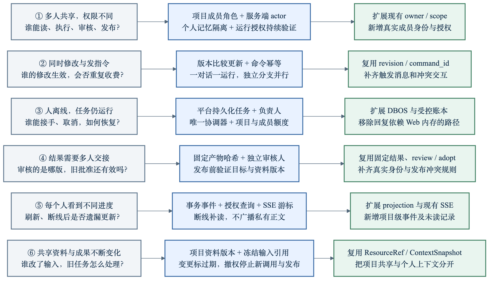
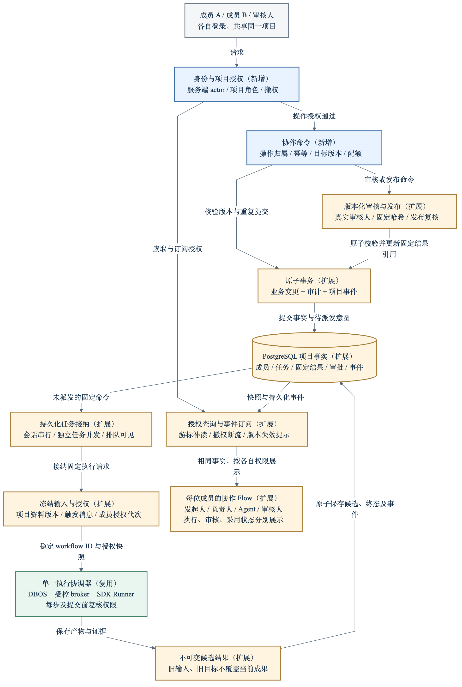

# 多人围绕同一个项目协作：现状、目标架构与开发路线

2026-10-13 · 设计稿。本轮只生成文档与图，不修改产品代码、配置、数据库或运行行为。这里的协作指多名真实用户使用同一 Agent 平台推进项目；Agent 内部分工仍沿用当前机制。

## 1. 核心结论

现有项目已经有研究主线、分支、专家任务、固定输入、结果版本、审核/采用、受控执行及 DBOS。多人协作的主要缺口是：真实用户身份、项目成员授权、操作归属、并发指令规则、后台任务归属、版本化人工交接和跨用户状态同步。

第一版建议是同一个部署中的共享项目：全部项目成员按角色查看同一项目内容，各有独立账号；同一对话按轮串行执行，不同任务/分支可并行；任务由平台执行，浏览器关闭不取消任务。首版保留现有单宿主、单一执行协调器，明确不具备多实例高可用。

关键分离：

- 用户身份：谁正在操作，谁承担操作责任。
- 项目归属：资料、会话、任务和成果属于哪个项目。
- 执行授权：本次 Agent 能读取哪些固定资料、使用哪些工具。
- 人工责任：谁发起、谁负责、谁审核、谁发布。

不能让所有人共享 local owner，也不能把用户账号直接变成资源的项目归属。

## 2. 图：特点与解法

[Mermaid 源码](../figures/shared-project-challenges.mmd) · [可预览 Markdown](../figures/shared-project-challenges.md)

## 3. 图：目标架构

蓝色为新增能力，橙色为需要扩展的现有模块，绿色为复用执行器；这是目标设计，不是现有架构截图。事件只在事务提交后对外可见，读取与订阅按成员当下权限过滤。

[Mermaid 源码](../figures/shared-project-architecture.mmd) · [可预览 Markdown](../figures/shared-project-architecture.md)

## 4. 代码核查：可以复用什么，真正缺什么

| 能力 | 当前源码证据 | 多人协作缺口与风险 | 设计动作 |
| --- | --- | --- | --- |
| 项目空间 | projects/models.py 的 Project.owner；ProjectService.project/list 按 research.owner 查询 | 单一 owner，没有真实用户成员表；PostgresProjects 的 members 是 MainTask 映射，不是用户成员 | 新增 ProjectMembership，项目作为资源边界，actor 作为操作者 |
| API 身份 | app/api.py 只有同源写入检查，create_app 持有一个共享 service | 同源检查不等于登录；不能识别成员角色或抵御对象 ID 越权 | 统一认证入口、请求 ActorContext、每个操作的项目授权 |
| 运行权限 | RunScope.owner、ScopeService.check、受控授权代次 | owner 同时承载身份与资源归属；尚无成员权限撤回的运行代次 | 项目资源授权与成员操作授权分别校验，冻结两者代次 |
| 聊天并发 | ChatService._append、PostgresResearch.save_chat 使用 revision CAS | 已有防覆盖基础，但 ChatMessage.role=user 没有真实 sender_user_id；回复由 chat_revision 触发 | 每条消息标 actor；固定触发消息；同一会话一轮运行规则 |
| 指令幂等 | command_id、DBOS workflow_id 校验固定输入；ChatReplies.admission 是进程内 asyncio.Lock | 部分入口已支持重投，不能据此认定所有多人操作都幂等；两个成员的两条不同意图也不能互相去重 | 统一按项目/actor/请求键/内容哈希接纳，逻辑对象活跃运行由数据库约束 |
| 长任务 | ChatReplies._start 使用 create_task 和内存 Preview；专家和计划已有 DBOS | 回复任务未统一进入持久化平台作业；Web 重启或多个 API 进程不等于自动恢复 | 回复也走固定持久化任务，浏览器只提交与订阅 |
| 部署边界 | PostgresDatabase 全库 advisory lock、单主机实例记录、共享连接；DurableResearch 全局 _tasks/_plans | 不能直接开多个 uvicorn worker 或多个执行主机；现有执行权是全库独占 | 首版一个应用协调器服务多人；扩容先重构存储/执行权，再分离 API 与 worker |
| 审核采用 | TaskService.review/save_receipt 已做内容状态与版本校验；adopt 与 delivery 分开 | reviewer 当前是字符串，API 可接收 reviewer；adopt 缺真实操作者；主线成功提交自动更新 current_result_id | 服务端派生审核身份；批准绑定固定哈希；新增项目正式成果引用 |
| 实时视图 | projection、轮询和回复 SSE；没有项目级持久化事件游标 | 成员 B 看不到成员 A 的操作直到刷新；回复 Preview 是临时数据 | 事务项目事件、游标补读、授权 SSE、未读和责任人视图 |
| 记忆与资料 | MemoryService.namespaces 默认包含 user；资料有 ResourceRef 与快照 | 共用 owner 会混用个人偏好；资料上传到单研究，不等于项目资料库 | 共享 Agent 仅加载项目记忆；个人偏好隔离；项目资料显式挂载到研究 |
| 审计和配额 | 运行与模型请求账本、run limits、DBOS 全局并发 2 | 不是人类操作审计；没有成员/项目公平排队；单次限制不等于项目共享预算 | 人类 AuditEvent、项目用量归属、原子额度预留与公平调度 |

未运行产品验收测试来证明这些多人能力存在。上述结论来自源码结构核查；既有测试通过也不等于多人协作通过。

## 5. 具体设计

### 5.1 用户、项目、角色

认证采用 OIDC 登录，优先接现有组织身份提供方；Starlette 使用成熟 OAuth/OIDC 库，例如 [Authlib Starlette Client](https://docs.authlib.org/en/latest/client/starlette.html)。不自建密码与找回密码系统。初版管理员给已登录用户添加项目成员，不做邮件邀请、组织目录同步或复杂自定义角色。

User 用身份提供方 issuer + subject 唯一识别，邮件只是显示字段。Session 对应服务端可撤销会话，浏览器用 Secure/HttpOnly cookie；保留 Origin 检查并补充 CSRF。反向代理提供 HTTPS，但不相信浏览器提交的 user_id 或未经验证的身份 header。

成员角色采用固定矩阵，参考 [GitHub 按资源赋予角色的模式](https://docs.github.com/en/organizations/managing-user-access-to-your-organizations-repositories/managing-repository-roles/repository-roles-for-an-organization)，不引入通用权限表达式引擎。

| 操作 | owner 项目负责人 | contributor 协作者 | reviewer 审核人 | viewer 观察者 |
| --- | --- | --- | --- | --- |
| 查看项目任务、资料、候选结果和 Flow | 是 | 是 | 是 | 是 |
| 上传项目资料、创建/执行任务 | 是 | 是 | 否 | 否 |
| 修改或取消任务 | 任意项目任务 | 自己发起或负责的任务 | 否 | 否 |
| 请求审核、评论与交接 | 是 | 是 | 是 | 否 |
| 批准或退回结果 | 是，但不可自审 | 否 | 是，但不可自审 | 否 |
| 将批准的结果设为项目正式成果 | 是 | 否 | 否 | 否 |
| 管理成员、共享工具授权、项目预算 | 是 | 否 | 否 | 否 |

项目必须始终保留至少一个 active owner。指派负责人不能自动提升角色。项目成员删除或降权更新成员授权代次，执行端检测后停止该授权已不允许的新操作。成员管理与操作接纳在事务内检查，不能先校验角色、过一段时间再写入。

初版项目内无对象级私有任务：成员按角色看到共享内容。个人草稿只保留在个人界面，不写进共享会话；敏感资料需要另一个项目隔离，不先加入复杂 ACL。任何后台检索与产物读取仍遵循同一项目边界。

### 5.2 资源归属与 ActorContext

Project、Research、资料、任务、成果、共享记忆明确归属 project_id；不再用 research.owner == 请求用户判断项目共享权限。User 私有数据归属 user_id。author_user_id 记录来源，不能拿作者身份当授权边界。

ActorContext 显式进入 API/service 命令：user_id、session_id、project_id、membership_version、request_id；服务器从会话和目标对象推导。后台运行冻结 requested_by、initiator_membership_version、project_policy_version、目标对象版本与 scope 版本。

不要在处理请求时把全局 service.owner 改成当前用户：当前 create_app 和 DBOS 全局服务是共享实例，异步任务会串身份。服务应按目标对象授权，后台携带固定身份而不是引用可变的“当前用户”。AgentIdentity 继续表示 Agent；真人身份单独建模。

CLI 如保留生产操作，只允许经过认证的操作者或固定服务账号进入同一授权服务，不保留默认 local 绕过路径。不做旧 owner 协议 fallback、自动成员迁移或猜测历史操作者；开发在独立新测试库验证，旧库归档范围在实施切换时另行明确。

### 5.3 共享上下文与个人记忆

当前 MemoryService 默认包含 user 记忆，必须在多人版第一阶段改掉共享运行的默认选择：

- 共享任务只加载获准项目资料、项目约定和项目内已发布专家知识。
- 不自动加载任何成员的个人偏好、私有会话或私有记忆，连任务发起人的也不自动加载。
- 成员愿意共享某条个人约定时，显式提交成项目约定，保留原作者与版本，并经过项目确认。
- 项目约定/skill/模型配置由 owner 管理，版本固定；成员普通聊天不能偷偷改成全项目长期规则。

项目资料库只负责共享目录与快照。研究节点仍显式选择 ResourceRef，能查到谁上传、哪个任务使用了哪版。项目权限允许“发现目录”不等于 Agent 可以读全部资料。资料更新产生新版本，不改旧快照；运行可继续使用仍授权的旧版并标记过期。资料撤权则停止后续读/调用及发布；已发往供应商的请求无法倒退取消，相关未知用量按原账本记录。

### 5.4 同一对话的并发指令

首版同一会话在一次回复运行期间不接纳第二条可执行指令，也不修改该轮目标。其他成员可以查看、写独立任务评论、创建分支，或有权限时取消；不会修改正在执行的 chat_revision。独立任务之间允许并发。

这样保留当前“提交时校验聊天版本”的可靠规则，而不是放宽校验后让回复写进错误上下文。后续如确需消息队列，必须显式表示 queued_turn、触发消息和上一轮结果；本版先不做隐式自动续聊。

ChatMessage 新增 sender_user_id；Run/Command 新增 trigger_message_id。保存用户消息与接纳回复任务作为一个事务命令，不再让两名用户的两阶段“发消息/开始回复”交错后引用最新消息。模型输入仍按版本冻结，团队成员意见冲突由明确任务修订解决，模型不负责决定哪位成员具有更高权限。

并发规则：

- 编辑、指派、资料选择、审核、正式成果引用更新均要求目标 expected_revision；409 返回当前版本及结构化冲突类型，不自动覆盖。
- 同一 actor 的相同请求键和相同内容重投返回已保存结果；不同内容返回冲突。两个 actor 的相同文本不是同一个请求。
- 每个 node/thread 至多一个 active reply；由数据库约束和接纳事务保证，不能只靠 asyncio.Lock。
- 不持有数据库事务跨越模型/工具调用，不用整个项目的排他锁阻塞独立任务。
- 发布旧输入结果保留为候选并显示 base_revision / stale_reason，不自动覆盖后来已采用的成果。

### 5.5 平台持久化执行、归属与额度

所有执行入口，包括聊天回复，统一提交持久化任务。请求事务保存 command、任务状态、触发者、冻结输入引用、人类审计、项目事件和待派发意图；提交后由协调器用稳定 command_id/workflow_id 派发至现有 DBOS。派发确认也持久化。事务后崩溃可以补派同一个 ID，而不是生成新 ID 重跑。

DBOS 提供队列与并发机制，继续使用已有依赖，参见 [队列与并发文档](https://docs.dbos.dev/python/tutorials/queue-tutorial)。具体 API 要以项目锁定 dbos==3.0.0 的类型和行为为准，不根据最新在线例子直接替换代码。

执行沿用 ControlledEngine / SDK Runner，不另写 Agent loop；member 权限、project policy 和现有 scope 取交集。每次工具/模型接纳前以及最终发布前复核授权；权限变化即停止不再获准的操作。已撤销发起者权限的运行不自动“转移身份继续执行”；负责人接手时创建新的获准运行，保留原输入/产物关联。

任务离线继续，负责人 owner_user_id 只表示人工责任；发起人 requested_by 是不可修改审计事实。取消、修订、接手都走授权命令。Agent 消息只能是信息，不能作为另一名用户同意的证据。

接纳时原子预留项目与成员额度，先支持并发数、队列长度和 token 预算。多个请求不能都读取同一个余量后同时通过。未确认调用保留额度占用，待核查后处理；成本单价缺失时不声称实现硬金额预算。项目内轮转调度成员的可执行命令，避免一个成员挤满队列；限制耗时和返回正文大小，同时计入辅助模型与失败重试。

### 5.6 审核、发布与结果交接

现有主线 ResearchLedger 成功提交会更新 current_result_id，专家有 review/adopt 状态。因此新增项目正式成果引用 accepted_result_id，不把“聊天回答已保存”称为“团队批准”。current_result_id 继续表示节点最新执行结果；正式成果只能指向已批准的固定版本。

ReviewRequest 绑定 result_id、artifact_sha256、task/spec_version、资料引用和目标基线 revision；ReviewDecision 记录服务端派生 reviewer_user_id、决定、证据及时间。发起人、结果提交者和实际修订参与者不能自审。owner 也不能绕过这一规则。

审核通过不等于已采用。owner 发布时在一个短事务内再次确认：审核决定属于该固定哈希、所用资料仍获准、目标正式引用版本没变、审核/发布者身份仍有效。任一项变化返回具体冲突，不偷偷沿用旧批准。版本绑定及变更使审批失效的模式参考 [GitLab 审批规则](https://docs.gitlab.com/user/project/merge_requests/approvals/settings/)。

旧版审核历史保留，不覆盖新版本；新内容新建 ReviewRequest。下游任务固定引用某个采用版本，上游有新版本时显示更新提示，不能静默换输入。讨论用 CommentThread 关联 task/result/固定版本，不把同事讨论直接当成 Agent 执行指令；明确“提交修改要求”才创建修订命令。

### 5.7 项目实时事件与人类审计

不把原有 CoreEvent 变成人类操作审计，两者保持独立且关联 command_id/run_id。

ProjectEvent：project_id、event_id、object_type/id、revision、event_type、actor、occurred_at；描述状态变更，默认不包含模型/工具正文。AuditEvent：actor、动作、目标、请求键、前后版本引用、决定及原因。批准/发布/撤权必须与业务状态同事务保存；被拒绝的操作写到受控审计，不向无权用户泄露对象内容。

事件游标必须是提交安全的项目顺序：短事务锁定该项目 event_counter 并分配 seq，所有事件生产者遵循相同顺序；不要把普通自增 ID 当作提交顺序，否则晚提交的较小 ID 可能被 Last-Event-ID 略过。这个短锁只保护事件提交，不串行化长任务执行。

浏览器先读授权项目快照及对应 cursor，再订阅 /projects/{id}/events；SSE 只推事件身份与对象版本，客户端按当前权限重读 projection。事件保留期限到期后返回 resync_required，重新读快照；网络断开从 cursor 补读，重复事件按 seq 忽略。

每次订阅/补读/正文请求都验证当前 membership；撤权后发空的 revoked 事件并断流，客户端清空项目缓存。已下载到用户设备的数据不能通过撤权收回。现有回复 token 流保持临时预览语义，不能当作正式产物或项目事件账本。

Notification 只做平台内待办：审核请求、退回、任务交接、依赖完成、失败；UserProjectCursor 记录每位用户已读位置。成员在线状态、正在输入、协同文本编辑和邮件/Slack 推送不在首版范围。

### 5.8 Flow 的产品结构

同一个项目有三个相关视图，不增加新的执行状态系统：

1. 项目 Flow：当前任务/分支/固定成果，节点展示发起人、负责人、执行 Agent、审核人；边标明依赖、固定结果引用、审核与交接。成员只是元信息，不把所有人画成执行 DAG 节点。
2. 项目活动时间线：谁修改、评论、批准、取消和发布，链接具体对象及版本。
3. 运行详情：点击运行查看 Agent 事件回放、工具步骤、错误证据、token 与耗时。

执行状态、交付审核状态、采用状态分别显示，保留当前正确区分。新增人工协作状态：负责人待处理、待审核、退回、目标已变化，不能把待审核显示为执行失败。

个人草稿、当前选中对象、画布视角保留用户本地；localStorage key 必须含 user_id/project_id，并在退出登录清理，避免同一浏览器换账号误读草稿。若要共享布局，另做 owner 可保存的版本化项目布局，不在拖动时覆盖所有成员视图。

## 6. 最小数据增量与接口契约

这些是设计字段与契约，不是代码实现；优先扩展现有实体，不复制 Research、Task、Run 或 Result。

| 新实体或字段 | 最小内容 |
| --- | --- |
| User / Session | OIDC issuer+sub、显示名、会话撤销与过期 |
| ProjectMembership | project_id+user_id 唯一、role、status、authorization_version |
| Task/Command 归属 | created_by、requested_by、owner_user_id、request_key、payload_hash、trigger_message_id、base_revision |
| RunAdmission | initiator、成员授权代次、project policy 版本、现有 scope/version、冻结上下文 |
| ReviewRequest / Decision | 固定结果+哈希+任务版本、指定审核人、真实决定与证据 |
| Project 正式引用 | accepted_result_id、expected_revision、published_by/at |
| AuditEvent / ProjectEvent | actor、对象、版本、动作；事件拥有提交安全 seq |
| CommentThread / Notification | 固定对象版本、消息作者、待办目标与已读状态 |
| DispatchIntent | 稳定命令/工作流 ID、pending/enqueued、派发状态；复用现有 intent 模式 |
| ProjectQuota | 并发/队列/token 上限、原子 reservation 与实际结算 |

典型契约：

- GET 项目列表仅返回当前用户 active memberships，不按单一 owner 列举。
- POST 项目 command 携带 request_key、target、expected_revision、业务内容；actor 由服务端派生。
- 发消息并启动回复作为一个 command，原子保存消息与执行意图；不接受来自客户端的审核人身份。
- GET 项目 snapshot 返回 projection + cursor，GET events 用该 cursor 补读。
- POST review 提交固定 result/hash、决定和证据；POST publish 同时校验审核与目标版本。
- 所有资料预览、生成文件、报告、搜索、记忆、运行、SSE、后台恢复和 CLI 入口都必须经过同一授权边界，不能只保护项目首页。

## 7. 分阶段开发路线

### P0：约定与测试夹具

产物：成员角色矩阵、身份/项目/运行授权契约、共享上下文政策、错误语义、单宿主部署范围；三名测试用户 A/B/审核人，两个项目 P/Q，固定资料与冲突场景。

验收：逐入口列出读写授权覆盖；明确同一会话一轮、审核固定版本、成员撤权的处理；后续测试不触碰现有真实库。无需收费模型实验。

### P1：安全共享项目，形成第一条端到端路径

实现 OIDC/会话、membership、ActorContext、项目归属和项目级查询；消息与任务真实作者；成员/资料撤权检查；共享运行关闭个人记忆默认检索。保留单一协调器和已有 Flow；读进展暂用授权轮询。

闭环：A 登录创建项目并加入 B → A 上传并挂载资料 → B 在独立任务执行 → A 能查看 B 的运行和结果 → 无关用户看不到项目。

验收：A/B 共享同项目，Q 成员读 P 任何子资源都失败；viewer 不能启动执行；伪造 actor/reviewer 无效；不同用户个人记忆不进入共享输入；撤权使现有读取和后续运行接纳失效。跨账号浏览器缓存不串数据。

### P2：可靠的多人操作与后台执行

将聊天回复统一持久化，数据库保证同对话一运行、原子发消息/接纳、CAS、actor 请求幂等、待派发意图；所有命令加基础人类审计；项目/成员并发及 token 预留。

闭环：A 执行时 B 查看或另开任务 → A 浏览器关闭 → 平台完成并保存 → B 重新进入看到结果；同时修改产生可解释冲突。

验收：重投同请求不重复启动模型；两个不同请求不被错误合并；同会话并发只有一个接受；事务后派发前崩溃可补派同 ID；已确认模型操作恢复复用、未知副作用暂停核查；额度并发接纳不超卖。

### P3：真实交接、审核与项目成果

任务负责人、固定版本评论、审核请求/真实审核身份、独立审核限制、批准与正式采用分离、旧结果过期提示；平台内待办可用轮询。

闭环：A 提交候选 → B 审核退回 → A 产生新版 → B 批准新版 → owner 发布固定成果 → 下游引用该版本。

验收：不能自审或伪造审核人；旧批准无法批准新版；两人同时发布同目标只能一个成功；目标已变化不会覆盖；项目上游更新不会静默改下游输入。

### P4：协作 Flow 与实时一致性

项目快照+提交安全事件游标、SSE、断线补读、用户未读记录、授权重新检查；Flow 显示真实人物归属、执行/审核/采用三组状态，链接人类活动与 Agent 运行详情。

闭环：A/B 同时查看项目 → A 修改/审核 → B 收到更新 → B 断线重连补齐 → 撤权后断流并清理缓存。

验收：事件提交先后交换也不漏；重复不造成重复节点；cursor 过期可全量重同步；被撤权成员不收到正文与后续事件；SSE 恢复不触发执行。

### P5：生产运行完善与按需扩容

完善成员公平调度、排队原因、项目/成员资源统计、限流与背压、DB+blob+private+事件一致备份及恢复演练、部署/密钥/告警。正式接收不可信代码前，沿先前可靠性方案完成 OS 沙箱，不把多人登录当代码隔离。

多人可以先共用单一协调器。只有并发压测证明瓶颈，才拆 stateless API 与唯一 execution coordinator：先让 API 存储访问不取得执行锁，使用事务级连接，API 不做启动时全库 interrupted 标记；API 只写获准命令与订阅，协调器独占受控执行。保留运行 fence/checkpoint，不简单删除全库锁。不先实现多个执行协调器或宣称多宿主故障接管。

验收：慢订阅者不拖垮服务；成员间调度公平；负载与项目预算清楚；备份恢复关联证据完整。如果拆 API，明确 Web 重启不影响协调器执行；协调器重启遵循现有未知操作核查规则。多执行宿主高可用作为独立后续项目，不属于当前承诺。

## 8. 一组贯穿演示与关键决策

演示：A 发起研究 → B 并行做另一个独立任务 → A/B 对同一任务修订产生冲突 → B 完成候选 → 审核人 C 退回旧版并批准新版 → owner 发布 → 所有人 Flow 一致 → 移除 B 后立即停止其读取及新执行。

角色、队列和证据均真实保存；前端看见多名用户头像不是多人验收。

首版默认：项目内共享、个人记忆隔离、同会话单轮、项目审核人与发布人分工、单协调器部署。部署前需要确定现有 OIDC 提供方、预计并发量和是否存在项目内秘密资料；这些影响基础设施与后续范围，但不影响先完成上述契约。

未纳入首版：组织多租户/计费、复杂自定义角色、多人实时文本合写、在线光标、外部通知、外部 Agent 框架接入、个人私有任务混入共享项目，以及多宿主执行高可用。

## 9. 来源与图验证

本设计采用仓库当前结构，不声称已经实施。现有入口与模块：projects/models.py/service.py、context/scopes.py、research/chat.py/models.py、app/api.py/replies.py/commits.py、tasks/service.py、memories/service.py、adapters/postgres/__init__.py、durable.py、frontend/src/workspace/useChatReply.js。

外部模式分别参考 GitHub 项目角色、GitLab 固定变更审核、Authlib OIDC、PostgreSQL CAS/短事务与 DBOS 队列；其链接见相关章节。所用依赖具体 API 应在实施时核对锁定版本。

两张图保存 .mmd 与相同内容的 .md，并使用临时 Mermaid CLI 渲染 PNG；未向产品添加依赖。渲染及逐节点/逐箭头检查记录见 figures/shared-project-diagram-review.md。
