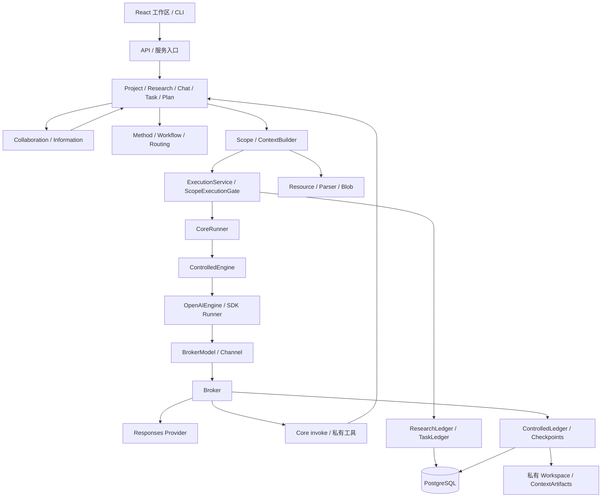
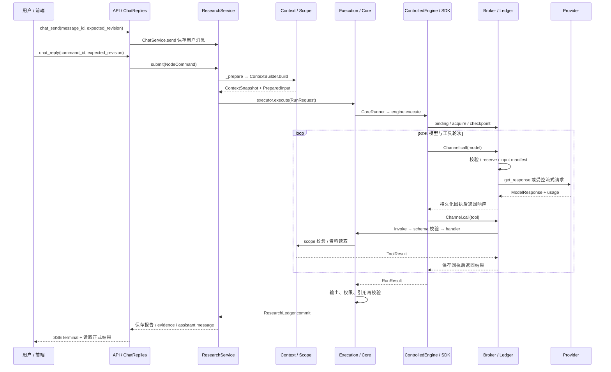
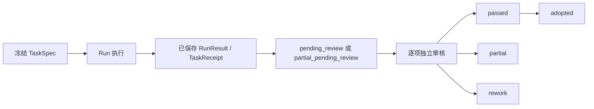

# Research Agent Core 项目系统 Wiki

> 基于 2026-10-12 当前工作区源码。本文以产品实际装配路径为准，结合函数实现解释设计。当前仓库尚无可解析的 HEAD 提交，因此不能绑定 Git commit；配套 `source-manifest.json` 记录本次分析涉及源码的 SHA-256，便于识别后续漂移。未读取密钥、未执行真实模型或修改业务数据。文中的“设计原因”由代码约束和测试推导，除明确引用注释外，不声称是作者原始设计记录。

## 阅读导航

1. [系统清单与分层](#1-系统清单与分层)
2. [项目对象与关键身份](#2-项目对象与关键身份)
3. [一次完整请求的总链路](#3-一次完整请求的总链路)
4. [入口、前端与流式回复](#4-入口前端与流式回复系统)
5. [研究与分支会话](#5-研究与分支会话系统)
6. [Harness 与受控执行](#6-harness-与受控执行系统)
7. [Agent Runtime](#7-agent-runtime-系统)
8. [工具调用与按需加载](#8-工具调用与按需加载系统)
9. [资料、解析与联网检索](#9-资料解析与联网检索系统)
10. [授权与 Scope](#10-授权与-scope-系统)
11. [上下文管理](#11-上下文管理系统)
12. [记忆](#12-记忆系统)
13. [专家任务与交付](#13-专家任务与交付系统)
14. [多智能体协作](#14-多智能体协作系统)
15. [补充信息与专家讨论](#15-补充信息与专家讨论系统)
16. [计划与 DAG 调度](#16-计划与-dag-调度系统)
17. [Skill、Method 与 Workflow](#17-skillmethod-与-workflow-系统)
18. [专家及模型路由](#18-专家及模型路由系统)
19. [证据、引用与语义复核](#19-证据引用与语义复核系统)
20. [持久化、事务与恢复](#20-持久化事务与恢复系统)
21. [受控编码](#21-受控编码系统)
22. [评测、反馈与方法进化](#22-评测反馈与方法进化系统)
23. [可观测性与排查](#23-可观测性与排查)
24. [场景串联、边界与源码阅读顺序](#24-场景串联边界与源码阅读顺序)

## 1. 系统清单与分层

这是一个本地研究工作区：用户拥有项目与主研究，可以上传资料、在主线或分支聊天、委派专家、确认研究计划、查看证据以及审核交付。它包含编码专家，但不是一个向模型开放任意终端的通用 coding agent。

源码实际支持以下系统。这里按职责划分，目录只是定位依据；例如 Harness 横跨多个目录，记忆也不只有 `memories/`。

| 系统 | 主要目录/文件 | 负责的问题 | 调用下游 |
|---|---|---|---|
| 入口与工作区 | `frontend/src/workspace/`、`app/api.py`、各 CLI | 接收用户操作、展示状态与交付 | Project/Research/Task/Plan 等服务 |
| 项目与研究会话 | `projects/`、`research/service.py`、`research/chat.py` | 项目、研究节点、分支、消息和结论转交 | Context、Execution、Collaboration |
| Harness | `controlled/`、`context/execution.py`、`execution/` | 准入、权限、预算、可恢复操作、交付边界 | CoreRunner、SDK、账本 |
| Agent runtime | `core.py`、`contracts.py`、`adapters/openai.py` | 一次 agent run 和模型/工具交替运行 | EnginePort、SDK Runner |
| 工具调用与加载 | `tool_routing.py`、各 `tools.py`/bindings | 类型化工具、身份绑定、按组暴露 | 业务服务及 Broker |
| 资料及解析 | `resources/`、`adapters/parsing/`、`evidence/search.py` | 原文、资料版本、OCR、联网发现与正文 | Scope、BlobStore、Parser |
| 授权 | `context/scopes.py`、`context/execution.py` | 谁能读取哪个固定版本、权限撤销 | Resource、执行/提交校验 |
| 上下文 | `context/builder.py`、`projection.py`、`artifacts.py`、`controlled/model_projection.py` | 组装、外置、分页、模型窗口预算 | Scope、Compactor、Broker |
| 记忆 | `memories/`、`context/compaction.py`、`controlled/workspace.py` | 长期偏好/经验、运行摘要、私有笔记 | Task、Context、Ledger |
| 专家任务与交付 | `tasks/` | 冻结任务、执行、收据、审核与采用 | Method、Runtime、Evidence |
| 多智能体协作 | `collaboration/` | 异步委派、会话、消息、依赖、修订与取消 | Task、Project、Durable |
| 补充信息与讨论 | `collaboration/information.py`、`projects/service.py` | 专家缺信息时求助、围绕既有材料讨论 | 独立受限 run、History |
| 计划与调度 | `research/plan_service.py`、`planning.py`、`plans.py`、`orchestration/` | 先提案后确认、DAG 波次执行 | Research、Dispatcher、Durable |
| Skill/方法资产 | `methods/` | 可复用职责指令、工作流模板、路由资产 | Task、Plan、Routing |
| 路由 | `routing/`、`adapters/routellm.py` | 能力过滤和模型选择 | Method、Task、RouteLLM |
| 证据 | `evidence/` | 声明、原文引文、定位和人工支持性判断 | Scope、Resource、业务提交 |
| 持久化与恢复 | `execution/`、`adapters/postgres/`、`durable.py`、`controlled/checkpoints.py` | 事务、独占、SDK checkpoint、工作流恢复 | PostgreSQL、私有工件、DBOS |
| 编码 | `coding/` | 指定路径编辑、可信测试、冻结代码候选 | Git worktree、受控工具 |
| 评测与进化 | `evaluation/`、`evolution/`、`evals/` | 反馈归因、冻结案例、A/B、候选方法发布 | Task、Method、受控执行 |

### 1.1 装配入口是理解架构的起点

[composition.py · build_live_services](</Users/chenyouran/Documents/ChatGPT/New project 2/src/agent_core/composition.py:215>) 使用 `LiveModelProvider`，再调用 [composition.py · build_controlled_services](</Users/chenyouran/Documents/ChatGPT/New project 2/src/agent_core/composition.py:201>)。后者构建 Research、Task、Project/Collaboration，让 Research 与 Task 共用同一个 `ControlledEngine`。资料侧由 [composition.py · build_resources](</Users/chenyouran/Documents/ChatGPT/New project 2/src/agent_core/composition.py:1>) 构建 `ScopeService(ResourceService(...))`。

这张图有一个看似绕行但关键的路径：`ControlledEngine → SDK → BrokerModel → Broker → 真实 provider`。SDK 拥有模型与工具循环；Broker 控制实际外部调用。二者职责不同，项目没有另写一个完整模型循环取代 SDK。

### 1.2 主线、辅助设施与历史代码

`src/agent_core/` 是产品源码；`frontend/` 是界面；`tests/` 是契约和回归证据；`evals/` 是评测入口；`scripts/` 是辅助验证。`research-bases-2026-09-15/` 和 `architecture-analysis/` 是研究参考材料，不能把其中第三方项目的能力当作本产品能力。大量阶段文档同样不能替代当前函数实现。

MemoryDatabase、ScriptedEngine 等仍用于测试与底层验证；真实产品链路要求 PostgreSQL。底层 `conversation.py`、`CoreRunner.delegate` 等机制仍存在，但现行多智能体产品链路以 CollaborationService 与 TaskService 为主。旧 CLI 执行协议已经在产品入口收敛，不应从旧文档推断现行启动方式。

## 2. 项目对象与关键身份

| 对象 | 含义 | 为什么需要独立身份 |
|---|---|---|
| Project | UI 中的项目、文件夹、摆放关系 | 组织多个主研究，避免 UI 布局影响执行 |
| Research | 一个主研究及其根资料授权 | 隔离资料、结果和专家会话 |
| ResearchNode | 主线、分支或批准计划的一步 | 单独目标、指令、scope、结果版本 |
| ChatThread / ChatMessage | 节点对话与消息 | 消息保存和模型执行可以分开确认 |
| NodeCommand | 一次可重复投递的业务操作 | `command_id` 幂等，revision 防并发覆盖 |
| TaskSpec | 某专家任务的不可变版本 | 固定目标、输入、方法、模型、验收和预算 |
| NodeRun / TaskRun | 一次准入后运行的业务绑定 | 同一任务与一次真实执行不是同一个对象 |
| RunRequest / RunResult | Runtime 的输入/输出契约 | 核心执行层无需理解研究业务 |
| AgentSpec | 本次 agent 指令、工具、输出类型、模型 | 描述执行能力，不保存任务结果 |
| ResourceRef | `resource_id + snapshot_id + parse_id` | 同名资料也可能有不同原文与解析版本 |
| ContextSnapshot | 固定 scope 和组装后的输入 | 恢复时不能重新拼出一份不同输入 |
| ResultMount | 已保存结果及其资料依赖的只读挂载 | 使用结果同时承接其来源与缺项 |
| ExpertSession / ContextPacket / DispatchIntent | 专家身份连续性、固定交接、异步执行意图 | 会话持续存在，任务交接和执行状态独立 |
| TaskReceipt | 程序检查、语义复核、采用状态和产物 | 成功生成不等于成功交付 |
| operation_id / checkpoint / artifact_id | 操作回执、SDK 状态、固定内容工件 | 重启可查证，不依赖当前内存 |

基础值对象 [contracts.py · Value](</Users/chenyouran/Documents/ChatGPT/New project 2/src/agent_core/contracts.py:11>) 设置 `frozen=True, extra="forbid"`。更新通常通过 `model_copy` 创建新值，再以 expected version/revision 写入。它提供清晰的版本语义，但不要把 Pydantic 的 frozen 解释为所有嵌套字典都获得了不可变硬隔离。

## 3. 一次完整请求的总链路

以下以“在主聊天输入问题，读取资料并给出带证据的回答”为例。

顺序上不能跳过四件事：先保存业务请求身份；再冻结输入与权限；实际调用前计入预算并记录；最后经过事务提交才成为正式结果。模型输出一段文字只是其中一个中间步骤。

**为什么不是直接 `Runner.run(prompt)`？** 产品还需要解释“这次用了什么资料版本、为什么能读、谁派的专家、任务后来是否被改过、强杀前工具到底是否完成、结果是否保存”。这些问题由 Harness 与业务系统负责，SDK Runner 本身不能替代这些业务约束。

## 4. 入口、前端与流式回复系统

### 4.1 做什么

界面用同源 `/api/{action}` 调用后端。[app/api.py · create_app](</Users/chenyouran/Documents/ChatGPT/New project 2/src/agent_core/app/api.py:37>) 创建 Starlette app、业务 endpoints 和后台恢复 worker。[research_cli.py · setup](</Users/chenyouran/Documents/ChatGPT/New project 2/src/agent_core/research_cli.py:13>) 是 CLI 装配起点；具体产品启动命令以根 README 为准。前端 `api.js` 集中处理 GET/POST 和 403/409 等错误。

### 4.2 完整聊天链路

1. `useChatReply.send` 生成 `message_id` 与 `command_id`，把草稿和待处理操作存入 localStorage。
2. `saveMessage` 调 `chat_send`，[research/chat.py · ChatService.send](</Users/chenyouran/Documents/ChatGPT/New project 2/src/agent_core/research/chat.py:76>) 以 message ID 幂等保存用户消息。返回的新 chat revision 用于启动回复。
3. `startReply` 调 `chat_reply`。[app/replies.py · ChatReplies.start](</Users/chenyouran/Documents/ChatGPT/New project 2/src/agent_core/app/replies.py:52>) 串行准入；重复 command 返回既有记录，不重新推导 revision。
4. [app/replies.py · ChatReplies._start](</Users/chenyouran/Documents/ChatGPT/New project 2/src/agent_core/app/replies.py:56>) 生成 `NodeCommand(kind='chat_reply')`，设置本次聊天 `900 秒 / 12 model turns / 12 tool calls` 上限，创建异步任务执行 ResearchService.submit。
5. 前端打开 EventSource。[app/replies.py · ChatReplies.stream](</Users/chenyouran/Documents/ChatGPT/New project 2/src/agent_core/app/replies.py:93>) 发当前累计正文、phase 和账本状态；这是一份最新预览快照，并非把供应商所有原始事件直传给浏览器。
6. 真实模型流在 `controlled/streaming.py` 中转成报告正文预览；摘要调用不进入聊天预览。成功终态后前端清除 pending，重新读取已保存 ChatThread。
7. 页面刷新沿用 localStorage 中的 command，先查询已保存消息和 projection，再重连 SSE。已确认失败后手动重试才用新 command；保存失败需要恢复保存，不能自动重跑模型。

**与其他系统配合：** API 不决定证据真实性或模型预算，分别交给 Evidence 和 ControlledLedger；前端不作为最终状态权威，终态来自后端业务记录。

**失败边界：** SSE 的 Preview 存在内存中，进程重启后不能恢复半段正文。没有 live worker 时 stream 返回 interrupted，避免永久等待。模型推理和工具参数不显示在正文预览；正常预览结束也不自动审核专家交付。

**设计原因：** 把“消息是否保存”和“回复是否执行”分成两个幂等步骤，才能在网络结果未知时避免重复消息与重复收费。API 的同源 POST 检查属于本地服务防护，不能据此声称有完整的公网身份认证体系。

**源码定位：** [frontend/src/workspace/useChatReply.js](</Users/chenyouran/Documents/ChatGPT/New project 2/frontend/src/workspace/useChatReply.js:1>)、[frontend/src/workspace/api.js](</Users/chenyouran/Documents/ChatGPT/New project 2/frontend/src/workspace/api.js:1>)、[app/api.py · create_app](</Users/chenyouran/Documents/ChatGPT/New project 2/src/agent_core/app/api.py:37>)、[app/replies.py · ChatReplies.record](</Users/chenyouran/Documents/ChatGPT/New project 2/src/agent_core/app/replies.py:33>)、[controlled/streaming.py](</Users/chenyouran/Documents/ChatGPT/New project 2/src/agent_core/controlled/streaming.py:1>)。相关契约在 [tests/test_chat_streaming.py](</Users/chenyouran/Documents/ChatGPT/New project 2/tests/test_chat_streaming.py:1>) 与 [tests/test_workspace_api.py](</Users/chenyouran/Documents/ChatGPT/New project 2/tests/test_workspace_api.py:1>)。

## 5. 研究与分支会话系统

### 5.1 做什么

ResearchService 管节点命令、输入、运行绑定与结果版本；ChatService 管可见消息与固定分叉；ProjectService 管项目结构和专家会话展示。一个 node 既可以是图上的研究节点，也可拥有聊天线程。布局位置变化与目标/资料版本变化具有不同执行语义。

### 5.1.1 项目创建与导航的完整链路

`project_list/create → ProjectService.create → project_main_task → create_main_task → ResearchService.create → ChatService.start → 保存 MainTask 成员关系 → project_contents → contents`。

ProjectService.create 对重复 ID 校验 owner/name；create_main_task 先创建 Research 与主 ChatThread，再保存 project membership。这个组合不是单个跨所有步骤的大事务，各步骤依靠固定 identity/已有对象复用支持重投。主研究有自己的资料根 scope；一个 Project 可组织多个 Research，不能仅因为同属项目就相互读所有资料。

`project_folder → create_folder/update_folder → 检查同层命名、parent project 与循环 → 版本化保存 Folder`；`project_arrange → arrange → 检查对象归属与 folder → 保存 Placement`。目录和 placement 是展示导航关系，研究节点的 display_parent、DAG depends_on 和任务 parent_task_id 则是另外三种关系，不能从文件夹位置推断执行依赖。

### 5.2 完整节点执行链路

`NodeCommand → ResearchService._accept → submit → _prepare → execution_factory → executor.execute → ResearchLedger.commit → NodeResultVersion`。

- [research/service.py · ResearchService._accept](</Users/chenyouran/Documents/ChatGPT/New project 2/src/agent_core/research/service.py:115>) 记录命令身份，校验复投与 revision。
- [research/service.py · ResearchService.submit](</Users/chenyouran/Documents/ChatGPT/New project 2/src/agent_core/research/service.py:141>) 把 create/branch/select/exclude/move/mount 类命令交 `_mutate`；需要计算的命令在节点锁下执行。
- [research/service.py · ResearchService._prepare](</Users/chenyouran/Documents/ChatGPT/New project 2/src/agent_core/research/service.py:204>) 读取当前 node、获准 chat、资料与上游结果；chat_reply 固定 chat_revision，选出需通知的专家结果；retry 使用旧运行的固定输入，不重新授权已撤销来源。
- `_configure_scope` 形成节点可用资料集合；ContextBuilder 冻结输入；保存 NodeRun 并标记 node.active_run_id。
- [app/research_execution.py · build_execution](</Users/chenyouran/Documents/ChatGPT/New project 2/src/agent_core/app/research_execution.py:16>) 按节点入口组装 AgentSpec、工具、ScopeExecutionGate 和提交校验。
- [app/commits.py · ResearchLedger.commit](</Users/chenyouran/Documents/ChatGPT/New project 2/src/agent_core/app/commits.py:11>) 在同一业务事务内写 Run、研究结果版本、Evidence；聊天回复还写 assistant message、推进 chat revision，并消费本轮已送达通知。

### 5.3 完整分支与结论转交链路

`chat_branch → ChatService.branch → 确定 fork_message_id → 复制截至该消息的 inherited → 创建新节点/线程`。分支得到固定历史前缀。主线之后的新消息不会自动并入分支，UI 可报告 upstream_updated。

`chat_transfer → ChatService.transfer → 校验源结论和目标 revisions → 选择目标资料 → 保存 transfer 消息与 ChatTransfer → chat_adopt`。转交仅适用于同一研究中的不同分支，源消息须是已完成 assistant/expert 结论，附带资料、结果和局限。这里的 adopt 是 ChatTransfer 状态，与 TaskReceipt 的专家结果采用是两个对象。

### 5.4 为什么这样设计

节点树的展示关系、对话继承和结果依赖分别管理，避免拖动画布就改变研究语义。固定分叉让“当时依据什么得出结论”可复现；显式转交让跨分支信息流可审计。修改目标、挂载或排除可以使旧运行失去发布资格，单纯 move 不使其失效。

**源码定位：** [research/service.py · ResearchService._mutate](</Users/chenyouran/Documents/ChatGPT/New project 2/src/agent_core/research/service.py:181>)、[research/service.py · ResearchService.validate_binding](</Users/chenyouran/Documents/ChatGPT/New project 2/src/agent_core/research/service.py:347>)、[research/service.py · ResearchService.validate_commit](</Users/chenyouran/Documents/ChatGPT/New project 2/src/agent_core/research/service.py:368>)、[research/chat.py · ChatService.branch](</Users/chenyouran/Documents/ChatGPT/New project 2/src/agent_core/research/chat.py:95>)、[research/chat.py · ChatService.transfer](</Users/chenyouran/Documents/ChatGPT/New project 2/src/agent_core/research/chat.py:146>)、[research/chat.py · ChatService.adopt](</Users/chenyouran/Documents/ChatGPT/New project 2/src/agent_core/research/chat.py:180>)、[projects/service.py · ProjectService.contents](</Users/chenyouran/Documents/ChatGPT/New project 2/src/agent_core/projects/service.py:63>)。验证见 [tests/test_research.py](</Users/chenyouran/Documents/ChatGPT/New project 2/tests/test_research.py:1>)、[tests/test_chat.py](</Users/chenyouran/Documents/ChatGPT/New project 2/tests/test_chat.py:1>)、[tests/test_projects.py](</Users/chenyouran/Documents/ChatGPT/New project 2/tests/test_projects.py:1>)。

## 6. Harness 与受控执行系统

### 6.1 本项目中 Harness 的确切含义

没有单独的 `Harness` 类。Harness 是包住运行时的一组机制：业务准入、固定身份、权限检查、模型/工具代理、预算、私有工件、checkpoint、输出校验与提交。它控制“允许执行什么以及什么算完成”，Agent Runtime 决定“在已允许的能力里下一步调用什么”。

### 6.2 一次完整受控执行

1. 上层已保存 TaskRun 或 NodeRun、ContextSnapshot。辅助 planning/consultation/discussion/preview 用 [controlled/admission.py · admit](</Users/chenyouran/Documents/ChatGPT/New project 2/src/agent_core/controlled/admission.py:22>) 建立受信准入上下文，不能由模型自报身份。
2. [controlled/engine.py · ControlledEngine.binding](</Users/chenyouran/Documents/ChatGPT/New project 2/src/agent_core/controlled/engine.py:26>) 将 request 与快照、任务版本、权限版本、模型、limits 对比。产品 run 无合法服务端准入就拒绝。
3. [controlled/engine.py · ControlledEngine.execute](</Users/chenyouran/Documents/ChatGPT/New project 2/src/agent_core/controlled/engine.py:99>) 按 entrance 交叉过滤工具：manager/expert/planning/plan_step/consultation/discussion/preview 各自有固定允许集，coding 使用 CODING_TOOLS。
4. 形成 frozen binding，包括 request_hash、agent_hash、authorization_generation 和代码契约。workspace ID 由研究、session 和授权 generation 派生。
5. [controlled/ledger.py · ControlledLedger.acquire](</Users/chenyouran/Documents/ChatGPT/New project 2/src/agent_core/controlled/ledger.py:112>) 获取私有 workspace writer token 与 epoch，固定本次 run 的 deadline。已有同进程 writer 不能被第二个 engine 接管。
6. 建立 Workspace、ContextArtifacts、Broker、Checkpoints，启动 controlled.runner.run；运行过程中持续重验 binding。
7. Channel 只发送 `model/tool/private/result` 四类 Frame；Broker 验证顺序、身份和参数。实际执行前 reserve；完成后 settle/checkpoint。
8. 同一 SDK 循环内 ProgressPolicy 从 researching 进入 finalizing，禁用进一步调查工具，使用保留预算完成回答与有限纠错。
9. 结束时关闭 Workspace、释放 writer；成功返回前再验证权限。最终业务提交仍由外层 ExecutionService 完成。

### 6.2.1 同一引擎中的不同入口

| entrance | 业务来源 | 可用业务工具边界 |
|---|---|---|
| manager | 主研究/聊天的 NodeRun | 来源读取、按组加载、专家发现/派发、报告和管理工具 |
| expert | 冻结 TaskSpec/TaskRun | 来源读取、信息求助、获准协作者；coding 改用专属编码工具 |
| plan_step | 已批准提案创建的 NodeRun | 来源读取/搜索/抓取，不再派发扩展计划 |
| planning | PlanProposal 的 auxiliary admission | 只读已有 source，不联网 |
| consultation | 信息补充或方法生成的 auxiliary admission | 仅 read_information；具体 AgentSpec 还可更窄/无工具 |
| discussion | 专家讨论的 auxiliary admission | 无业务调查工具 |
| preview | 方法 A/B 的 auxiliary admission | 只读已有 source |

这些是业务工具集合，私有笔记与 context 分页由引擎另外装配并受 max_calls/入口限制。辅助准入只在可信服务代码建立，模型无法指定 entrance 获得新权限。

### 6.3 Broker 实际控制什么

[controlled/broker.py · Broker.handle](</Users/chenyouran/Documents/ChatGPT/New project 2/src/agent_core/controlled/broker.py:57>) 对 model 输入限制文本和本地 function 项；禁用 hosted operations、remote media、SDK handoffs 与远端 conversation。它重建批准的 FunctionTool schema，但 provider 侧工具 handler 是 forbidden：供应商返回 tool call 后仍由 SDK 经受控 Channel 执行，不直接调用真实 handler。

Broker 对 task 和 summary 都计入模型预算。工具包括私有分页、笔记操作也计入 tool budget。取消、权限变更、deadline、窗口与总 plan token 预算在实际调用前检查。重复无新增信息的工具结果会触发调查收尾策略。

### 6.3.1 预算层级

| 层级 | 当前约束与作用 | 恢复后是否重置 |
|---|---|---|
| RunLimits | 默认 8 模型轮、8 工具、60 秒、max_depth=1；入口可冻结其他值 | 不重置受控账本计数/deadline |
| 聊天入口 | 12 模型轮、12 工具、900 秒 | SSE 重连不创建新 run |
| 总管委派专家 | 常规交接 20 模型轮、24 工具、360 秒 | 同一 spec/run 保持冻结 |
| 信息咨询 | 4 模型轮、3 工具、45 秒 | 有自己的受控操作回执 |
| 协作主研究 | 最多 8 任务、depth 2、80 预留模型轮、300,000 已记录 tokens | 以持久化任务/用量检查；不是硬供应商花费限额 |
| 调度/计划 | max_concurrency/max_runs/整体 timeout/可选 max_total_tokens | 固定 proposal/workflow 身份 |
| 模型输入 | 65,536 窗口策略、8,192 输出与4,096余量 | 保存输入/settings，可使用持久化实测基线 |
| 收尾预留 | 至少保留模型轮；时间按半个总 deadline 与已观测模型耗时调整，最多预留 75% | ProgressPolicy 使用原 deadline 与已保存观测 |

模型摘要也花模型轮和 tokens；私有工具也花工具次数；格式修复共享剩余轮次。不同层预算不能互相替代：路由美元预估不是窗口预算，调度并发上限不是委派深度，UI 超时不是唯一的执行 deadline。

### 6.4 设计原因和边界

这种“SDK 运行循环 + 受控代理”沿用了成熟库的工具协议与 RunState，又把产品级限制放在可信边界上。系统不靠 prompt 要求模型自律来保证权限；prompt 描述流程，Broker/Scope/账本负责执行约束。

它是同进程逻辑受控机制，Frame 编解码并不代表进程隔离；Workspace 是逻辑私有目录，不是 Docker/OS 沙箱；deadline 和 call budget 也不是硬 CPU/GPU/内存配额。把这些区别说清才能正确理解其可靠性范围。

**源码定位：** [controlled/protocol.py · Frame](</Users/chenyouran/Documents/ChatGPT/New project 2/src/agent_core/controlled/protocol.py:10>)、[controlled/runner.py · Channel.call](</Users/chenyouran/Documents/ChatGPT/New project 2/src/agent_core/controlled/runner.py:19>)、[controlled/broker.py · Broker.handle](</Users/chenyouran/Documents/ChatGPT/New project 2/src/agent_core/controlled/broker.py:57>)、[controlled/progress.py · ProgressPolicy.prepare_model](</Users/chenyouran/Documents/ChatGPT/New project 2/src/agent_core/controlled/progress.py:26>)、[context/execution.py · ScopeExecutionGate.execute](</Users/chenyouran/Documents/ChatGPT/New project 2/src/agent_core/context/execution.py:21>)。验证见 [tests/test_controlled.py](</Users/chenyouran/Documents/ChatGPT/New project 2/tests/test_controlled.py:1>)、[tests/test_prompt_harness.py](</Users/chenyouran/Documents/ChatGPT/New project 2/tests/test_prompt_harness.py:1>)、[tests/test_controlled_external.py](</Users/chenyouran/Documents/ChatGPT/New project 2/tests/test_controlled_external.py:1>)。

## 7. Agent Runtime 系统

### 7.1 三个层次

- CoreRunner 是 SDK 无关的执行契约与工具调用守卫。
- ControlledEngine 实现 EnginePort，加入 Harness。
- OpenAIEngine 是 SDK 适配器，建立 Agent 并驱动 Runner.run；真实 SDK Model 注入的是 BrokerModel。

`AgentSpec` 是指令与能力配置；`RunRequest` 是本次固定输入、运行身份和 limits；`RunResult` 是成功/失败/取消以及 output、usage、修复记录。业务系统在上层把 TaskSpec 或 ResearchNode 转换成这组契约。

### 7.2 完整 runtime 链路

[core.py · CoreRunner.execute](</Users/chenyouran/Documents/ChatGPT/New project 2/src/agent_core/core.py:45>) 发 run.started 事件，检查 depth 并查 AgentCatalog。它构建 invoke 闭包，校验 tool name、call_id、max_calls、Pydantic 参数与 ToolResult 类型；随后在超时上下文中调用 engine.execute。

[adapters/openai.py · OpenAIEngine.execute](</Users/chenyouran/Documents/ChatGPT/New project 2/src/agent_core/adapters/openai.py:22>) 将每个 ToolBinding 包为 SDK FunctionTool，按 ToolRouter 当前 profile 决定可见性，构建 SDK Agent，设 `parallel_tool_calls=False`。`Runner.run` 接收本地 history，不使用远端 session。输入 filter 在每轮实际模型调用前执行上下文投影。

SDK 产出工具调用 → FunctionTool 的 call → controlled invoke → Broker → Core invoke → handler → ToolResult → SDK 继续模型轮次。SDK 负责判断最终输出，项目再验证 output schema 与可选 validate_output。

### 7.3 输出纠错与中断

结构化输出使用 RepairableOutputSchema。JSON/schema 或引用校验发现可纠正问题时，将草稿、问题及原会话保留，关闭工具，只允许格式/引文修复。记录达到三次或无剩余轮次时失败，不能无限修复或开展新调查。

启用 Checkpoints 时 FunctionTool 设置 needs_approval，SDK 在待执行工具点形成 interruption；适配器先发布 RunState，再在受控循环内批准已有 interruption。**这里的 SDK approval 是为了保存可恢复边界，不是用户研究计划确认或专家语义审核。**

### 7.4 底层 delegate 与产品委派

CoreRunner 能向注册的 `AgentSpec.delegates` 递归执行独立子请求，检查 depth 并累计 child usage。当前受控产品工具交集没有通用 `delegate`；产品专家委派走 CollaborationService 的后台任务、固定交接和审核机制，不能把两条路径等同。SDK provider 的 handoffs 也明确禁用。

**为什么这样设计：** Core 只依赖自有 contracts/Pydantic，不知道 PostgreSQL、Research 或 SDK；SDK 行为集中在 adapter。[tests/test_architecture.py](</Users/chenyouran/Documents/ChatGPT/New project 2/tests/test_architecture.py:1>) 直接检查这些导入边界。协议、output 和恢复验证见 [tests/test_sdk_contract.py](</Users/chenyouran/Documents/ChatGPT/New project 2/tests/test_sdk_contract.py:1>)、[tests/test_checkpoint_sdk.py](</Users/chenyouran/Documents/ChatGPT/New project 2/tests/test_checkpoint_sdk.py:1>)、[tests/test_core.py](</Users/chenyouran/Documents/ChatGPT/New project 2/tests/test_core.py:1>)。

## 8. 工具调用与按需加载系统

### 8.1 一个工具由哪些部分组成

[contracts.py · ToolBinding](</Users/chenyouran/Documents/ChatGPT/New project 2/src/agent_core/contracts.py:93>) 包含 name、description、input_type、async handler。模型只看到 schema 与说明；handler 闭包绑定真实 run、scope、task/service，模型参数不拥有服务器身份选择权。

### 8.2 一次完整工具请求

`SDK FunctionTool → runner.invoke → Channel.call(tool, call_id) → Checkpoints.operation → Broker.handle → ledger.reserve → CoreRunner.invoke → input_type.validate → handler → 业务授权校验 → ToolResult → 工件/回执落盘 → settle → SDK`。

这里有两层去重：Core 的 completed 处理同进程相同 call_id，并拒绝同 ID 不同 name/arguments；Checkpoints 用稳定 operation ID 与 request hash 在重启后复用已确认响应。Core 计数是局部守卫，跨重启的工具计数以 PostgreSQL Broker budget 为准。

参数错误返回 `invalid_input/executed=False/issues/remaining_tool_calls`，允许用新 call ID 修正；错误尝试仍消耗预算。未知工具、越权或 handler 的不可恢复异常会中止 run，不能绕过批准集合。

### 8.3 主助手的按需工具加载

[app/manager_profiles.py](</Users/chenyouran/Documents/ChatGPT/New project 2/src/agent_core/app/manager_profiles.py:1>) 定义四组：sources、experts、manage、reports。初始主要暴露 select_task_tools、get_task_status、read_context_page。模型调用 select_task_tools 后，[tool_routing.py · ToolRouter.observe](</Users/chenyouran/Documents/ChatGPT/New project 2/src/agent_core/tool_routing.py:12>) 更新 profile，下一轮 FunctionTool.is_enabled 与输入 filter 才暴露该组的 schema 与职责指令；profile 存入 SDK checkpoint。

这不是关键词分类器，也不额外调用一个模型选工具。工具“已加载”仍受 frozen capabilities 和 scope 限制；profile 本身不新增权限。

### 8.4 目录、搜索、正文与状态分开

- search_context：按字面词搜索一种获准元数据，非语义向量检索、非全文检索。
- list_context：显式分页目录。
- read_context：按指定消息、ref、result ID 读正文，空选择返回可纠正 invalid_input。
- search_source：一个固定资料版本内定位片段。
- read_source：读片段或连续页；大的结果附 next_cursor。
- get_task_status：只查持久化状态，不运行专家、不读取全部报告。

初始主聊天资料目录最多八项、默认目录分页八项、正文选择最多五项等限制，目的是给模型一个可控发现面。最新工具输出在下一模型轮次保留真实内容，不能只回同一 artifact ID 形成空转。

**与其他系统配合：** 协作工具创建业务意图，源码读取工具执行 Scope 授权，分页工具回取 ContextArtifacts，编码工具只能选择固定 profile。模型无法通过工具路由切换到任意 shell。

**验证：** [tests/test_manager_routing.py](</Users/chenyouran/Documents/ChatGPT/New project 2/tests/test_manager_routing.py:1>)、[tests/test_context_projection.py](</Users/chenyouran/Documents/ChatGPT/New project 2/tests/test_context_projection.py:1>)、[tests/test_controlled.py](</Users/chenyouran/Documents/ChatGPT/New project 2/tests/test_controlled.py:1>)；详细现行边界另见 [docs/tool-routing-context.md](</Users/chenyouran/Documents/ChatGPT/New project 2/docs/tool-routing-context.md:1>)。

## 9. 资料、解析与联网检索系统

### 9.1 原文、解析与授权为何分开

Resource 是资料身份；SourceSnapshot 指向内容哈希、media type 和依赖；ParseResult 是一次固定解析版本；ResourceIngestion 记录本次导入/抓取的 scope、run、URL、时间和查询。BlobStore 保存原始字节。ResourceRef 同时绑定 resource/snapshot/parse 三个 ID。

相同文件可以复用 blob 和解析缓存，但每次导入仍有自己的访问关系，不能因为内容一样就让另一研究获得权限。引用绑定 parse_id，避免原文没变而解析器更新后位置变化。

### 9.2 完整上传链路

`API upload → ScopeService.ingest → ResourceService.ingest → FileBlobStore.put → 创建 resource/snapshot/ingestion/parse → Parser.parse → save_parse → 返回 ResourceRef → scope grants/allowed 更新`。

[resources/service.py · ResourceService.ingest](</Users/chenyouran/Documents/ChatGPT/New project 2/src/agent_core/resources/service.py:12>) 先登记 pending parse，再报告 processing；缓存 key 包含 parser key 与 media type。可读片段且有 issues 是 partial，只有片段是 ready，无可读内容是 failed。上传失败的解析状态仍留存，不能把解析失败当空资料悄悄继续。

[adapters/parsing/__init__.py · DocumentParser](</Users/chenyouran/Documents/ChatGPT/New project 2/src/agent_core/adapters/parsing/__init__.py:16>) 使用 Docling native 解析，文本 path 用 TextParser，扫描图像/PDF 使用 Tesseract OCR，PDF 渲染用 pypdfium2。原生 PDF 片段保留 page/bbox，OCR 至少保留 page，表格转换成可读 Markdown。每页异常进入 ParseIssue，其他页可继续形成 partial。默认最多 300 页，OCR 每次有超时。parser key 包含依赖版本、Tesseract 版本、语言与训练数据 hash。

### 9.3 完整联网研究链路

1. `search_web → source_bindings → SearchService.discover → TinyFishSearchProvider.search`。
2. 每条搜索命中导入为 `kind='discovery'`，保存摘要和 URL，返回 discovery ref。它只证明发现了候选网页。
3. `fetch_web(discovery_ref, query) → SearchService.fetch` 检查这个 ref 属于当前研究、类型是 discovery，读取已登记 URL，再获取正文。
4. 正文作为新的 `kind='web'` 资料进入 ResourceService/Parser，得到新的 **body ref**，与 discovery ref 不同。
5. web_bindings 将正文获取到当前活跃 run 的 scope；有聚焦 query 时立即通过 search_source 返回相关片段，减少先抓全文再重复定位的工具轮次。
6. `search_source/read_source → report claims → EvidenceService.prepare`，只用保存的正文和固定定位作为证据。

TinyFish adapter 做 URL 与抓取来源检查，arXiv 辅助函数识别全文入口。SearchService.fetch 最终要求 provider 给出的 actual_url 与获准 discovery URL 一致；不能把任意跳转结果直接当同一个证据来源。

### 9.4 与其他系统配合及边界

资料服务不知道 SDK；Scope 承担授权；Context 决定哪些目录和正文进入输入；Evidence 保证引用能定位到保存的解析结果。`search_source` 是局部词频与短语匹配排序，最多四条短摘录，不是 embedding/RAG 向量库。未抓取全文的摘要不能冒充全文证据；全文保存也不代表模型实际完整阅读。

**源码定位：** [resources/service.py · ResourceService.describe](</Users/chenyouran/Documents/ChatGPT/New project 2/src/agent_core/resources/service.py:57>)、[resources/service.py · ResourceService.read](</Users/chenyouran/Documents/ChatGPT/New project 2/src/agent_core/resources/service.py:65>)、[adapters/filesystem/__init__.py](</Users/chenyouran/Documents/ChatGPT/New project 2/src/agent_core/adapters/filesystem/__init__.py:1>)、[adapters/parsing/__init__.py · DocumentParser.parse](</Users/chenyouran/Documents/ChatGPT/New project 2/src/agent_core/adapters/parsing/__init__.py:56>)、[evidence/search.py · SearchService.discover](</Users/chenyouran/Documents/ChatGPT/New project 2/src/agent_core/evidence/search.py:159>)、[evidence/search.py · SearchService.fetch](</Users/chenyouran/Documents/ChatGPT/New project 2/src/agent_core/evidence/search.py:175>)、[app/research_web.py · source_bindings](</Users/chenyouran/Documents/ChatGPT/New project 2/src/agent_core/app/research_web.py:42>)、[context/tool_guard.py · ScopedTool.search_binding](</Users/chenyouran/Documents/ChatGPT/New project 2/src/agent_core/context/tool_guard.py:59>)。验证见 [tests/test_resources.py](</Users/chenyouran/Documents/ChatGPT/New project 2/tests/test_resources.py:1>)、[tests/test_research_web.py](</Users/chenyouran/Documents/ChatGPT/New project 2/tests/test_research_web.py:1>)、[tests/test_expert_web_capabilities.py](</Users/chenyouran/Documents/ChatGPT/New project 2/tests/test_expert_web_capabilities.py:1>)。

## 10. 授权与 Scope 系统

### 10.1 Scope 的模型

[context/scopes.py · RunScope](</Users/chenyouran/Documents/ChatGPT/New project 2/src/agent_core/context/scopes.py:14>) 保存 owner、version、grants、allowed、inherited、tools、web_urls、input/tool 大小约束和 enabled。

- grants：持有该固定资料版本的访问关系。
- allowed/inherited：本次选择的资料和继承资料；“获授权”与“本次挂载”并不相同。
- version：可撤销授权 generation 的基础。
- dependencies：派生摘要/结果不能绕过其原始资料的权限检查。

### 10.2 完整授权读取链路

`创建空 scope → 从合法源 scope grant(ref) → select(refs) → mount → tool require → check → ResourceService.describe/read → 读取后 valid → 提交前 validate_commit`。

[context/scopes.py · ScopeService.create](</Users/chenyouran/Documents/ChatGPT/New project 2/src/agent_core/context/scopes.py:44>) 强制新 scope 无资源授权。grant 要求来源有权读，owner 相同；select 不得扩展 web authorization，并检查依赖闭包。[context/scopes.py · ScopeService.check](</Users/chenyouran/Documents/ChatGPT/New project 2/src/agent_core/context/scopes.py:64>) 检查当前版本、grants、selected、resource owner 和依赖，检测循环。

[context/execution.py · ScopeExecutionGate.execute](</Users/chenyouran/Documents/ChatGPT/New project 2/src/agent_core/context/execution.py:21>) 将 request.input 与持久化 ContextSnapshot 核对，在 track/running 上下文内执行；工具闭包取得当前 run 身份。撤销/修改 scope 通过 `_replace` 产生新版本并取消受影响活跃任务。即使任务吞掉 cancellation，提交前校验也不能让旧权限结果进入有效发布。

### 10.3 为什么有不递增 version 的 acquire

活跃 run 新抓网页或显式读取根资料库时，[context/scopes.py · ScopeService.acquire](</Users/chenyouran/Documents/ChatGPT/New project 2/src/agent_core/context/scopes.py:114>)、[context/scopes.py · ScopeService.acquire_library](</Users/chenyouran/Documents/ChatGPT/New project 2/src/agent_core/context/scopes.py:129>) 在严格核对 run/source/owner 后扩大该 run 可读集合，`invalidate=False`。这服务于“已批准研究中的实际资料获取”，避免每次获取正文都让自己失效；不是模型可以任意修改授权。

用户撤销、选择集合改变等语义变化会递增 version。ControlledEngine 的 workspace generation 与根 scope version 绑定，因此撤销后不能恢复旧私有上下文来重新发布。历史结果即使已存在，读取时也重新检查其来源是否仍可访问。

### 10.4 设计取舍

授权边界放在程序里且重复校验，避免模型生成 ref 或复用旧摘要绕过撤销。代价是派生结果依赖多份原文时，撤销其中一份可能使整个历史结果或会话不可读；这是保守来源追踪的实际结果，而不是“记录删除”。多租户、跨主机授权与公网登录并不由这个单 owner 本地 scope 模型完整提供。

**源码定位：** [context/scopes.py · ScopeService.valid](</Users/chenyouran/Documents/ChatGPT/New project 2/src/agent_core/context/scopes.py:57>)、[context/scopes.py · ScopeService._replace](</Users/chenyouran/Documents/ChatGPT/New project 2/src/agent_core/context/scopes.py:76>)、[context/scopes.py · ScopeService.select](</Users/chenyouran/Documents/ChatGPT/New project 2/src/agent_core/context/scopes.py:87>)、[context/execution.py · ScopeExecutionGate.validate_commit](</Users/chenyouran/Documents/ChatGPT/New project 2/src/agent_core/context/execution.py:46>)、[research/service.py · ResearchService.check_result](</Users/chenyouran/Documents/ChatGPT/New project 2/src/agent_core/research/service.py:56>)。验证见 [tests/test_resources.py](</Users/chenyouran/Documents/ChatGPT/New project 2/tests/test_resources.py:1>)、[tests/test_context_projection.py](</Users/chenyouran/Documents/ChatGPT/New project 2/tests/test_context_projection.py:1>)、[tests/test_controlled.py](</Users/chenyouran/Documents/ChatGPT/New project 2/tests/test_controlled.py:1>)。

## 11. 上下文管理系统

### 11.1 四份“上下文”不要混为一谈

| 层次 | 保存内容 | 谁负责 |
|---|---|---|
| 业务全量 | 原聊天、资料目录/片段、固定交接、上游报告、获准 memory | Research/Task/ContextBuilder |
| 准入输入 | PreparedInput 与 external_context、ContextSnapshot | ContextBuilder/project_payload |
| Runtime history | SDK 新产生的 reasoning/message/function call/output 与恢复状态 | SDK/OpenAIEngine/Checkpoints |
| 最终模型输入 | 实际启用工具、schema、instructions、投影 history、settings、wire body | ModelProjection/Broker/HTTP audit |

conversation_id 在 ContextBuilder 中只是关联字段，不会自动从某个远程 conversation 装载全部历史。业务系统显式选择 history 后传入。

### 11.2 初始输入完整链路

`服务 _prepare → ContextBuilder.build → scope/mount 校验 → 组织 payload → project_payload → ContextSnapshot → ControlledEngine 导入 external_context → 模型输入 filter`。

[context/builder.py · ContextBuilder.build](</Users/chenyouran/Documents/ChatGPT/New project 2/src/agent_core/context/builder.py:13>) 组装 goal、sources/content、history、handoff、results、approved_memory。evidence_mode 只给来源目录，要求工具读取定位原文；lazy_sources 用于主聊天，只给受限目录并按需发现。

[context/projection.py · project_payload](</Users/chenyouran/Documents/ChatGPT/New project 2/src/agent_core/context/projection.py:28>) 判断 UTF-8 序列化大小；字段名虽然是 max_input_chars，实现采用 byte 约束。小 payload 原样进入 user message；过大时完整 JSON 以 SHA-256 指向 external_context，并保留 goal 等关键字段与所有历史 user content，包括中途纠错。较旧可选历史/正文可外置，exclusions 明确记录。

若仅必需指令和用户约束就超过上限，则 ContextBudgetExceeded，不能默默删掉用户约束。大 payload 的原件后来被存入 Workspace 中 ContextArtifacts。

### 11.3 每轮模型输入完整链路

`SDK filter → Checkpoints.prepare → controlled.runner.prepare → ProgressPolicy → Compactor.prepare → ModelProjection → Broker 最终预算校验 → manifest → provider`。

[controlled/model_projection.py · ModelProjection.__call__](</Users/chenyouran/Documents/ChatGPT/New project 2/src/agent_core/controlled/model_projection.py:39>) 对真实启用工具、output schema、instructions 和 settings 一并预算。优先外置重复/较旧工具输出和 assistant 内容，保存原件与引用；保留完整工具调用与结果关系。最近工具输出至少保留真实分页文本，有压力时缩小页并提供 next_cursor，避免下一轮看不到刚取得的信息。

固定窗口参数目前是 65,536，输出保留 8,192，安全余量 4,096。它是项目策略常量，不是动态发现的供应商上下文窗口规格。[controlled/input_budget.py · estimate_input](</Users/chenyouran/Documents/ChatGPT/New project 2/src/agent_core/controlled/input_budget.py:17>) 无观测时用 UTF-8 保守上界；有本 run 已持久化的 provider input_tokens 时，以上一实测输入加新增/变化完整 item 的 byte 上界估计。删除旧内容不会从实测基线倒扣，所以估计保持保守。

Broker 对最终 public_input 再检查一次，还检查批准 Plan 的剩余总 token。收到供应商明确 context overflow 时最多进行一次更小的重投影，必须真的减少 input；不能不断发送同一超窗请求。

### 11.4 分页回读完整链路

`read_context_page(artifact_id, pointer, offset, limit) → ContextArtifacts.read → validate → hash/JSON pointer 校验 → page → read receipt → SDK`。

JSON pointer 如 `/results/0` 指向固定工件中的一个值，offset/limit 分页。工件 ID 不是 ResourceRef，也不是 source 的 checksum。`read_source` 的 next_cursor 应继续调 read_source；context 页应继续 read_context_page。两种定位不可混用。

[context/artifacts.py · ContextArtifacts.deliver](</Users/chenyouran/Documents/ChatGPT/New project 2/src/agent_core/context/artifacts.py:95>) 对大结果外置并提供首屏；`after_complete_read` 用于把“内容真正被完整交付”与业务阅读授权回调衔接。Ledger 保存 read 轨迹以追查模型实际获得的内容。

### 11.5 为什么这样设计

外置是无损内容管理，摘要是有损语义整理，二者分开。完整原件可追溯，模型输入可控；用户约束不被任意覆盖；最新观察仍能推动任务。这样支持长研究与恢复，却不承诺无限上下文：必需输入、巨型完整 turn 或 schema overhead 仍可能无法容纳，应该停止而不是隐性截断。

**源码定位：** [context/projection.py · page](</Users/chenyouran/Documents/ChatGPT/New project 2/src/agent_core/context/projection.py:97>)、[context/artifacts.py · ContextArtifacts.read](</Users/chenyouran/Documents/ChatGPT/New project 2/src/agent_core/context/artifacts.py:71>)、[context/artifacts.py · ContextArtifacts.deliver](</Users/chenyouran/Documents/ChatGPT/New project 2/src/agent_core/context/artifacts.py:95>)、[controlled/checkpoints.py · Checkpoints.prepare](</Users/chenyouran/Documents/ChatGPT/New project 2/src/agent_core/controlled/checkpoints.py:61>)、[controlled/broker.py · Broker.summary_payload](</Users/chenyouran/Documents/ChatGPT/New project 2/src/agent_core/controlled/broker.py:44>)、[context/audit.py](</Users/chenyouran/Documents/ChatGPT/New project 2/src/agent_core/context/audit.py:1>)。验证见 [tests/test_context_projection.py](</Users/chenyouran/Documents/ChatGPT/New project 2/tests/test_context_projection.py:1>)、[tests/test_incremental_input_budget.py](</Users/chenyouran/Documents/ChatGPT/New project 2/tests/test_incremental_input_budget.py:1>)、[tests/test_compaction_controlled.py](</Users/chenyouran/Documents/ChatGPT/New project 2/tests/test_compaction_controlled.py:1>)。

## 12. 记忆系统

### 12.1 三种存储的职责

| 类型 | 目的 | 是否可当证据 | 生命周期 |
|---|---|---|---|
| MemoryEntry | 用户确认的偏好/经验，跨任务复用 | 不能代替资料事实 | owner 级或 research 级、版本与过期控制 |
| MemorySummary | 长上下文的累计工作摘要 | 不是独立事实审查 | workspace/stream、摘要 head 与来源 coverage |
| 私有 note | 当前工作区的过程笔记 | 不能独立扩大授权或证明事实 | workspace 私有目录 |

这些都不同于 ChatThread 的可见消息记录。现行源码没有通用自动抽取用户画像、向量召回或 mem0/Letta 风格常驻记忆 agent 的产品链路。

### 12.2 长期记忆完整链路

`memory_create → MemoryService.create → draft 或显式 confirmed → 用户 update 确认 → task_create(memory_ids) → MemoryService.select → MemoryRef(id,version) → TaskService._prepare → validate → contributions → ContextBuilder.approved_memory → run/commit 再 validate`。

[memories/service.py · MemoryService.create](</Users/chenyouran/Documents/ChatGPT/New project 2/src/agent_core/memories/service.py:17>) 只允许 preference/experience，要求 content/source；[memories/models.py · MemoryEntry.available](</Users/chenyouran/Documents/ChatGPT/New project 2/src/agent_core/memories/models.py:26>) 只有 confirmed 且未过期才可用。owner 与 research 范围都校验；global memory 的 research_id 是 None，使用时仍需显式选 ID。

TaskSpec 冻结 MemoryRef。后来记忆编辑、删除、改回 draft 或过期，[memories/service.py · MemoryService.validate](</Users/chenyouran/Documents/ChatGPT/New project 2/src/agent_core/memories/service.py:65>) 就拒绝旧任务版本继续使用。模型输入明确这些是历史用户确认经验，当前用户指令优先、反证要保留、事实仍应引资料。

**配合关系：** 这是任务准入时选取的资产；没有在所有 Research chat 中自动注入全部 MemoryEntry。修改旧记忆后，应该创建采用新版本的新任务。

### 12.3 增量摘要完整链路

1. [context/compaction.py · Compactor.prepare](</Users/chenyouran/Documents/ChatGPT/New project 2/src/agent_core/context/compaction.py:199>) 先存全量 runtime input，再执行确定性投影。投影失败或窗口压力超过约 80% 等情况促使摘要。
2. [context/compaction.py · complete_groups](</Users/chenyouran/Documents/ChatGPT/New project 2/src/agent_core/context/compaction.py:35>) 把 function_call/output 组成不可拆的完整组，user/system/developer 项保护；未完成 tool pair 或孤立 output 不参与摘要。最近两组 runtime 内容保留。
3. 业务外置 history/messages 的旧消息可形成 business stream，runtime 的旧完整组形成 runtime stream。每个 source 保存固定原件，以 artifact ID 为 source_id。
4. [context/compaction.py · Compactor.compact](</Users/chenyouran/Documents/ChatGPT/New project 2/src/agent_core/context/compaction.py:94>) 从 head.cursor 之后取新批次，输入 `previous_summary + 新 sources + 累计 required_source_ids`。每批 byte 上限 20,000。
5. 调 summarize，经 **同一 Channel/Broker/Ledger** 调用模型，禁用工具且与任务共用原预算；剩余预算需留给交付，否则不启动摘要。
6. 校验 MemorySummary：coverage 顺序一致、source 存在、quote 是原文子串、没有漏掉新来源或旧摘要来源、响应未截断，并要求明显缩小（摘要不到本次整理输入的 85%）。
7. 成功才写新的 summary artifact 和 compaction head；失败保留旧 cursor/head 与原文，同时记录 attempt 原因。
8. [context/compaction.py · Compactor.render](</Users/chenyouran/Documents/ChatGPT/New project 2/src/agent_core/context/compaction.py:185>) 把摘要作为历史 assistant 数据覆盖层插入当前原请求前，给出 source_id 回读方式；再次 ModelProjection 后发送。

**重要边界：** 程序检查结构、来源和逐字 quote，不验证所有 summary text 的语义是否忠实。它保留纠错与未知的指令，但不能称“保证摘要绝不误读”。运行摘要可能跨同一授权 workspace 复用；source prefix 变化会使旧 head 失效，不能把不同历史的 coverage 硬接上。

### 12.4 私有笔记完整链路

`write_private_note → Broker private operation → Workspace.save → read_private_note → Workspace.read`。路径和内容由 Workspace 的受限接口管理；能力是否可见仍由入口与 tool profile 决定。它没有 MemoryEntry 的确认状态，也不自动加入研究资料库，不能把它当长期事实数据库。

**源码定位：** [memories/service.py · MemoryService.select](</Users/chenyouran/Documents/ChatGPT/New project 2/src/agent_core/memories/service.py:53>)、[memories/service.py · MemoryService.contributions](</Users/chenyouran/Documents/ChatGPT/New project 2/src/agent_core/memories/service.py:76>)、[context/compaction.py · Compactor.compact_available](</Users/chenyouran/Documents/ChatGPT/New project 2/src/agent_core/context/compaction.py:173>)、[controlled/workspace.py · Workspace.bindings](</Users/chenyouran/Documents/ChatGPT/New project 2/src/agent_core/controlled/workspace.py:75>)。验证见 [tests/test_memories.py](</Users/chenyouran/Documents/ChatGPT/New project 2/tests/test_memories.py:1>)、[tests/test_compaction.py](</Users/chenyouran/Documents/ChatGPT/New project 2/tests/test_compaction.py:1>)、[tests/test_compaction_controlled.py](</Users/chenyouran/Documents/ChatGPT/New project 2/tests/test_compaction_controlled.py:1>)。

## 13. 专家任务与交付系统

### 13.1 专家任务与普通聊天的区别

TaskSpec 是冻结的工作单：user_request、goal、kind、expert_id、method version/digest、model、required/optional refs、required results、memory refs、acceptance、limits，以及可能的 ContextPacket/CodingContract。专家 output 的 self_checks 只是自述，不能代替独立验收。

### 13.2 一次完整专家请求

`task_create 或 collaboration.delegate_task → prepare_spec → 保存 TaskSpec → run/prepare_durable → _prepare → TaskRun + Snapshot + Scope → _execute_binding → Runtime/Harness → TaskLedger.commit → TaskReceipt → review → adopt`。

- [tasks/service.py · TaskService.prepare_spec](</Users/chenyouran/Documents/ChatGPT/New project 2/src/agent_core/tasks/service.py:227>) 校验研究、节点、parent cycle、已发布方法、输入或联网能力，选择显式长期记忆。方法 kind 必须与任务 kind 一致。
- [tasks/service.py · TaskService._prepare](</Users/chenyouran/Documents/ChatGPT/New project 2/src/agent_core/tasks/service.py:401>) 固定上游已复核结果，检查 required refs、记录 optional 缺失，创建只具有方法工具与根授权交集的独立 scope。每个 spec version 有尝试次数上限。
- 有 ContextPacket 时，将原用户要求、总管要求、交付要求和选定上下文加入输入。数值 analyze 需要完整且通过交接的 extract 结果，不能拿任意 source-only 输入冒充结构化提取。
- [tasks/service.py · TaskService._execute_binding](</Users/chenyouran/Documents/ChatGPT/New project 2/src/agent_core/tasks/service.py:591>) 组装专家 AgentSpec、source/web/协作工具和输出 schema；编码任务走专属工具。普通直接路径仍用 Dispatcher 单项调度；durable 路径恢复固定 run。
- 提交前重验 scope、task/method version、memory、取消状态、资料、code candidate 与 evidence。变更可能把本来 succeeded 的候选转换为明确失败结果。
- [tasks/service.py · TaskLedger.commit](</Users/chenyouran/Documents/ChatGPT/New project 2/src/agent_core/tasks/service.py:114>) 保存业务 run、报告 artifact、evidence 和收据；程序检查全部通过时初始 delivery 仍是 pending_review。
- [tasks/service.py · TaskService.review](</Users/chenyouran/Documents/ChatGPT/New project 2/src/agent_core/tasks/service.py:755>) 逐项要求 passed/failed 与证据，计算 passed/partial/rework；[tasks/service.py · TaskService.adopt](</Users/chenyouran/Documents/ChatGPT/New project 2/src/agent_core/tasks/service.py:789>) 只允许当前版本且 delivery=passed 的结果采用。

### 13.3 状态与产物

图省略了执行失败直接产生 rework 等分支。`checks` 对提取字段、Decimal 数字、单位、来源位置、编码测试等执行程序检查；语义 check 一律先 pending。报告 artifact 保存报告/输出身份与 hash，read_artifact 会再核对真正已保存 output。

**为什么这样设计：** 提取、分析、汇总各自形成可核对输入与交接条件，把“专家会说正确答案”转为“专家必须交出可检查产物”。程序能检查格式和数据位置，语义质量仍需独立判断。

**源码定位：** [tasks/models.py · TaskSpec](</Users/chenyouran/Documents/ChatGPT/New project 2/src/agent_core/tasks/models.py:19>)、[tasks/models.py · TaskReceipt](</Users/chenyouran/Documents/ChatGPT/New project 2/src/agent_core/tasks/models.py:132>)、[tasks/service.py · checks](</Users/chenyouran/Documents/ChatGPT/New project 2/src/agent_core/tasks/service.py:56>)、[tasks/service.py · TaskService.read_artifact](</Users/chenyouran/Documents/ChatGPT/New project 2/src/agent_core/tasks/service.py:736>)、[tasks/artifacts.py · describe](</Users/chenyouran/Documents/ChatGPT/New project 2/src/agent_core/tasks/artifacts.py:17>)。验证见 [tests/test_tasks.py](</Users/chenyouran/Documents/ChatGPT/New project 2/tests/test_tasks.py:1>)、[tests/test_report_delivery.py](</Users/chenyouran/Documents/ChatGPT/New project 2/tests/test_report_delivery.py:1>)、[tests/test_controlled_delivery.py](</Users/chenyouran/Documents/ChatGPT/New project 2/tests/test_controlled_delivery.py:1>)。

## 14. 多智能体协作系统

### 14.1 四个核心对象

ExpertSession 表示同一主研究中持续可用的专家会话；TaskSpec 表示这次具体任务版本；ContextPacket 表示明确选定的上下文交接；DispatchIntent 表示需要执行的后台任务与通知状态。复用 session 不等于复用全部上下文，也不等于覆盖旧报告。

### 14.2 总管委派的一次完整链路

1. 主助手先选择 experts profile，find_experts 找当前已发布方法与既有 sessions；按需 search/read_context 选取材料。
2. `delegate_task` tool 闭包由当前 node 和最新 user message 生成稳定 command ID，将 manager_run_id 绑定当前 run。
3. [collaboration/service.py · CollaborationService.delegate_task](</Users/chenyouran/Documents/ChatGPT/New project 2/src/agent_core/collaboration/service.py:290>) 校验同一研究、专家/会话二选一、输入来源、既有结果复核状态、协作者和总协作预算。
4. 固定原用户消息、user_instruction、manager_instruction、选定消息/资料/结果、delivery_requirements，保存 ContextPacket。packet 长度也有上限。
5. 同一短事务保存 session（若新建）、packet、TaskSpec、依赖边及 DispatchIntent。无未来依赖为 accepted；有 upstream_task_ids 为 waiting。
6. 工具立即返回 task/session/packet/status，要求主助手说明待处理并结束当前轮，不通过轮询占用模型 turn。
7. API lifespan 的后台 worker 调 [collaboration/service.py · CollaborationService.recover_pending](</Users/chenyouran/Documents/ChatGPT/New project 2/src/agent_core/collaboration/service.py:958>) / execute，将 accepted 推进 queued；直接运行 prepare_durable/run_durable，或提交 DBOS workflow。
8. TaskLedger 保存成功报告与收据后，intent 为 completed；失败保留可见 error。completed 只表明执行与保存完成，收据仍可能待审核。
9. [collaboration/service.py · CollaborationService.resume_manager](</Users/chenyouran/Documents/ChatGPT/New project 2/src/agent_core/collaboration/service.py:1049>) 等同一总管轮派出的任务全部 settled；没有冲突的用户新轮时创建稳定 `resume:` command，再让主助手读取所需报告并继续回答。
10. ResearchLedger 在成功提交回复时消费 notification_ids。续接失败有次数上限，之后 deferred，避免反复触发收费。

### 14.3 依赖、子任务、消息和修订

**等待上游：** waiting intent 固定 `(task_id, version)`。[collaboration/service.py · CollaborationService.resolve_waiting](</Users/chenyouran/Documents/ChatGPT/New project 2/src/agent_core/collaboration/service.py:840>) 检查指定版本与通过复核的上游，形成有效固定输入才推进；不能用未来尚无结果的 ID 假装已交接。

**专家子任务：** delegate_collaborator 只允许总管在 packet 中批准的 collaborator session，资料和结果必须是父 handoff 的子集；不允许父专家再等待未来上游，并限制一个父任务的子委派。不是无限递归自治网络。

**专家互问：** ask_collaborator 一次 expert run 只允许一个问题，进入对方固定任务的 discussion，无搜索工具，也不会自动反问形成循环。

**修订：** revise_task 保存不可变新版本，mode 为 save/after_current/replace；replace 先请求取消再替换。普通 send_agent_message 讨论不会自动修改 task goal。修订和取消都带 expected_version。

**取消：** cancel_task 先持久化请求，process_cancellation 才处理实际停止；可选择含 children。页面上的“已请求取消”和“运行实际停止”不同。

### 14.4 为什么这么组织

显式 handoff 把“专家究竟收到什么”变成可保存对象；异步 intent 把“接受任务”和“已完成报告”分开；session 保留专家连续性，TaskSpec 保留任务版本；审核依赖避免错误结果层层放大。后台状态机持有工作，主助手只在需要理解结果时使用模型。

**源码定位：** [collaboration/models.py](</Users/chenyouran/Documents/ChatGPT/New project 2/src/agent_core/collaboration/models.py:1>)、[collaboration/tools.py · manager_bindings](</Users/chenyouran/Documents/ChatGPT/New project 2/src/agent_core/collaboration/tools.py:177>)、[collaboration/tools.py · expert_bindings](</Users/chenyouran/Documents/ChatGPT/New project 2/src/agent_core/collaboration/tools.py:116>)、[collaboration/service.py · CollaborationService._execute_locked](</Users/chenyouran/Documents/ChatGPT/New project 2/src/agent_core/collaboration/service.py:913>)、[collaboration/service.py · CollaborationService._resume_one_manager](</Users/chenyouran/Documents/ChatGPT/New project 2/src/agent_core/collaboration/service.py:1103>)、[collaboration/service.py · CollaborationService.process_revision](</Users/chenyouran/Documents/ChatGPT/New project 2/src/agent_core/collaboration/service.py:710>)、[collaboration/service.py · CollaborationService.process_cancellation](</Users/chenyouran/Documents/ChatGPT/New project 2/src/agent_core/collaboration/service.py:638>)。验证见 [tests/test_collaboration.py](</Users/chenyouran/Documents/ChatGPT/New project 2/tests/test_collaboration.py:1>)、[tests/test_controlled_collaboration.py](</Users/chenyouran/Documents/ChatGPT/New project 2/tests/test_controlled_collaboration.py:1>)、[tests/test_disagreement_followup.py](</Users/chenyouran/Documents/ChatGPT/New project 2/tests/test_disagreement_followup.py:1>)。

## 15. 补充信息与专家讨论系统

### 15.1 专家向总管求信息的完整链路

`request_manager_information → InformationService.begin/request → 保存问题与 progress → _resolve → _ask_manager 独立 consultation → read_information → InformationAnswer → _deliver 授权补充上下文 → 专家原 SDK 轮次继续 → 原 TaskReceipt`。

[collaboration/information.py · InformationService.begin](</Users/chenyouran/Documents/ChatGPT/New project 2/src/agent_core/collaboration/information.py:61>) 把问题、进度和 requested_result_ids 按专家 run 固定；同一 run 重复请求回原答案，不开启无限澄清。[collaboration/information.py · InformationService._ask_manager](</Users/chenyouran/Documents/ChatGPT/New project 2/src/agent_core/collaboration/information.py:132>) 创建新的受控 consultation，预算为四轮/三工具/45 秒，只允许 read_information，不允许再委派或搜索。

咨询读取主聊天、资料与报告目录。要以某份报告/资料作答，须实际读取正文，回调登记 read_refs/read_results。返回 available=true 时程序检查所选 IDs 来自已读内容，追溯消息所携带的资料和派生依赖；缺来源的答案会变为不可用。待复核历史报告可以作为讨论信息，但不被升级成正式 passed 交付。

[collaboration/information.py · InformationService._deliver](</Users/chenyouran/Documents/ChatGPT/New project 2/src/agent_core/collaboration/information.py:246>) 将有效补充资料加入专家访问范围并形成可恢复记录；InformationEngine 在重启时恢复进度与答复，原任务继续，剩余 missing 保留。咨询 usage 合并到专家业务结果，咨询本身也有独立受控账本记录。

### 15.2 为什么不用主聊天的普通队列

代码注释明确：主 run 可能正在等待这个专家，专家又在等待总管；如果咨询也拿主聊天锁，就可能互等死锁。独立 consultation 与自己的 workspace 解决这个锁依赖，同时没有主助手完整执行权限，不共用私有笔记。

### 15.3 专家讨论的一次完整链路

`expert_discuss 或 send_agent_message → 保存 ExpertMessage/消息意图 → execute_message → ProjectService.discuss → 固定原任务和已选补充材料 → admit(kind='discussion') → CoreRunner/ControlledEngine → 文本答案 → 保存专家会话/通知`。

[projects/service.py · ProjectService._fixed_context](</Users/chenyouran/Documents/ChatGPT/New project 2/src/agent_core/projects/service.py:152>) 获取既定任务上下文；_discussion_additions 检查新增消息的来源。[projects/service.py · ProjectService.discuss](</Users/chenyouran/Documents/ChatGPT/New project 2/src/agent_core/projects/service.py:253>) 在会话 revision 约束下运行讨论；discussion 入口的业务工具集合为空，因此能解释、比较、重估既有材料，不能悄悄做新的联网调研。

**配合关系：** 想补充事实调查用 delegate_task；想改变交付目标用 revise_task；想让原专家根据新材料重估用带 resource_refs/result_ids 的讨论。三者对应不同系统状态，不能用“发一条消息”替代正式任务变更。

**源码定位：** [collaboration/information.py · InformationService.binding](</Users/chenyouran/Documents/ChatGPT/New project 2/src/agent_core/collaboration/information.py:280>)、[collaboration/information.py · InformationService.engine](</Users/chenyouran/Documents/ChatGPT/New project 2/src/agent_core/collaboration/information.py:291>)、[collaboration/history.py · ReportHistory](</Users/chenyouran/Documents/ChatGPT/New project 2/src/agent_core/collaboration/history.py:17>)、[collaboration/service.py · CollaborationService.send_agent_message](</Users/chenyouran/Documents/ChatGPT/New project 2/src/agent_core/collaboration/service.py:467>)、[collaboration/service.py · CollaborationService.execute_message](</Users/chenyouran/Documents/ChatGPT/New project 2/src/agent_core/collaboration/service.py:529>)、[projects/service.py · ProjectService.discuss](</Users/chenyouran/Documents/ChatGPT/New project 2/src/agent_core/projects/service.py:253>)。验证见 [tests/test_information_requests.py](</Users/chenyouran/Documents/ChatGPT/New project 2/tests/test_information_requests.py:1>)、[tests/test_report_information.py](</Users/chenyouran/Documents/ChatGPT/New project 2/tests/test_report_information.py:1>)、[tests/test_projects.py](</Users/chenyouran/Documents/ChatGPT/New project 2/tests/test_projects.py:1>)。

## 16. 计划与 DAG 调度系统

### 16.1 规划与执行是两个请求

规划输出 PlanProposal，不执行其中步骤。用户确认的是准确 proposal revision，批准后才创建可执行节点和冻结 ResearchPlan。PlanningOutput 的分析不是隐藏思维链，而是用户可审阅的目标分析、假设、问题与步骤。

### 16.2 从生成到确认的完整链路

1. `plan_generate → PlanService.create/prepare`，检查 request_id 幂等、origin node、chat revision、根/节点权限版本、资料与结果；创建只读 planning scope 和 ContextSnapshot。
2. [research/planning.py · generate](</Users/chenyouran/Documents/ChatGPT/New project 2/src/agent_core/research/planning.py:34>) 构造 planner AgentSpec，工具只有 read_source/search_source，无联网、派发和采用；通过同一个 CoreRunner/Scope gate/ControlledEngine，auxiliary admission 为 planning。
3. [research/planning.py · compile_plan](</Users/chenyouran/Documents/ChatGPT/New project 2/src/agent_core/research/planning.py:67>) 把模型 step keys 变为真实 node IDs，输出 nodes、DAG、policy、questions 等。
4. [research/plan_service.py · PlanService.generate](</Users/chenyouran/Documents/ChatGPT/New project 2/src/agent_core/research/plan_service.py:107>) 校验生成未取消/替换，validate_definition 检查节点与 DAG 相符、权限不超出批准面、run 和时间预算合理；成功进入 awaiting_confirmation。
5. 修改创建新 proposal，不能复用旧确认；questions 非空不允许确认。
6. `plan_confirm(expected_revision) → PlanService.confirm` 再校验来源对话与 scope 未变，创建每步 scope 与 ResearchNode，同一事务保存 approved_revision、approved_by/at、workflow_id 和计划。
7. API schedule_plan 或 DurableResearch.submit_plan 在后台执行批准版本。切换 UI 的执行模式不等于确认。

### 16.3 DAG 执行完整链路

[research/plans.py · execute_plan](</Users/chenyouran/Documents/ChatGPT/New project 2/src/agent_core/research/plans.py:10>)：`queued → running → 选择依赖满足的 ready wave → 校验冻结定义 → 挂载上游完整 NodeResultVersion → 为每步创建稳定 command/run → Dispatcher.dispatch → 业务提交 → 检查波次交付 → 下一波 → succeeded/blocked/failed/interrupted`。

同一 wave 的独立步骤允许有界并发。下游只消费 completion=complete 的上游；上游 partial 则阻断，不把 missing 隐藏。每步 approved_plan_execution 指令明确解除历史“只生成计划、等待确认”的阶段限制，保留研究目标和资料约束，防止执行阶段反复重新规划。

### 16.4 Dispatcher 的职责与上限

[orchestration/dispatcher.py · Dispatcher.dispatch](</Users/chenyouran/Documents/ChatGPT/New project 2/src/agent_core/orchestration/dispatcher.py:14>) 接收固定 DispatchPlan，检查 agent/run IDs，持久化 group，用 asyncio tasks 按 max_concurrency 和 max_runs 启动，按 FIRST_COMPLETED 收集。fail_fast、整体 timeout 或预算条件触发 stop；取消/排空 children 后保存 group。它验证返回的是已提交 result，不能用内存候选伪装完成。

已有 group_id 只 collect，不恢复计算。Dispatcher 不是 DBOS，也没有自动重跑中断孩子的职责。计划整体 token gating 还有 Broker 的调用前检查，不能仅依赖并发子任务结束后累加；一般 Dispatcher 的 max_total_tokens 是停止进一步准入的策略，不应解读为所有并发任务永远精确不会超额的通用硬限额。

### 16.5 恢复边界

计划 executor 复用已经成功保存的步骤。对已创建 run 但执行/保存状态未知的步骤，停止并要求检查；不会刷新就发新 run。它的恢复保守性不同于专家 DBOS step + SDK checkpoint 恢复，不能笼统说“所有计划中断都自动接着生成”。

**源码定位：** [research/plan_service.py · PlanService.confirm](</Users/chenyouran/Documents/ChatGPT/New project 2/src/agent_core/research/plan_service.py:143>)、[research/plan_service.py · PlanService.validate_definition](</Users/chenyouran/Documents/ChatGPT/New project 2/src/agent_core/research/plan_service.py:133>)、[research/plan_service.py · PlanService.recover](</Users/chenyouran/Documents/ChatGPT/New project 2/src/agent_core/research/plan_service.py:296>)、[research/models.py · ResearchPlan](</Users/chenyouran/Documents/ChatGPT/New project 2/src/agent_core/research/models.py:156>)、[orchestration/models.py · DispatchPolicy](</Users/chenyouran/Documents/ChatGPT/New project 2/src/agent_core/orchestration/models.py:9>)、[orchestration/collect.py · collect](</Users/chenyouran/Documents/ChatGPT/New project 2/src/agent_core/orchestration/collect.py:26>)、[durable.py · plan_workflow](</Users/chenyouran/Documents/ChatGPT/New project 2/src/agent_core/durable.py:168>)。验证见 [tests/test_planning.py](</Users/chenyouran/Documents/ChatGPT/New project 2/tests/test_planning.py:1>)、[tests/test_planning_controlled.py](</Users/chenyouran/Documents/ChatGPT/New project 2/tests/test_planning_controlled.py:1>)、[tests/test_orchestration.py](</Users/chenyouran/Documents/ChatGPT/New project 2/tests/test_orchestration.py:1>)，人工/真实证据见 [docs/plan-mode-acceptance.md](</Users/chenyouran/Documents/ChatGPT/New project 2/docs/plan-mode-acceptance.md:1>)。

## 17. Skill、Method 与 Workflow 系统

### 17.1 项目中的 skill 对应什么

现行 `src/agent_core` 没有扫描 SKILL.md 并执行任意脚本的产品 Skill Loader。最接近 skill 的正式机制是版本化方法资产 `AssetVersion`，类别为 method/workflow/routing。不要把开发环境中 Codex 自己的 skills 或参考项目 skill 当成本产品实现。

| 资产 | 描述 | 用在哪 |
|---|---|---|
| MethodBody | kind、instructions、examples、允许 tools | 专家 TaskSpec 与 AgentSpec 的职责 |
| WorkflowBody | 类型化 parameters、TemplateStep、depends_on、tools、policy | 编译 ResearchPlan 并等待确认 |
| routing AssetVersion | CatalogFile 路由目录与版本 | 冻结模型/专家选择策略 |

方法正文 digest 与整个 asset digest 不是同一个 hash：MethodBody.method_digest 当前哈希 prompt（instructions 加 examples），AssetVersion.digest 哈希包含类别、工具等在内的完整资产。执行侧另外冻结实际工具和 agent_hash，不能以“method_digest 已校验”推断整个能力集合都由这个 hash 覆盖。

### 17.2 方法资产一次完整请求

`保存 AssetVersion → MethodService.save 校验 body → 存不可变版本 → publish(expected head, actor, reason) → 激活 head 并保存发布历史 → method(expert_id,version) → TaskSpec 固定版本/digest → _prepare 取回校验 → AgentSpec.instructions`。

[methods/service.py · MethodService.save](</Users/chenyouran/Documents/ChatGPT/New project 2/src/agent_core/methods/service.py:25>) 校验 body，workflow 还检查引用方法存在与预算；[methods/service.py · MethodService.publish](</Users/chenyouran/Documents/ChatGPT/New project 2/src/agent_core/methods/service.py:36>) 通过 expected head 防并发发布。[methods/service.py · MethodService.method](</Users/chenyouran/Documents/ChatGPT/New project 2/src/agent_core/methods/service.py:69>) 要求方法有已发布历史，不能随意执行未审核候选。旧版本不会被覆盖，运行仍能读取冻结版本。

[composition.py · build_methods](</Users/chenyouran/Documents/ChatGPT/New project 2/src/agent_core/composition.py:153>) 仅在某 expert 没有 active head 时初始化基线；已有已发布 registry 是权威，不每次启动覆盖成默认指令。

### 17.3 Workflow 模板一次完整请求

`workflow instantiate(instance_id, parameters) → exact 参数集合校验 → resource ref 授权 → 文本 placeholder 编译 → 每步选冻结 Method → 幂等创建节点 → 保存 bindings/template_digest/ResearchPlan → propose → PlanProposal → 用户 confirm → 既有 Plan/Dispatcher 执行`。

[methods/models.py · WorkflowBody.validate_template](</Users/chenyouran/Documents/ChatGPT/New project 2/src/agent_core/methods/models.py:48>) 用 ResearchPlan 校验依赖，限制普通命名文本 placeholder，每个入口步必须有资料参数或依赖。[methods/service.py · MethodService.instantiate](</Users/chenyouran/Documents/ChatGPT/New project 2/src/agent_core/methods/service.py:74>) 在创建任何节点前先验证所有输入；instance fingerprint 防同 ID 换参数。节点创建 command 是稳定的，编译中断可续编而不重复创建。

[methods/service.py · MethodService.propose](</Users/chenyouran/Documents/ChatGPT/New project 2/src/agent_core/methods/service.py:135>) 检查编译节点未被手工改目标、指令、资料和工具，再通过 planning.import_plan 形成待确认提案。workflow 创建并非自动执行，复用既有人工确认和 DAG 机制。

### 17.4 为什么这样设计

复用行为资产与一次任务事实分开：Method 不保存某次原文/结果，TaskSpec 不承担可复用指令发布。Workflow 编译到已有 ResearchPlan，不引入第二套调度器。显式版本与发布记录使方法比较、回滚和恢复都有明确身份。

**配合关系：** MethodService.experts 提供 Collaboration/Router 的专家候选；Task 冻结方法；Evolution 生成候选但不自动切换 head；Planning 承担执行确认。

**源码定位：** [methods/models.py · AssetVersion](</Users/chenyouran/Documents/ChatGPT/New project 2/src/agent_core/methods/models.py:63>)、[methods/models.py · MethodBody](</Users/chenyouran/Documents/ChatGPT/New project 2/src/agent_core/methods/models.py:17>)、[methods/models.py · WorkflowBody](</Users/chenyouran/Documents/ChatGPT/New project 2/src/agent_core/methods/models.py:41>)、[methods/service.py · MethodService.resolve](</Users/chenyouran/Documents/ChatGPT/New project 2/src/agent_core/methods/service.py:18>)、[methods/service.py · MethodService.require_published](</Users/chenyouran/Documents/ChatGPT/New project 2/src/agent_core/methods/service.py:65>)、[methods/service.py · MethodService.instantiate](</Users/chenyouran/Documents/ChatGPT/New project 2/src/agent_core/methods/service.py:74>)、[methods/service.py · MethodService.propose](</Users/chenyouran/Documents/ChatGPT/New project 2/src/agent_core/methods/service.py:135>)、[app/method_api.py](</Users/chenyouran/Documents/ChatGPT/New project 2/src/agent_core/app/method_api.py:1>)。验证见 [tests/test_methods.py](</Users/chenyouran/Documents/ChatGPT/New project 2/tests/test_methods.py:1>)。

## 18. 专家及模型路由系统

### 18.1 三种“路由”是三件事

ToolRouter 决定模型本轮能看到哪组工具；Collaboration.find_experts 根据当前已发布方法发现专家；`routing.Router` 为 routed task 执行专家能力过滤与模型选择。并非所有产品请求都自动走 RouteLLM。普通 TaskSpec 与总管委派可以固定模型，Plan/manager 使用入口设定的模型。

### 18.2 Routed task 的完整链路

`TaskService.create_routed → 汇总批准的输入和需求 → Router.route → 专家过滤/选择 → 模型过滤/选择 → RouteRecord → TaskSpec 冻结 route/model/method → _prepare 实际输入再次检查 → run → usage/cost 记录`。

[routing/service.py · Router.route](</Users/chenyouran/Documents/ChatGPT/New project 2/src/agent_core/routing/service.py:26>) 先要求正的 budget_usd，扣除 spent_usd。专家按 kind、required_tools、可匹配模型容量/预算过滤；用户指定专家必须合格，否则 blocked。有多个候选且未指定时使用明确默认 expert policy，不调用大模型自由猜角色。

模型过滤检查 availability、supported kinds、capability_rank、tools、input_chars、估计成本。用户指定模型优先但仍受能力限制；只有一候选直接选；两个候选必须恰好匹配 RouteLLM strong/weak pair，交给现有 RouteLLM adapter 选择。配置缺失、候选不匹配或 RouteLLM 出错会保存可解释 blocked，不静默换一个备用模型。

RouteRecord 保存 eligible/excluded 及原因、选择来源、catalog/policy/router version、checkpoint/threshold、模型与专家配置、资源 refs、预算与估计。重新路由的 previous history 必须属于同一 task，策略和目录不可偷偷变化。

### 18.3 为什么路由后还检查一次

路由时只有摘要与预计 input chars；组装后的上下文、method prompt、工具 schema 可能更大。[tasks/service.py · TaskService._prepare](</Users/chenyouran/Documents/ChatGPT/New project 2/src/agent_core/tasks/service.py:401>) 用真实 PreparedInput 加 prompt/tool overhead 再校验 model capacity 和剩余估计预算；不够需重新路由，而不是继续执行。

这里 `chars/4` 的美元计算是路由预估，**不是 provider 实测 tokens**；Harness 的模型窗口估计采用另一套保守 byte/实测增量机制。真正费用还取决于供应商用量与价目配置，不能把 route estimate 作为账单。

**配合关系：** 方法 registry 给专家能力，route 固定一次 TaskSpec 的选择，Harness 检查实际调用与持久化预算。evaluation 可比较 fixed/rule/routellm/history 等选择方式，但 compare 返回 online_history_enabled=false，不能把离线实验当在线自适应已启用。

**源码定位：** [tasks/service.py · TaskService.create_routed](</Users/chenyouran/Documents/ChatGPT/New project 2/src/agent_core/tasks/service.py:291>)、[routing/service.py · Router.route](</Users/chenyouran/Documents/ChatGPT/New project 2/src/agent_core/routing/service.py:26>)、[routing/models.py · RouteRecord](</Users/chenyouran/Documents/ChatGPT/New project 2/src/agent_core/routing/models.py:45>)、[routing/config.py](</Users/chenyouran/Documents/ChatGPT/New project 2/src/agent_core/routing/config.py:1>)、[adapters/routellm.py](</Users/chenyouran/Documents/ChatGPT/New project 2/src/agent_core/adapters/routellm.py:1>)。验证见 [tests/test_routing.py](</Users/chenyouran/Documents/ChatGPT/New project 2/tests/test_routing.py:1>)、[tests/test_manager_model.py](</Users/chenyouran/Documents/ChatGPT/New project 2/tests/test_manager_model.py:1>)、[tests/test_evaluation.py](</Users/chenyouran/Documents/ChatGPT/New project 2/tests/test_evaluation.py:1>)。

## 19. 证据、引用与语义复核系统

### 19.1 证据模型

ClaimDraft 是模型声明，CitationDraft 是候选引文；正式 Evidence 固定 ref/location/quote/fields；ClaimEvidence 连接声明与证据，保存 relation、reasoning 和后续 assessment。missing 也形成独立关系，避免无证据的声明被装作有引用。

### 19.2 一份报告的完整证据链路

`模型输出 claims → validate_output → EvidenceService.prepare → 校验固定来源/quote/location/fields → 有限输出修复 → 提交前 prepare 重复校验 → ResearchLedger/TaskLedger 同事务 publish → API evidence/citation/original → 人工 evidence_review`。

[evidence/service.py · EvidenceService.prepare](</Users/chenyouran/Documents/ChatGPT/New project 2/src/agent_core/evidence/service.py:33>)：

1. evidence_required 时必须有 structured claims。
2. ref 必须属于固定 run 可用来源，包括合法获取/授权补充的来源；scope 与根 scope 都有权读。
3. discovery 不能成为证据。
4. quote 经空白规范化后必须出现在保存的正文片段。找不到时提供保存片段的 correction hint，不接受伪引文。
5. 引文文本只匹配一个片段而 location 错时，可校正定位；多个匹配且定位不对则拒绝歧义。
6. 可选 company/period/unit 等 fields 必须能在规定正文范围核对，代码含少量明确语义格式匹配，如季度和单位。
7. 生成固定 Claim、Evidence 与 ClaimEvidence；无证据时保存 missing 关系。

这里“逐字”有明确技术细节：检查用 `_canonical` 合并空白，不是原始 bytes 完全相等；它不会因为 PDF 换行就否定同一段引文，也不能把任意改写当合法 quote。

### 19.3 阅读与人工审查完整链路

`evidence → read(result_id) → 重新验证当前权限 → citation → locate → 返回 Evidence + 匹配 Fragment + source/snapshot/parse → original → 原始文件`。

`evidence_review → EvidenceService.review → 校验 relation 存在及 assessment/reason → 保存 supported/unsupported/uncertain`。missing 关系不能被标成 supported。

### 19.4 为什么引用检查不等于结论正确

程序能证明“这句话确实出现在这份获准原文”，不能仅凭子串匹配证明“它支持当前声明”、数字是否用对单位、是否漏反证。ClaimEvidence 的语义 assessment 与 TaskReceipt 的逐项 review 各自独立；模型 self_checks 也不能替代两者。

报告修复可改变格式和合法引用，但工具关闭，不允许偷偷重新调查。撤销资料会让历史 evidence 的读取失效，保存事实不等于永久读取授权。

**源码定位：** [evidence/models.py · CitationDraft](</Users/chenyouran/Documents/ChatGPT/New project 2/src/agent_core/evidence/models.py:16>)、[evidence/models.py · ClaimDraft](</Users/chenyouran/Documents/ChatGPT/New project 2/src/agent_core/evidence/models.py:30>)、[evidence/models.py · ClaimEvidence](</Users/chenyouran/Documents/ChatGPT/New project 2/src/agent_core/evidence/models.py:59>)、[evidence/service.py · EvidenceService.validate_output](</Users/chenyouran/Documents/ChatGPT/New project 2/src/agent_core/evidence/service.py:19>)、[evidence/service.py · EvidenceService.locate](</Users/chenyouran/Documents/ChatGPT/New project 2/src/agent_core/evidence/service.py:144>)、[evidence/service.py · EvidenceService.review](</Users/chenyouran/Documents/ChatGPT/New project 2/src/agent_core/evidence/service.py:155>)、[adapters/output_repair.py](</Users/chenyouran/Documents/ChatGPT/New project 2/src/agent_core/adapters/output_repair.py:1>)。验证见 [tests/test_evidence.py](</Users/chenyouran/Documents/ChatGPT/New project 2/tests/test_evidence.py:1>)、[tests/test_controlled_delivery.py](</Users/chenyouran/Documents/ChatGPT/New project 2/tests/test_controlled_delivery.py:1>)。

## 20. 持久化、事务与恢复系统

### 20.1 有三种账本/状态层

| 层次 | 负责的状态 | 不负责什么 |
|---|---|---|
| 业务 Ledger / repositories | RunRecord、Commit、NodeResult、TaskReceipt、消息和命令 | 不能只凭模型成功确认外部工具副作用 |
| ControlledLedger / Checkpoints | 每次模型/工具 reservation、usage、writer、输入与 SDK state/回执 | 不替代业务审核与研究结果发布 |
| DBOS | workflow/step 的调度、重试和工作流状态 | 不代替 SDK 中途工具回执，也不改变任务合约 |

### 20.1.1 数据实际存在哪里

| 存储 | 主要内容 | 备份/恢复意义 |
|---|---|---|
| 应用 PostgreSQL repositories | 研究、任务、项目、协作、methods、memories、evidence、反馈评测，以及 Run/Commit/Event | 业务身份、版本与发布权威 |
| PostgreSQL controlled 表 | controlled_workspaces/runs/operations/checkpoints/progress/cancellations | writer、deadline、预算、回执和恢复引用 |
| PostgreSQL context 表 | context_manifests/reads/compactions/compaction_heads，以及 scope/snapshot repository | 最终输入审计、阅读轨迹、摘要覆盖 |
| DBOS system database | workflow 输入、step/workflow 状态与输出 | 工作流调度/恢复，与业务事务职责分开 |
| blobs 文件目录 | 按内容 hash 保存的原文 bytes | 没有原文就不能打开原文件/复核解析来源 |
| controlled private workspace | transcript、context artifacts、SDK/summary 响应和私有笔记；本地 SQLite 元数据登记 | PostgreSQL checkpoint 指向这些工件，必须成套保留 |
| coding 根目录 | Git object store/worktree 与 state.sqlite | 候选代码、测试与集成状态 |
| 浏览器 localStorage | 草稿、message/command ID、待重连阶段 | 客户端恢复线索，不是模型执行或正式结果权威 |

“产品使用 PostgreSQL”指服务端执行与业务协调必须经过它，不能误读为所有内容都只存数据库。数据库提交成功、私有工件丢失的情况仍会使回读/恢复失败。

### 20.2 业务事务一次完整提交

[execution/service.py · ExecutionService.execute](</Users/chenyouran/Documents/ChatGPT/New project 2/src/agent_core/execution/service.py:41>) 根据 run_id 查询既有记录，确保 request 相同；创建 RunRecord 后调用 runner。返回的 RunResult 先组成 Commit 并放入 pending，再调 retry_save。

[execution/service.py · ExecutionService.retry_save](</Users/chenyouran/Documents/ChatGPT/New project 2/src/agent_core/execution/service.py:66>) 先查询 commit 是否已确认，再 validate_commit、flush events、标 saving、ledger.commit。数据库异常后再次查询 commit 来判定已成功、明确未提交还是结果未知。save_failed/confirming 的预览不作为正式结果。**retry_save 只重试保存同一 run，不能重做模型生成。**

ResearchLedger 与 TaskLedger 在短事务内原子写业务 run 和相关结果/证据/收据。数据库事务不跨 await 模型/工具调用，避免长时间持锁和外部等待干扰提交。内存 pending 是当进程的候选提交缓存，跨重启还依赖 checkpoint 和 durable/业务恢复边界，不能宣称 pending 字典本身持久。

### 20.3 进程独占完整链路

`PostgresDatabase.__init__ → PostgreSQL advisory lock → 数据库持久 identity + OID → 本机 flock → hostname/lifecycle 校验 → 建 schema/repositories → 中断旧 running/saving 记录 → 执行服务`。

[adapters/postgres/__init__.py · PostgresDatabase](</Users/chenyouran/Documents/ChatGPT/New project 2/src/agent_core/adapters/postgres/__init__.py:22>) 不按 URL 字符串识别数据库，避免不同连接别名绕过独占。连接丢失后禁止自动 reconnect，本机 flock 持续到 close，不能凭过期时间让新进程贸然接管仍活着的旧进程。它是单 host 生命周期方案，不是分布式 lease 集群。

ControlledLedger 在这个已独占数据库进程内再维护每个 workspace 的 writer token/epoch。每次 reserve/settle/checkpoint 检查 token/epoch，防旧 writer 发布。私有目录与 blob 目录也须在不同实例之间独立配置。

### 20.4 一次操作的可靠落盘顺序

`Checkpoints.operation → 找稳定 ID/已存回执 → 没有则 Broker.reserve(status=unconfirmed) → 调外部 model/tool → 保存完整响应 artifact → settle 同事务写 usage + receipt ref + code snapshot → 返回 SDK → publish SDK state`。

响应文件先落盘、数据库后发布引用。若文件存在但事务未确认，会留下可查的 orphan artifact；它不会被当作成功回执。对外部 side effect 无法靠本地事务证明刚好执行一次，所以系统选择显式未知状态。

### 20.5 强杀恢复的完整链路与区别

1. 旧进程退出，新进程拿数据库/本机锁，旧 running/saving 标 interrupted。
2. DBOS 专家工作流找冻结 task version、method digest、model、route；prepare_durable 复用唯一已准入 run。
3. [tasks/service.py · TaskService.run_durable](</Users/chenyouran/Documents/ChatGPT/New project 2/src/agent_core/tasks/service.py:552>) 若已有正式收据，校验权限后直接返回；没有则用原 ContextSnapshot 和 TaskRun 恢复。
4. ControlledEngine 重新验证同一 binding，获取新的 writer epoch，保持原 deadline 和模型/工具计数。
5. [controlled/checkpoints.py · Checkpoints.restore](</Users/chenyouran/Documents/ChatGPT/New project 2/src/agent_core/controlled/checkpoints.py:48>) 恢复 SDK input/state/result、model cursor、usage、remaining_turns、tool profile；编码快照也核对没有外部变化。
6. 重放已确认操作时返回持久回执，不再请求 provider/handler。首次发 model 前的投影输入/settings 也可恢复，不能重拼不同输入。
7. 操作已 reservation 却无回执：**tool/private/result 不自动重试**，报 operation_unconfirmed，等待检查；model 可用新的 `:retry:N` ID 再 reservation，旧用量仍未知，可能再次收费。
8. 最终 RunResult 仍需经原业务事务保存，DBOS step 成功不是绕过 TaskLedger 的通行证。

### 20.6 DBOS 工作流的具体行为

[durable.py · DurableResearch.submit](</Users/chenyouran/Documents/ChatGPT/New project 2/src/agent_core/durable.py:83>) 固定 task tuples 与稳定 workflow ID，旧 job_id 必须输入相同。expert_sequence 在一个 workflow 内按列表顺序执行专家；队列 global/worker concurrency=2 表示不同 workflows 可并发，不意味着列表内专家自动并行。

execute_expert step 只对 TransientExecutionError 允许有限重试（max_attempts=2），工作流 max_recovery_attempts=3。CODE_VERSION 当前 plan-v6，旧 code version 不自动接管。Plan 工作流调用独立的计划 executor，保守处理未知节点 run，详见第 16 节。

**为什么这样设计：** 把“不知道是否完成”保留下来比盲重试安全且可审计；业务提交、SDK checkpoint 与工作流恢复分层后，不必让核心 Agent 认识数据库或让 DBOS 猜测工具副作用。

**源码定位：** [execution/ledger.py · Ledger.commit_in](</Users/chenyouran/Documents/ChatGPT/New project 2/src/agent_core/execution/ledger.py:63>)、[controlled/checkpoints.py · Checkpoints.operation](</Users/chenyouran/Documents/ChatGPT/New project 2/src/agent_core/controlled/checkpoints.py:77>)、[controlled/checkpoints.py · Checkpoints.complete](</Users/chenyouran/Documents/ChatGPT/New project 2/src/agent_core/controlled/checkpoints.py:101>)、[controlled/ledger.py · ControlledLedger.reserve](</Users/chenyouran/Documents/ChatGPT/New project 2/src/agent_core/controlled/ledger.py:147>)、[controlled/ledger.py · ControlledLedger.settle](</Users/chenyouran/Documents/ChatGPT/New project 2/src/agent_core/controlled/ledger.py:166>)、[controlled/ledger.py · ControlledLedger.usage](</Users/chenyouran/Documents/ChatGPT/New project 2/src/agent_core/controlled/ledger.py:201>)、[durable.py · expert_sequence](</Users/chenyouran/Documents/ChatGPT/New project 2/src/agent_core/durable.py:50>)。验证见 [tests/test_execution.py](</Users/chenyouran/Documents/ChatGPT/New project 2/tests/test_execution.py:1>)、[tests/test_postgres_process.py](</Users/chenyouran/Documents/ChatGPT/New project 2/tests/test_postgres_process.py:1>)、[tests/test_checkpoint_process.py](</Users/chenyouran/Documents/ChatGPT/New project 2/tests/test_checkpoint_process.py:1>)、[tests/test_durable_process.py](</Users/chenyouran/Documents/ChatGPT/New project 2/tests/test_durable_process.py:1>)。真实 PostgreSQL 测试缺环境会 skip，不能算已证明持久化通过。

## 21. 受控编码系统

### 21.1 权限与环境

操作员配置 repository_id、固定 baseline commit、read/write paths、可信 test profiles 与环境 hash，形成 CodingContract。模型选 path/profile，不给 arbitrary shell command 或 host repository path。CodingService 建服务拥有的 Git object store 和独立 task worktree。

特别注意：编码 workspace 元数据使用自己的本地 SQLite 状态记录；这不意味着真实 Agent 执行账本可选 SQLite。产品 ControlledLedger 仍要求 PostgreSQL，二者存储职责不同。

### 21.2 一次完整编码请求

`操作员 CodingService.from_config → bind_contract/grant → TaskSpec(kind=coding) → _prepare 创建 scope → CodingService.admit → coding.bindings → SDK 调 read/write/test/freeze → candidate_ref → 提交 guard.resolve_candidate → TaskLedger 收据 → 独立审核`。

[coding/workspace.py · CodingService.admit](</Users/chenyouran/Documents/ChatGPT/New project 2/src/agent_core/coding/workspace.py:67>) 校验仓库、测试 profile hash、baseline 和授权 generation，生成任务版本专用 workspace key；仅接纳普通文件基线，不把 symlink/submodule 当普通获准路径。建立 `codex/task-...` 分支及独立 worktree。

[coding/workspace.py · CodeWorkspace.write](</Users/chenyouran/Documents/ChatGPT/New project 2/src/agent_core/coding/workspace.py:221>) 检查获准路径，编辑使旧测试无效；code_diff 比较固定 baseline，含新文件。checkpoint 建立当前代码提交，并固定 files/tree/content_sha256。

[coding/workspace.py · CodeWorkspace.test](</Users/chenyouran/Documents/ChatGPT/New project 2/src/agent_core/coding/workspace.py:314>) 只执行操作员配置的 argv。在临时目录导出代码，提供受限 env/CODE_SOURCE，给测试 profile timeout；完成后验证测试未改变导出源码且工作树未变化，保存 exit_code、日志、tree/content hash/profile hash。

[coding/workspace.py · CodeWorkspace.freeze](</Users/chenyouran/Documents/ChatGPT/New project 2/src/agent_core/coding/workspace.py:357>) 要求所有获准 test profiles 在交付的同一内容上成功，禁止冲突或过时测试，创建 CodeCandidate 并停止写入。模型只交 candidate_ref；Task 提交 guard 解析服务保存的候选、再验证哈希和 commit，补齐真实 candidate/patch，不能接受模型凭空写出的 commit/test 证据。

### 21.3 多候选集成完整链路

`新 CodingContract(candidate_workspaces) → 验证候选 frozen、同研究/generation/repository/baseline → git diff 取固定 patch → apply --3way --index → 有冲突进入 conflict → 获准编辑解决 → checkpoint → 全套重测 → freeze 新集成候选`。

冲突不是自动跳过某候选。集成测试绑定最终候选，不复用上游 worktree 的成功日志冒充集成测试通过。控制层 Checkpoints 保存 code execution_snapshot，恢复时检查不存在账本外改动。

### 21.4 为什么这样设计及边界

独立 worktree 隔离并行编辑，固定基线可复核差异；profile 定义命令避免让模型把“测试能力”扩展成任意 shell；候选冻结使 patch/test/commit 同源。可信测试仍是宿主进程执行，没有 OS 沙箱或硬内存隔离保证；文档不应称为安全执行任意不可信代码的平台。

**源码定位：** [coding/models.py · CodingContract](</Users/chenyouran/Documents/ChatGPT/New project 2/src/agent_core/coding/models.py:9>)、[coding/models.py · CodeCandidate](</Users/chenyouran/Documents/ChatGPT/New project 2/src/agent_core/coding/models.py:26>)、[coding/tools.py · bindings](</Users/chenyouran/Documents/ChatGPT/New project 2/src/agent_core/coding/tools.py:15>)、[coding/workspace.py · CodeWorkspace.resolve_candidate](</Users/chenyouran/Documents/ChatGPT/New project 2/src/agent_core/coding/workspace.py:378>)、[coding/paths.py](</Users/chenyouran/Documents/ChatGPT/New project 2/src/agent_core/coding/paths.py:1>)、[tasks/service.py · TaskService.grant_coding](</Users/chenyouran/Documents/ChatGPT/New project 2/src/agent_core/tasks/service.py:174>)。验证见 [tests/test_coding.py](</Users/chenyouran/Documents/ChatGPT/New project 2/tests/test_coding.py:1>)、[tests/test_coding_controlled.py](</Users/chenyouran/Documents/ChatGPT/New project 2/tests/test_coding_controlled.py:1>)。

## 22. 评测、反馈与方法进化系统

### 22.1 反馈到案例的完整链路

`feedback.submit(result_id, kind, description) → 固定结果身份 → adjudicate(status, attribution, finding, reviewer) → verified feedback → freeze(split, dimension) → FrozenCase`。

[evaluation/service.py · EvaluationService.submit](</Users/chenyouran/Documents/ChatGPT/New project 2/src/agent_core/evaluation/service.py:46>) 绑定真实 task/result/method/model/resources；[evaluation/service.py · EvaluationService.adjudicate](</Users/chenyouran/Documents/ChatGPT/New project 2/src/agent_core/evaluation/service.py:81>) 保存独立归因。偏好类反馈不能当作已核实事实案例。[evaluation/service.py · EvaluationService.freeze](</Users/chenyouran/Documents/ChatGPT/New project 2/src/agent_core/evaluation/service.py:112>) 固定 ContextSnapshot input digest、原输出 digest、label、method/model/route，并防 development/holdout 共享 task 或来源内容 hash，减少数据泄漏。

### 22.2 评测一次完整链路

`create_experiment → 固定 case_ids/arms/候选池/质量和费用门槛 → 各 arm 用真实任务执行得到保存结果 → record_trial → 独立 score/evidence/cost → compare`。

record_trial 校验对比的 kind/goal/refs/results/acceptance 没变，只比较目标维度；每个 case/arm 只评分一次。RouteLLM arm 必须有真实 route 记录，history arm 只接受获核实 development cases，且不能泄漏 evaluation cases。

[evaluation/service.py · EvaluationService.compare](</Users/chenyouran/Documents/ChatGPT/New project 2/src/agent_core/evaluation/service.py:291>) 汇总 quality、latency、cost；缺 arm 为 incomplete，未知成本为 cost_unknown，估计成本最多 provisional_estimated_cost，不把估计伪装 measured。通用评测服务保存冻结实验与评分，不等于所有运行都会自动语义评分。

`evals/research_quality/` 是另一个固定题真实研究质量评测入口，使用隔离数据库、重复 baseline/method A/B、产物验证和人工语义评审；真实运行需要显式 live。它的质量结论只针对规定样本和评分，不能从测试通过推导开放研究全面正确。

### 22.3 方法进化一次完整链路

1. [evolution/service.py · EvolutionService.propose](</Users/chenyouran/Documents/ChatGPT/New project 2/src/agent_core/evolution/service.py:46>) 要求已核实且 attribution=method 的 development cases、独立 holdout、当前发布基线和已审阅 reusable lesson。
2. generator 只看到基线指令/通用示例与人工批准的抽象 lesson；冻结输入、labels、holdout IDs 不进入生成 prompt。
3. 独立受控 consultation、max_calls=0，生成 CandidateDraft，仅允许 instructions/examples 变化，保留 kind/tools/contract；保存新的未激活 AssetVersion 与 Candidate。
4. [evolution/service.py · EvolutionService.run_preview](</Users/chenyouran/Documents/ChatGPT/New project 2/src/agent_core/evolution/service.py:109>) 在固定输入上分别执行 before/after，使用 preview admission 与 scope gate，不产生普通产品 TaskReceipt，也不改变当前 active method。
5. 下游 preview 必须使用 after 的 holdout 产物替代冻结下游指定 handoff，核对集成效果。
6. assess 记录独立质量、scope、cost 判定；compare 要求 development 与 holdout 成对齐全、有 downstream、质量达到 floor/gain、scope/program/contract 通过，且成本 measured 并满足上限。
7. [evolution/service.py · EvolutionService.publish](</Users/chenyouran/Documents/ChatGPT/New project 2/src/agent_core/evolution/service.py:239>) 只有 verdict=passed、基线没变、明确 exact version confirmation 才调用 MethodService.publish；rollback 显式将 active head 回到基线版本。

### 22.4 为什么这样设计

错误归因先于改方法，避免把资料缺失或路由问题误当 prompt 缺陷；开发与留出隔离避免“背答案”；真实产物与 downstream 检查防单项改进破坏集成；发布门槛和人工确认避免模型自我改写生产行为。

**源码定位：** [evaluation/models.py](</Users/chenyouran/Documents/ChatGPT/New project 2/src/agent_core/evaluation/models.py:1>)、[evaluation/service.py · EvaluationService.record_trial](</Users/chenyouran/Documents/ChatGPT/New project 2/src/agent_core/evaluation/service.py:219>)、[evolution/models.py](</Users/chenyouran/Documents/ChatGPT/New project 2/src/agent_core/evolution/models.py:1>)、[evolution/service.py · EvolutionService.compare](</Users/chenyouran/Documents/ChatGPT/New project 2/src/agent_core/evolution/service.py:192>)、[evolution/service.py · EvolutionService.rollback](</Users/chenyouran/Documents/ChatGPT/New project 2/src/agent_core/evolution/service.py:249>)、[evals/research_quality/README.md](</Users/chenyouran/Documents/ChatGPT/New project 2/evals/research_quality/README.md:1>)。验证见 [tests/test_evaluation.py](</Users/chenyouran/Documents/ChatGPT/New project 2/tests/test_evaluation.py:1>)、[tests/test_evolution.py](</Users/chenyouran/Documents/ChatGPT/New project 2/tests/test_evolution.py:1>)、[tests/test_research_quality_eval.py](</Users/chenyouran/Documents/ChatGPT/New project 2/tests/test_research_quality_eval.py:1>)。

## 23. 可观测性与排查

可观测性贯穿前述系统，主要不是另一个 tracing SaaS。SDK tracing 默认关闭；本地业务事件、受控 manifest、操作回执和私有 transcript 是主要证据。

### 23.1 一次完整审计链路

`CoreEvent → EventSink → run events → 每次 Broker 调用 public_input manifest → HTTP before_send/after_receive hooks → wire body/response metadata/usage → controlled operation receipt → 业务 Commit → UI task_activity/status/run`。

[execution/ledger.py · EventSink](</Users/chenyouran/Documents/ChatGPT/New project 2/src/agent_core/execution/ledger.py:84>) 保存 run/tool/delegate 事件；[context/audit.py](</Users/chenyouran/Documents/ChatGPT/New project 2/src/agent_core/context/audit.py:1>) 在真实 HTTP 请求发送与响应接收时调用本次 Broker 的 ContextVar hook，记录实际传输输入与供应商元数据。[controlled/ledger.py · ControlledLedger.save_manifest](</Users/chenyouran/Documents/ChatGPT/New project 2/src/agent_core/controlled/ledger.py:242>) 保存 assembled/sent/responded/unknown 等状态。缓存 tokens 包含在 input_tokens 中，metadata 里保留可获得的缓存细分；供应商未确认 usage 时 Usage.complete=false，而不是记零后说账本完整。

Channel 保存本次 attempt/sequence 的请求与响应 transcript，ContextArtifacts 保存全量正文、原输入和摘要来源，Checkpoint 保存可恢复状态。这些内容可能包含用户原文，应作为本地私有执行资料管理；本次 Wiki 不复制真实用户运行输入。

### 23.2 排查路径

| 用户看到的问题 | 优先查看 | 判断要点 |
|---|---|---|
| 消息有了，回复没启动 | ChatMessage、command_id、chat revision、ChatReplies | 保存失败还是准入冲突？是否复投同 command？ |
| 一直调查不交付 | controlled_progress、models/tools/deadline、repeat_streak | finalizing 是否触发？还有没有输出保留预算？ |
| 工具参数错 | Core tool failed event、invalid_input.issues | handler 未执行，是否用新 call ID 修正？ |
| 资料读不了 | ResourceRef 三 ID、ParseResult、scope version/grants/selection | 引用了 discovery？解析 failed？授权撤销？ |
| 专家显示完成却不能采用 | TaskReceipt.delivery/semantic_checks | 执行与保存完成，可能仍 pending_review |
| 专家已完成，总管没续接 | DispatchIntent.resume_status/attempt、主 chat 最新 revision | 同轮其他专家未 settled？用户新轮抢先？deferred？ |
| 重启恢复卡住 | DBOS workflow version、operation status、receipt checkpoint | 旧 code version 或工具副作用未知？ |
| 模型费用多了一次 | model:cursor:retry:N、manifest/Usage.complete | 未确认模型恢复有新 reservation，可能重复收费 |
| 看到了正文却没有正式结果 | RunRecord.status、Commit、retry_save、Evidence | SSE 临时预览，输出或保存未跨提交边界 |
| 编码测试过了却不能冻结 | profile hash、tree/content hash、conflict/state | 是否编辑后沿用旧测试，或漏某个 profile？ |

### 23.3 审计能证明什么

能定位运行绑定、输入版本、实际调用/回执、已知用量、引用来源与保存状态。不能仅凭这些证明模型思考正确、摘要无误或所有外部世界事实正确。阶段验收与真实评测还应看具体样本、环境和人工判断。

## 24. 场景串联、边界与源码阅读顺序

### 24.1 场景 A：上传两份文件，比较后输出报告

`Project.create_main_task → Research/Chat → upload → ResourceSnapshot/ParseResult → 根 scope 授权 → ChatService.send → chat_reply → _prepare 固定 history/refs → sources/reports profile → search_source/read_source → ResearchAnswer.claims → Evidence 校验/有限修复 → ResearchLedger 原子保存 → 正式 assistant message/NodeResult`。

文件来源版本决定引用身份，Scope 决定可读范围，Context 决定输入与分页，Runtime 决定调用顺序，Harness 决定预算和确认，Evidence 决定引用是否合法，Research 决定如何成为可见报告。这就是多个系统的实际协作关系。

### 24.2 场景 B：让两个专家独立研究，再给综合结论

`用户消息 → 总管 experts profile → find_experts → 选 ContextPacket 输入 → 两次 delegate_task → 保存两个 Intent → 总管先说明 pending 并结束 → 后台各自准入/执行 → TaskLedger 保存报告与 pending_review 收据 → 同轮 settled 后 resume_manager → reports profile 按需读两个正文/状态 → 主线综合`。

综合可以明确比较待审核报告，不能说已独立复核；若要把某报告作为正式 required_result 交给下游，先完成 Task.review。正式 adopt 必须 passed。专家 session、背景 intent、任务收据和主聊天回复共同实现这个流程，不能用一次 SDK handoff 替代。

### 24.3 场景 C：先规划，再批准一组依赖步骤

`plan_generate → 只读 planner → Proposal.awaiting_confirmation → 用户 revise/confirm(准确 revision) → 冻结 DAG/节点 → wave 1 Dispatcher → 已保存完整上游结果 → wave 2 挂载上游 → 最终综合结果 → Proposal.succeeded`。

计划步骤的完成检查基于 NodeResult.completion/blocking_missing，不是 TaskReceipt 的人工语义审核系统。步骤 execution succeeded 或 proposal succeeded 表示按程序契约完成，不意味着人已认可研究结论。用户允许保留的未知写 limitations；真正未完成必需交付才阻断下游。

### 24.4 场景 D：长研究达到窗口压力，然后强杀

`模型/工具积累 → 私有全量归档 → ModelProjection 外置旧结果 → Compactor 有预算时生成带来源摘要 → coverage/quote 校验 → checkpoint 保存投影输入与 SDK state → strong kill → 新进程独占 → DBOS/固定任务恢复 → 已确认 model/tool 回执复用 → unknown tool 停止/unknown model 新 reservation → 原任务提交`。

摘要、恢复和重试都用原预算与 deadline，没有刷新后再送一份全新任务。原文工件与数据库必须同时存在；丢失私有工件会让 checkpoint/read 无法完成，单独备份 PostgreSQL 不足以覆盖执行资料。

### 24.5 成熟模式的采用与实际限制

本项目已有明确采用的模式：SDK Runner/RunState 负责协议循环；ports/adapters 分离核心与基础设施；不可变版本和 CAS revisions 防止执行中改契约；命令 ID/操作回执负责幂等；DAG 有界并发而非任意递归；DBOS 提供持久化工作流；Method 发布与人工评测分离。这里描述的是代码已采用的机制，未声称其与参考产品所有细节相同。

| 容易产生的误解 | 当前实现的准确边界 |
|---|---|
| Harness 就是 agent while loop | Harness 包住 SDK 执行，实际模型/工具循环仍在 SDK |
| 多智能体共享所有上下文 | 固定 ContextPacket/显式追加授权，workspace 私有 |
| skill 是任意 SKILL.md 插件 | 本产品主要是 Method/Workflow/Routing 版本资产 |
| memory 自动把事实写入长期数据库 | 长期 memory 是显式选择的确认偏好/经验；摘要另管 |
| search_source 是向量检索 | 一个固定资料版本内的词项/短语排序 |
| 引用通过就结论通过 | 来源真实性程序检查与语义支持性复核分开 |
| 预览/SDK 成功就是正式交付 | 还需事务保存，专家还需独立 review/adopt |
| 所有 crash 恢复 exactly-once | 有回执复用；unknown tool 停止，unknown model 可再收费 |
| DBOS 队列并发等于列表内专家并行 | expert_sequence 顺序执行；独立 workflows 与 Dispatcher 并发分开 |
| 计划恢复会重发所有失败步骤 | 已保存成功结果复用，未知步骤停止检查 |
| 用量不全可以当 0 | complete=false；未知预算可阻断进一步执行 |
| 受控编码是 OS 安全沙箱 | 固定路径/可信测试/工作树隔离，未实现 OS 硬隔离 |
| PostgreSQL 意味可多主机抢占恢复 | 当前单 host 独占，无租约过期接管、无透明 reconnect |
| 文档提到测试代表本次已跑 | 本文引用现有测试作为验证入口；本次仅做文档与源码定位验证 |

### 24.6 推荐从源码怎么读

按一条能执行到底的链路阅读，再展开侧系统：

1. `composition.build_controlled_services`：确认谁被真正装配。
2. `contracts`：知道 Request/Spec/Result/Binding 的契约。
3. `app.replies.ChatReplies → research.service._prepare`：看用户消息如何成为运行。
4. `app.research_execution.build_execution → ExecutionService → ScopeExecutionGate → CoreRunner`：看业务/核心边界。
5. `ControlledEngine → controlled.runner → OpenAIEngine → BrokerModel → Broker`：看真正模型与工具路径。
6. `ControlledLedger → Checkpoints → ResearchLedger/TaskLedger`：看落盘与恢复。
7. `ContextBuilder → project_payload → Compactor → ModelProjection`：看输入如何形成。
8. `TaskService → CollaborationService → InformationService`：看多智能体交接和续接。
9. `PlanService → execute_plan → Dispatcher`：看人工确认和 DAG。
10. `MethodService → Router → Evidence → Evaluation/Evolution → Coding`：看资产、选择、质量与额外执行能力。

### 24.7 本 Wiki 的验证方式与维护

本文通过源码静态阅读生成。代码链接以 AST 确定函数/类的真实定义行；链接与源码文件存在性、章节覆盖和引用占位符由配套检查脚本验证。`source-manifest.json` 保存分析引用的源码 hash；后续代码变更后应从真实装配/请求链路更新说明，不能只改功能目录清单。

本次没有重跑整个测试集、真实 PostgreSQL crash 试验或付费模型评测，也不把历史验收文档里的通过结论自动升级成本次验证。要验证行为，按每章的测试入口与所需环境执行。可先读 [docs/development-acceptance-process.md](</Users/chenyouran/Documents/ChatGPT/New project 2/docs/development-acceptance-process.md:1>) 与 [docs/ce8-acceptance.md](</Users/chenyouran/Documents/ChatGPT/New project 2/docs/ce8-acceptance.md:1>)，了解固定样本、单元/契约与真实执行证据的区别。

