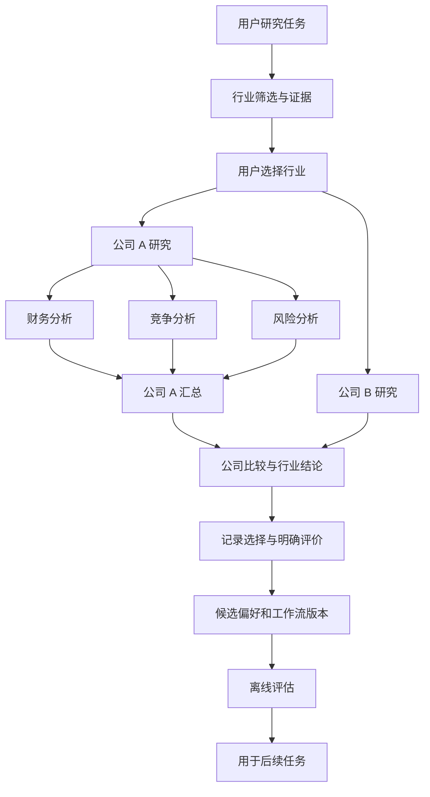

# 可进化深度研究 Agent：需求与开源基座选型

> **选型已更新：用户明确排除 LangGraph 架构。本文保留为前一轮调查记录，其中主基座推荐已失效；当前结论见 [Pi / Hermes / OpenAI Agents SDK 选型](lightweight-bases.md)。**

核查日期：2026-09-15。Agentflow 按用户确认，泛指 Agent 工作流编排。

## 结论

- **优先二开完整产品：DeerFlow 2。** 复用 Web 产品、工具、执行环境、子任务管理和持久化；重点增加研究节点模型、按分支控制上下文、多层调度、节点续研和偏好学习。它不是开箱即用的全部答案。
- **优先长期执行架构：Deep Agents + LangGraph。** 从官方 deep_research 示例扩展，利用已有 Agent 内核与图运行时；需要自己开发研究节点产品界面。不是重写 Agent 底层，但产品工作多于 DeerFlow。
- **优先现成流程画布：Sim；Python 组件生态优先则 Langflow。** 两者作为替代产品基座评估，不建议把两套平台都装进 DeerFlow。
- **成熟研究执行组件：GPT Researcher；本地研究方向备选 Local Deep Research。** 适合承担节点内的证据收集与报告任务。
- **Poirot：架构参考及实验候选。** 方向接近，但当前社区规模、发布和自动化验证证据弱于上述候选；源码还有叶子子 Agent 限制。

本轮覆盖 30 个仓库。六个重点项目进一步查了源码树、近期提交、发布记录；对其中五个的关键执行代码做了抽查。没有安装运行这些产品，没有复现研究基准或运行测试，因此本文是有源码证据的选型调查，不是生产可靠性认证。星数仅代表关注度。

## 1. 需求整理

你的产品可定义为：**用户能沿研究节点继续探索、分支之间有明确上下文边界、研究方法会随反馈改进的深度研究工作台。**

| 能力 | 在投资研究中的表现 | 验收重点 |
|---|---|---|
| 分层规划 | 投资方向→行业→公司→财务/竞争/估值/风险 | 子任务能继续细分，并保留父节点关系 |
| 决策可追溯 | 为什么选择行业，为什么判断有增量 | 判断必须关联来源、时间与反证 |
| 范围治理 | 排除某行业后，该分支材料不进入后续公司研究 | 输入、检索、记忆、文件访问都落实 scope |
| 并行与汇总 | 多家公司并行；每家公司多维度并行 | 等待、部分失败、重试、预算、结果归属清晰 |
| 逐级回传 | 维度→公司→行业→总任务 | 结构化发现和引用回传，避免转发全部聊天历史 |
| 节点交互 | 选择、排除、继续、补证、重跑、比较 | 已完成节点在刷新/重启后仍可续研 |
| 长期个性化 | 记住用户偏爱的指标、工具、资料类型 | 按用户和场景区分，可编辑、可删除 |
| Workflow/Skill 进化 | 高频有效路径形成场景模板 | 候选版本经评估才升级，可回退 |

### 两个必须澄清的设计问题

**独立上下文窗口不等于信息隔离。** 子 Agent 即便没有父消息，也可能通过共享文件、检索库、记忆工具读到兄弟分支内容。应在工具和数据访问层应用范围过滤，不能只靠提示词提醒。

**点击继续不等于认为结论正确。** 用户可能因为信息缺失或怀疑结论而继续。应分别记录“感兴趣”“采纳结论”“认为来源可信”“要求纠错”“放弃”等反馈。个性化主要改变研究顺序、深度和工具选择，不应奖励迎合偏见。

此外，范围控制不应误删相关的跨行业证据。例如研究电池公司时，汽车需求可能是直接相关证据。建议明确区分被排除的研究对象与获准引用的关联因素。

## 2. 核心候选与具体证据

### 2.1 DeerFlow 2：完整产品二开首选，需修改委派语义

[仓库](https://github.com/bytedance/deer-flow)；MIT；约 82.5k 星。2.0 是对旧版的重写，原深度研究实现位于 1.x 分支。当前主线已是通用 Agent 执行平台。

**值得复用：** 前后端、工具/技能、沙箱、子任务状态、数据库持久化、运行事件、产物展示。源码树存在后端单测、前端单测、E2E 等 CI 配置；发布 API 返回 v2.0.0，主线仍持续变更。

**关键差距：**

1. [SubagentConfig](https://github.com/bytedance/deer-flow/blob/main/backend/packages/harness/deerflow/subagents/config.py) 的默认 `disallowed_tools` 包含 `task`。不能把现成子任务机制当作任意深度的嵌套委派。
2. [ParentContextSnapshot](https://github.com/bytedance/deer-flow/blob/main/backend/packages/harness/deerflow/subagents/context_snapshot.py) 支持将父会话保留消息和摘要传给子任务；[executor](https://github.com/bytedance/deer-flow/blob/main/backend/packages/harness/deerflow/subagents/executor.py) 会在收到快照时注入它。复制为不可变快照解决状态别名问题，但没有自动按行业/公司做语义范围过滤。
3. 已有子任务 UI 和技能，不代表具备“研究节点选择→偏好归因→工作流生成”的完整闭环。

**二开方向：** 在现有后端建立 ResearchNode 和受范围约束的输入包，显式调度多层任务。不能只删除 task 禁用项；还需父子预算、深度限制、取消传播、结果路由和断点恢复。

### 2.2 Deep Agents + LangGraph：执行架构匹配度最高

[Deep Agents](https://github.com/langchain-ai/deepagents) 约 29.4k 星；[LangGraph](https://github.com/langchain-ai/langgraph) 约 41.7k 星；均 MIT。

Deep Agents 提供上下文管理、工具、子 Agent、技能和存储后端。LangGraph 提供图状态、子图和检查点。它们是同一套技术栈的不同层，不是并排拼接两套调度系统。

**不用从零写研究循环：** 可从现有 [deep_research 示例](https://github.com/langchain-ai/deepagents/tree/main/examples/deep_research) 开始。

**对你最重要的机制：**

- [子 Agent](https://docs.langchain.com/oss/python/deepagents/subagents) 支持 isolated 模式、各自工具和结构化输出；CompiledSubAgent 可接入定制子图。
- [子图通信](https://docs.langchain.com/oss/python/langgraph/use-subgraphs) 可使用不同状态 schema，由父节点映射允许输入，再映射结果回父节点。
- [持久化](https://docs.langchain.com/oss/python/langgraph/persistence) 支持检查点，为恢复、分支续研提供基础。

**仍需开发：** 业务研究图、范围策略、节点 UI、引用数据模型和反馈进化。官方示例的并发/迭代数字被写入提示词，不能直接当作已经实现的硬性调度上限。动态子 Agent 等 Beta 能力也不宜成为第一版必需依赖。

**适用判断：** 如果“准确表达研究树、控制信息流”高于复用现成 Web 产品的优先级，选这条路线。

### 2.3 Sim：现成可视化编排首选候选

[仓库](https://github.com/simstudioai/sim)；Apache-2.0；约 29.6k 星。

已有工作流画布、集成、执行日志和自托管。官方 [Parallel 文档](https://docs.sim.ai/workflows/blocks/parallel) 明确支持按集合分发、批量并发、按输入顺序汇总以及容器嵌套；源码也有 [parallel orchestrator](https://github.com/simstudioai/sim/blob/main/apps/sim/executor/orchestrators/parallel.ts)。适合实现公司列表→并行研究→聚合比较。

**差距：** 并发分支状态独立不等于检索范围独立；流程设计画布不等于运行时研究结果树。用户点击一家公司后生成新研究分支，以及把历史路径沉淀为模板，都要加业务层。

**成本：** 源码树规模较大（本次 API 返回约 2.1 万个文件，包含文档等），适合整个平台二开，不宜当轻量画布组件拆用。

### 2.4 Langflow：Python 可扩展组件和流程产品备选

[仓库](https://github.com/langflow-ai/langflow)；MIT；约 154.8k 星。

适合可视化搭建、定制 Python 组件、组合模型和工具。核查到持续发布及后端/前端测试配置，最近发布 API 返回 v1.12.1。

如果团队准备长期维护 Python 节点插件，值得与 Sim 对照。复杂的多层研究状态、分支续研和个性化策略仍需自行定义；高星数不能证明现成满足这些业务语义。

### 2.5 GPT Researcher：研究执行节点的有力候选

[仓库](https://github.com/assafelovic/gpt-researcher)；Apache-2.0；约 29.5k 星。最近发布 API 返回 v3.6.1。

[深度研究实现](https://github.com/assafelovic/gpt-researcher/blob/main/gpt_researcher/skills/deep_research.py) 有 breadth/depth、Semaphore 和 asyncio.gather，适合复用搜索、阅读、引用与递归研究。

**边界：** 搜索深度递归不等于业务 Agent 层级。它会累积 learnings、引用和已访问来源，不能默认符合你的兄弟分支隔离要求。建议每个公司/范围创建独立研究调用，由外层汇总结构化结果。

**源码抽查观察：** 本次下载版本的空搜索查询路径，在初始化 `all_learnings` 等局部变量前就引用它们返回。静态阅读显示存在未赋值异常风险；未实际执行复现。这说明成熟仓库同样需要用你的失败场景验证。

### 2.6 Poirot：贴近理念，但当前不应排在成熟基座之前

本次识别为 [HezaoHezao/poirot](https://github.com/HezaoHezao/poirot)，若你指另一仓库需重新核对。MIT；224 星；API 返回仓库创建于 2026-07-28，最后推送也是当日；仓库含更早的开发历史，创建时间不等于代码研发起点。

记忆、上下文治理、技能变体、评估门、回退和事件记录确实有对应代码。比如 [ScoreDeltaGate](https://github.com/HezaoHezao/poirot/blob/master/poirot/backend/agents/skill/evolution/gates/score_delta_gate.py) 根据候选分数、基线和 hard failure 决定接受或拒绝。

但 [SubagentProvider](https://github.com/HezaoHezao/poirot/blob/master/poirot/backend/agents/multiagent/subagent.py) 明确写了 **sync only MVP、leaf role、不能 spawn**；[runtime](https://github.com/HezaoHezao/poirot/blob/master/poirot/backend/agents/multiagent/runtimes/subagent_runtime.py) 的独立状态只传目标和摘要。

本次源码树里找到了约 245 个匹配测试路径的文件，但没有 `.github/workflows/` 文件，发布 API 返回空列表。因此 README 的“2400+ tests”只是项目方声明，本次没有运行验证。它的技能评估也不能直接证明已实现“用户节点选择驱动进化”。

**建议：** 借鉴事件、记忆和技能候选评估设计；如果选它作为主基座，要接受自己承担更多维护和验证工作。

## 3. 当前不宜优先投入的高星项目

- [Flowise](https://github.com/FlowiseAI/Flowise)：2026-08-13 归档。Agentflow V2 的状态与节点设计仍可学习，但新产品将缺少原仓库持续维护支持。
- [Open Deep Research](https://github.com/langchain-ai/open_deep_research)：2026-08-21 归档。保留作研究算法/评估参考，新内核优先考虑活跃的 Deep Agents。
- [AutoGen](https://github.com/microsoft/autogen)：官方 README 已标维护模式，新用户被引导至 [Microsoft Agent Framework](https://github.com/microsoft/agent-framework)。
- [STORM](https://github.com/stanford-oval/storm)：多角度研究和文章组织有价值；本次 API 的最后推送在 2025-09-30，不是优先的活跃通用产品基座。
- [Dify](https://github.com/langgenius/dify)：产品成熟，但当前 [许可证](https://github.com/langgenius/dify/blob/main/LICENSE) 含多租户及前端标识附加条件，不应简单按标准 Apache-2.0 处理。

## 4. 如何实现“进化”

建议先做无需训练模型的三层演进，之后有足够数据再评估 RL。

1. **偏好记忆：** 用户在某场景偏好哪些资料、指标、研究顺序；这些偏好必须有来源和作用范围。
2. **工作流推荐：** 从成功任务提炼可复用路径，推荐给下一次相似任务；先作为候选，不自动覆盖通用模板。
3. **技能优化：** 对工具选择、研究提示词和步骤产生候选版本，在保留任务集上比较质量、引用准确性、成本和耗时，再推广。
4. **模型/规划策略训练：** 数据和评估成熟后，再考虑 AgentFlow 或 Agent Lightning。

可复用项目：

- [LangMem](https://github.com/langchain-ai/langmem)：记忆提取、整合及提示词优化，适合 LangGraph 路线。
- [Mem0](https://github.com/mem0ai/mem0)：独立个性化记忆组件；并不替代分支访问策略。
- [DSPy](https://github.com/stanfordnlp/dspy)：有可评估任务集之后优化提示词和程序模块。
- [Agent Lightning](https://github.com/microsoft/agent-lightning)：当前版本是带训练基础设施的 Agent RL 系统，不是即插即用的用户偏好插件。
- [lupantech/AgentFlow](https://github.com/lupantech/AgentFlow)：Planner/Executor/Verifier/Generator 和 Flow-GRPO 值得研究；与你说的通用工作流编排不是同一概念。

## 5. 推荐的最小长期架构

将三种图/数据分开：

- **执行图：** 下一步执行谁、哪些任务并行、何时汇总。
- **研究图：** 用户看到的行业、公司、判断、证据及续研关系。
- **偏好与模板：** 用户过去认可了哪些研究方式。

一个公司节点可能包含许多搜索/阅读调用，因此 UI 研究节点不能直接等同于每一个底层工具调用。工具调用放在可展开的执行记录中。

节点最小数据：node_id、parent_id、branch_id、scope、status、input_snapshot、findings、source_refs、checkpoint_ref、budget、workflow_version。来源保留 URL/文档标识、发布日期/抓取时间、引用片段。用户选择事件单独存储。

传给子节点的输入应由服务端构造：目标、选定范围、所需父结论、可读取证据集合、工具和预算。原始资料保留在有分支标记的存储里；上层需要时按引用读取，避免层层摘要丢失关键证据。

## 6. 二开顺序与验收

### 第一层：一个端到端任务

限定一个行业和三家公司，跑通并行研究、证据引用、比较报告；沿用选定基座已有前后端和执行能力。

### 第二层：节点可继续

增加公司→维度的分层、点击继续/排除/重跑，以及关闭页面后恢复。初期固定两到三层，验证完整后再拓展深度。

### 第三层：范围治理

为上下文、检索、长期记忆、共享文件统一传入并校验分支范围；使用混入无关资料的测试任务检验边界。

### 第四层：偏好与模板

记录明确评价和选择理由，生成用户场景模板候选。稳定后引入提示词/技能优化和版本评估。

正式决定 fork 哪个项目前，用同一模型、数据源和预算跑这些验收：

1. 排除行业 B 后，行业 A 的子节点输入/检索结果中不混入 B 的无关资料。
2. 三家公司并行，单家公司失败不会让其他结果丢失。
3. 公司→财务/竞争两个子任务，结果逐级回到正确节点。
4. 重启后继续已选公司，不全量重跑已完成工作。
5. 任意主要结论能回到具体来源与时间；修改选择后旧结果标记为过期。
6. 新工作流版本必须比基线有实证收益；点击率增加而引用质量下降应拒绝升级。

**最终建议：先以 DeerFlow 2 为产品基座做上述小范围验证；若其现有委派/状态设计使研究树需要大范围重构，改选 Deep Agents 官方示例 + LangGraph，并接受开发专用研究节点 UI。不要同时深度整合 DeerFlow、Sim、Langflow 三套平台。**

## 7. 全量候选清单

下表星数与最后推送取自当天 GitHub API；推送时间不等于默认分支最后提交或最后发布。许可证是仓库级初筛信息，NOASSERTION 表示 GitHub 未能归为单一标准许可证，不代表没有许可证。

| 项目 | 分类 | Stars | 最后推送 | 许可初筛 | 定位判断 |
|---|---|---:|---|---|---|
| [bytedance/deer-flow](https://github.com/bytedance/deer-flow) | 研究产品 | 82,465 | 2026-09-15 | MIT | 完整产品首选；递归委派、范围策略和研究节点需二开 |
| [HezaoHezao/poirot](https://github.com/HezaoHezao/poirot) | 研究内核 | 224 | 2026-07-28 | MIT | 理念贴合；叶子子 Agent；小社区，适合参考与实验 |
| [langchain-ai/open_deep_research](https://github.com/langchain-ai/open_deep_research) | 研究示例 | 12,678 | 2026-08-10 | MIT | 已归档，保留算法和评估参考 |
| [langchain-ai/deepagents](https://github.com/langchain-ai/deepagents) | Agent 内核 | 29,428 | 2026-09-15 | MIT | 长期核心候选；有官方深度研究示例，UI 需开发 |
| [assafelovic/gpt-researcher](https://github.com/assafelovic/gpt-researcher) | 研究组件 | 29,457 | 2026-08-27 | Apache-2.0 | 节点内检索、引用和报告候选；需测试失败边界 |
| [LearningCircuit/local-deep-research](https://github.com/LearningCircuit/local-deep-research) | 研究产品 | 9,092 | 2026-09-15 | MIT | 本地模型、多搜索源与私有资料方向备选 |
| [jina-ai/node-DeepResearch](https://github.com/jina-ai/node-DeepResearch) | 研究组件 | 5,226 | 2026-05-01 | Apache-2.0 | 迭代检索问答；项目明确不以长篇报告为目标 |
| [dzhng/deep-research](https://github.com/dzhng/deep-research) | 研究示例 | 19,675 | 2026-04-11 | MIT | 简洁的深度/广度递归研究参考；不是完整工作台 |
| [Alibaba-NLP/DeepResearch](https://github.com/Alibaba-NLP/DeepResearch) | 研究模型 | 19,944 | 2026-02-27 | Apache-2.0 | 研究模型及推理/训练生态；不是现成可视化产品 |
| [stanford-oval/storm](https://github.com/stanford-oval/storm) | 研究组件 | 31,355 | 2025-09-30 | MIT | 多角度研究与写作参考；近期维护证据偏弱 |
| [FlowiseAI/Flowise](https://github.com/FlowiseAI/Flowise) | 可视化编排 | 55,459 | 2026-08-13 | README 声明 Apache-2.0；API 未识别 | 已归档，Agentflow V2 仅优先作为设计参考 |
| [langflow-ai/langflow](https://github.com/langflow-ai/langflow) | 可视化编排 | 154,815 | 2026-09-15 | MIT | Python 组件和现成流程产品强候选 |
| [simstudioai/sim](https://github.com/simstudioai/sim) | 可视化编排 | 29,639 | 2026-09-15 | Apache-2.0 | 画布产品强候选；并行/嵌套容器，代码体量大 |
| [langgenius/dify](https://github.com/langgenius/dify) | 应用平台 | 155,790 | 2026-09-15 | Dify 修改版 Apache-2.0 | 成熟但有许可证附加条件；研究图需二开 |
| [langchain-ai/langgraph](https://github.com/langchain-ai/langgraph) | 图运行时 | 41,682 | 2026-09-14 | MIT | 子图、状态映射、持久化；与 Deep Agents 配合 |
| [crewAIInc/crewAI](https://github.com/crewAIInc/crewAI) | Agent 编排 | 58,578 | 2026-09-14 | MIT | 角色团队与 Flows 备选；研究节点图仍需开发 |
| [agno-agi/agno](https://github.com/agno-agi/agno) | Agent 平台 | 42,179 | 2026-09-15 | Apache-2.0 | SDK、AgentOS、存储/工具集成备选；非现成研究树 |
| [microsoft/agent-framework](https://github.com/microsoft/agent-framework) | Agent 编排 | 13,530 | 2026-09-15 | MIT | Python/.NET 编排候选；微软生态优先时考虑 |
| [microsoft/autogen](https://github.com/microsoft/autogen) | Agent 编排 | 60,990 | 2026-04-15 | 代码 MIT；文档 CC-BY-4.0 | 维护模式；新项目优先看 Microsoft Agent Framework |
| [lupantech/AgentFlow](https://github.com/lupantech/AgentFlow) | 策略训练 | 2,040 | 2026-02-08 | MIT | Flow-GRPO 和模块化规划训练参考；后期考虑 |
| [microsoft/agent-lightning](https://github.com/microsoft/agent-lightning) | 策略训练 | 18,124 | 2026-09-15 | MIT | Agent RL 基础设施；需要数据和训练资源 |
| [stanfordnlp/dspy](https://github.com/stanfordnlp/dspy) | 程序优化 | 38,035 | 2026-09-15 | MIT | 有评估集后优化研究提示词和模块 |
| [langchain-ai/langmem](https://github.com/langchain-ai/langmem) | 记忆/优化 | 1,666 | 2026-09-09 | MIT | LangGraph 路线的记忆与提示词优化候选 |
| [mem0ai/mem0](https://github.com/mem0ai/mem0) | 记忆 | 65,318 | 2026-09-14 | Apache-2.0 | 独立用户记忆组件；不替代分支范围治理 |
| [virattt/dexter](https://github.com/virattt/dexter) | 金融研究 | 27,601 | 2026-08-04 | README 声明 MIT；LICENSE 文件未核实 | 财务研究工具与评估参考；数据源适配和授权需核验 |
| [TauricResearch/TradingAgents](https://github.com/TauricResearch/TradingAgents) | 金融多 Agent | 106,431 | 2026-09-15 | Apache-2.0 | 分析师分工与讨论机制参考；偏交易决策流程 |
| [666ghj/BettaFish](https://github.com/666ghj/BettaFish) | 舆情研究 | 42,219 | 2026-09-04 | GPL-2.0 | 中文舆情与多引擎报告参考；GPL-2.0 |
| [TencentCloudADP/youtu-agent](https://github.com/TencentCloudADP/youtu-agent) | Agent 框架 | 4,611 | 2026-03-21 | 自定义/未分类，需核对原文 | 开源模型适配、配置与评估方向备选；非现成研究树 |
| [agentscope-ai/agentscope](https://github.com/agentscope-ai/agentscope) | Agent 框架 | 31,698 | 2026-09-15 | Apache-2.0 | 活跃的 Agent 服务与多 Agent 构建备选；需研究产品层 |
| [jd-opensource/OxyGent](https://github.com/jd-opensource/OxyGent) | Agent 编排 | 2,070 | 2026-07-21 | README 声明 Apache-2.0；API 未识别 | 模块化、可观察和演进理念相关；生态规模较小 |

## 8. 核查材料与限制

- metadata.json / metadata-extra.json：30 个仓库 API 元数据快照。
- inspection.json：六个重点候选的文件树统计、CI 路径、发布和默认分支提交。
- 各项目目录：README、元数据；重点项目另附 tree.json、releases.json、commits.json 和 source/ 抽样源码。
- projects.csv：可筛选的完整候选表。
- 测试文件数来自路径规则统计，包含测试辅助文件，不能当作测试用例数或测试通过率。未查询全量贡献者、未系统抽样 issue 响应速度，不对这些未核验项作排名。
- 获取对象是调查时的默认分支；发布版本与主线功能可能不同。后续二开应固定选定提交，并重新验证代码与文档差异。
